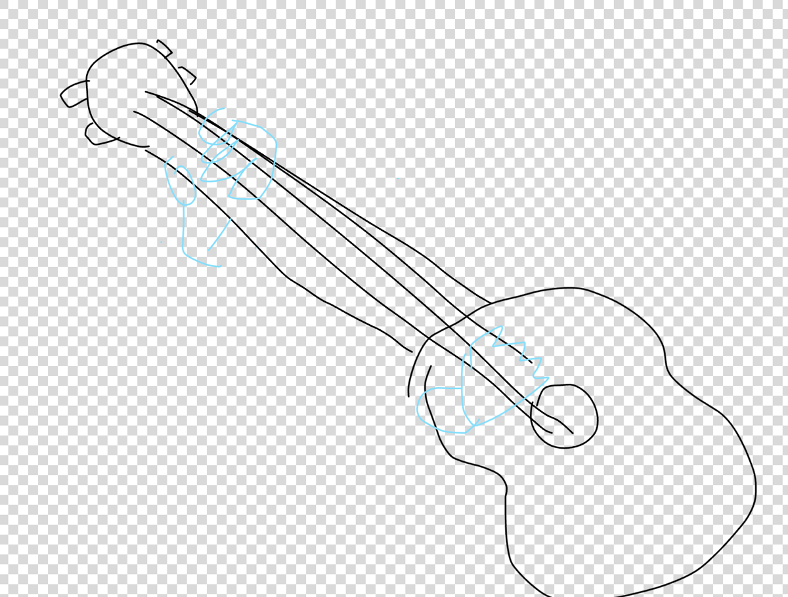

# Ghost hands — visual spec

*Decided by Andrew, Sat 2026-11-14 ~00:00 PT. **This is the core of the product**: never cut, never reduced to dots only.*

## What the sketch says

Two **glowing, translucent blue hands** sit on the real guitar:

1. **Fretting hand** at the first frets: fingers curled over the strings, thumb behind the neck, wrist below the neck.
2. **Strumming hand** over the strings between the end of the fretboard and the soundhole.

A chord diagram tells a beginner *which* frets. The ghost hands show *how the hand gets there*: wrist angle, thumb position,
curled fingertips just behind the fret, and how the other hand moves for the strum or picking pattern.

## 1. Fretting hand

| Item | Spec |
|---|---|
| Chords (MUST) | **G, C, D, Em, Am** (covers all three songs in `SONGS.md`); E and A are SHOULD |
| Anchor | a "neck socket" at the nut, aligned to the neck axis (aligned mode) or to the floating neck (headLocked) |
| Fingertips | each fingertip ends on a **fingertip dot** about 75% of the way from fret *n−1* to fret *n* (`FretboardGeometry`). The dots are the source of truth: if the pose and the dots disagree, the last finger joint bends to reach the dot (simple IK snap) |
| Height | the ghost hovers 5–10 mm above the strings, so it never "sinks" into the real neck |
| Morph | to the next chord **one beat early**, 250–300 ms ease |
| Finger-by-finger | active finger at full brightness with its number (1–4); other fingers at 30% |
| Strings not played | X marks at the nut; open strings get O marks |
| After success | once the pluck check passes, the hand fades to 40% (dots stay bright) so it doesn't fight your real hand; it returns at full brightness on the next chord |
| Left-handed | a flag mirrors both hands and the neck |

## 2. Strumming hand

| Item | Spec |
|---|---|
| Anchor | the strum zone: from the end of the fretboard to the soundhole. Its distance from the nut comes from the guitar measurement (`nutToSoundholeMm`, measured tonight) |
| Strum pattern | a down stroke sweeps from string 6 to string 1 (≈120–180 ms); an up stroke sweeps back over the top 3–4 strings. The hand plays the song's `strum` slots in time with the beat cursor |
| Learn mode | before the strum check it demonstrates one slow down-strum, then waits |
| Picking pattern | the hand hovers over the strings; the next string to pick glows, and a "pick" tip flicks it in time with the `pick` slots |
| Wait mode | the pattern loops slowly at the current chord until the change is played |
| Muted strings | strings the chord doesn't use dim, so "don't strum string 6" is visible on the strumming side too |

## 3. Look: glowing translucent blue

| Property | Value | Why |
|---|---|---|
| Core color | electric blue `#4FC3F7` | reads well on an additive display, matches the sketch |
| Rim | fresnel rim, brighter `#B3E5FC`, about 2–3 px wide at arm's length | the silhouette carries the shape |
| Fill | 15–25% opacity | translucent: you see the real strings and your own fingers through it |
| Fingertip glow | small bright dots/halos at the fingertips | where to press must be the brightest thing in view |
| Outlines | **none dark** — black is invisible on these glasses | additive display rule |
| Finger numbers | small white 1–4 labels by the fingertips (flag `fingerColors` adds per-finger colors) | beginner pedagogy |
| Motion | eases only; nothing flashes faster than 3 Hz | comfort |
| Brightness | tuned with the glasses' dimming level in the demo room | contrast in a bright hall |

## 4. Accuracy we promise (and don't)

The neck alignment is good to about **1–2 cm** (see `HOW_IT_WORKS.md` §3). So the ghost hands show the *shape and region*
reliably; the exact string and fret come from the fingertip dots, the diagram on the HUD and the audio check. In the pitch,
say exactly that. Never claim millimetre registration.

## 5. Implementation (Unity 2021.3.3f1, Built-in render pipeline)

- **Mesh and rig:** a CC0 rigged hand or a stylized hand modelled in Blender (Andrew). License goes in `docs/CREDITS.md`.
- **Poses:** authored in Blender on a 1:1 neck mock-up built from the measured scale length (`MASTER_PLAN.md` Appendix B4).
  Export joint rotations as JSON (`Assets/StreamingAssets/poses/*.json`): text, testable, hot-reloadable, no Animator YAML.
  Fretting: rest + G, C, D, Em, Am. Strumming: rest, down-start, down-end, up-start, up-end, pick-ready.
- **Runtime:** `Runtime/GhostHand/FrettingGhost`, `StrummingGhost`, `GhostPoseLibrary`, `FingertipSnap` (2-joint IK on the
  last phalanges). Driven by Core practice events (current chord, next chord, beat, active finger, pattern slot).
- **Shader:** one hand-written unlit additive shader (`Blend One One`, fresnel rim + fill + fingertip glow) in a `.shader`
  text file. Create the material through the Unity MCP (`manage_material`); agents never hand-edit `.mat` files.
- **Fallback if the Blender poses slip:** a procedural "capsule hand" posed purely by IK from the fingertip dots. It is
  less pretty but always correct. Still a hand, never dots only.

## 6. Acceptance

- [ ] L3 (Editor): for every MUST chord, each fingertip lands within 3 mm of its dot on the virtual neck.
- [ ] L4 (Editor sim): the strumming hand stays in time with the beat cursor at 50/75/100% tempo.
- [ ] L5 (glasses): the wearer can copy the fretting shape for G and Em without looking at a diagram.
- [ ] L5: the hands read as "glowing blue, see-through" in the demo room's lighting (ux-critic reviews a through-the-lens photo).

## 7. Andrew's Blender checklist (Fri night / Sat morning)

1. Neck mock-up: measured scale length, nut width, frets 0–5 (Appendix B4), strings as thin cylinders.
2. Hand: model or import a CC0 rig; left hand for right-handed players.
3. Fretting poses: rest, G, C, D, Em, Am — fingertips on the dots, thumb behind the neck.
4. Strumming poses: rest, down-start, down-end, up-start, up-end, pick-ready (right hand).
5. Export: joint rotations per pose to JSON (a small Blender Python script), plus one FBX of the mesh and rig.
