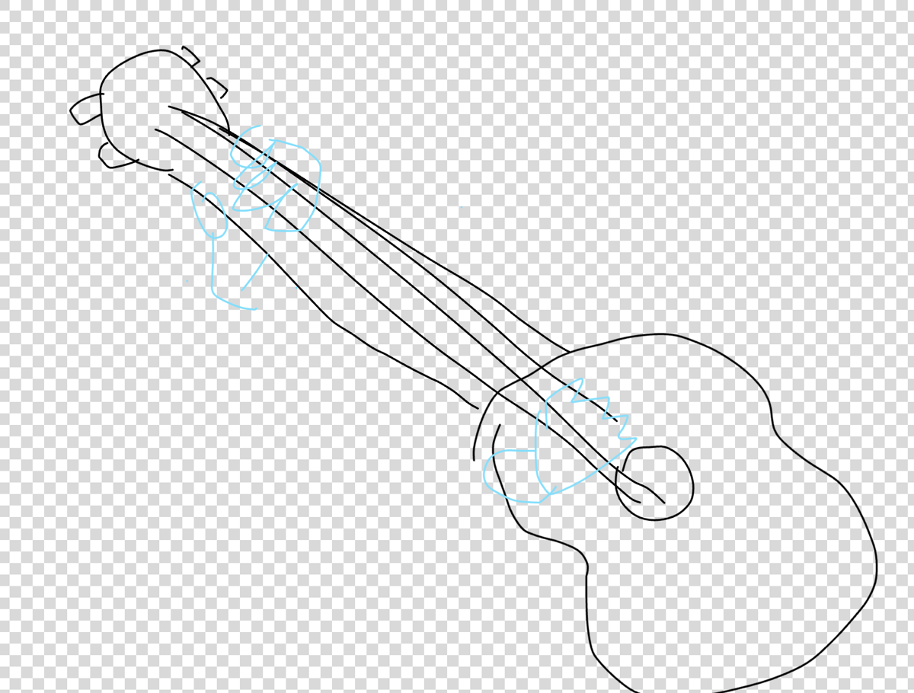

# Untitled Guitar App — Master Plan
*AR guitar coach for absolute beginners on XREAL Air 2 Ultra · Immerse the Bay 2026 (Stanford XR)*

`v0.3 · revised Sat 2026-11-14 ~00:20 PT after grill rounds 1–3 and adversarial review r0 (Part IV) · feature freeze Sun 2026-11-15 01:00 PT · Devpost deadline Sun 2026-11-15 09:00 PT`

**Platform (decided 23:10):** XREAL Air 2 Ultra + MacBook over one USB-C cable. No Android host, no webcam, no extra hardware. The glasses act as a side-by-side 3D display with an IMU, mics and speakers; Unity runs on the Mac and Claude drives it through the Unity MCP. See §1A for what the glasses can and can't do by themselves.

> The project is called **"Untitled Guitar App"** (decided 23:42, Q-DEMO-12). In code it is `UntitledGuitarApp`, with the short prefix `UGA`. This file seeds the whole repo. Stage 1 turns **Appendix A** into real files. Stage 2 turns **Part II** and your grill answers into `docs/PRD.md`, `docs/ARCHITECTURE.md` and `docs/TODO.md`. Nothing in this file has been executed yet. **Part IV** records what a fresh-context adversarial reviewer found and what changed because of it.
>
> **The repo scaffold ships with this plan:** `README.md`, focused docs (`PRD`, `GHOST_HANDS`, `HOW_IT_WORKS`, `WORKSPLIT`, `TODO`, `SONGS`, `DATA`, `HARNESS`, `ARCHITECTURE`) and every Appendix A file, already unpacked. Agents read the focused docs; this file is the reference.

---

## 0. How to use this document

1. **Tonight:** answer the 🔴 questions in **§29**, in chat or with `/grill-plan` once the harness exists. Every other question carries a recommended answer, and that answer becomes the decision unless you object.
2. **Stage 1:** unzip the scaffold and follow `README.md` → Setup (every Appendix A file is already there). Then open Claude Code at the repo root and say: *"Run the Stage 1 checks from docs/MASTER_PLAN.md Appendix A: verify the files, run ./scripts/verify.sh, invoke each skill once, run /doctor prompt-audit, then stop and report."*
3. **In parallel with Stage 1:** person B runs spikes **M-S1–M-S3** (§25) on the glasses. They decide the riskiest branch of the architecture, which is how the neck gets anchored. M-S4–M-S6 wait until Sat 07:00.
4. **Stage 2:** run prompt **P1** (§13) with Opus.

Legend: 🔴 blocking tonight · 🟠 needed before its slice starts · 🟢 default is fine · **MUST / SHOULD / COULD / WON'T** = MoSCoW scope · **L0–L5** = verification levels (§9).

---

## 1. One-page summary

**Promise.** Put on the glasses and pick up a guitar. A translucent ghost hand shows where each finger goes on *your* neck, and rings shrink onto each fret exactly when it's time to press. The app listens and tells you which string is wrong and which finger caused it. Then you play a whole song with a crisp Ultimate-Guitar-style chord sheet floating in front of you, at 50–100% speed.

**MVP demo (what must work Sunday morning)**
- **Tuner**, then **Learn mode** for G, C, D and Em: ghost hand on the real neck, finger-by-finger build, per-string *pluck check*, whole-chord *strum check*, beginner tips.
- **Play-along** for one song: **approach rings** on the fret targets, UG-style chord sheet on a virtual music stand, neck HUD (current and next chord, beat, strum and picking strip), tempo presets 50–100%, *wait mode*, results.
- **Real-neck alignment without cameras:** four gaze-dwells (nut low-E, nut high-E, fret 5, fret 12) place the virtual neck on your real one, and the glasses' IMU holds it in place as you turn your head. A one-dwell re-anchor fixes it when the guitar moves.
- **Fallback if the IMU can't be read:** a head-locked HUD with a floating ghost neck, labelled honestly as "no-tracking mode".
- Judges watch the spectator view on the MacBook screen, and one judge can play a first chord (Em) in 60 seconds.

**What the hardware gives us** (details in §1A and §15)
- Side-by-side 3D at 3840×1080 (90 Hz, ≤250 nits) or 2D at 1080p (120 Hz).
- 3DoF head rotation from the glasses' IMU over USB, via an open community protocol. *This is unverified for the Ultra on macOS; spike M-S2 decides it.*
- Built-in mics and speakers.
- **No** camera access, 6DoF, hand tracking or image tracking. XREAL only offers those through its Android SDK.
- **Tethered:** the glasses have no battery, compute or wireless.

**Architecture in one line.** Pure-C# **Core** (unchanged: theory, songs, DSP, practice logic; `dotnet test` in seconds) + Unity **Runtime on macOS** (stereo SBS rig on display 2, IMU head pose, gaze-dwell neck aligner, mic, HUD) + a ~100-line Python **IMU bridge** + **content** (songs JSON, Blender ghost-hand poses). There is no APK and no build-to-device loop: Play Mode renders straight onto the glasses.

**Gates**
- **G0** glasses show SBS 3D from Unity *and* the IMU streams (Fri night; hard deadline Sat 09:00). If it fails, the real-neck path becomes the no-tracking fallback.
- **G1** alignment holds within about 2 cm for 60 s seated (Sat 11:00).
- **G2** scope cut (Sat 18:00) · **freeze** Sun 01:00 · **submit** Sun 08:30.

## 1A. What the Air 2 Ultra can do by itself (answering "iPhone or Mac?")

| Host | What works | What doesn't | Verdict for us |
|---|---|---|---|
| **Glasses alone** | — | No battery, compute, Wi-Fi or Bluetooth. Power and video arrive over USB-C DisplayPort. | Needs a host |
| **iPhone (USB-C)** | Display (mirrored), speakers | No XREAL SDK or Nebula on iOS; an iOS app can't read the glasses' IMU | Head-locked HUD only (COULD: a "mobile HUD" variant) |
| **Mac (USB-C)** | Extended display: 2D 1920×1080, or **SBS 3D 3840×1080** after holding brightness-up for ~3 s; speakers and mics; **IMU readable via community HID drivers** (unverified for Ultra on macOS) | XREAL's 6DoF on Mac exists only inside its own Nebula for Mac app; no SDK for our app; no camera | ✅ **Our route:** 3DoF stereo AR |
| **Android (Beam Pro, Galaxy S22/S23)** | Full XREAL SDK: 6DoF, hand tracking, plane and image tracking, anchors, meshing | — | Not available this weekend (Appendix D) |

**The triangle: pick two.**
1. A ghost hand pinned *precisely* to the real neck.
2. Glasses-only (no Android, no webcam).
3. Untethered/wireless.

You chose (2). (3) is impossible with this hardware. So (1) becomes **"aligned once, held by the IMU, re-anchored in one glance"**: accurate to about a hand region (1–2 cm). Exact string and fret precision comes from the fingertip rings, the diagram and the audio verdicts, not from tracking. Q-FIT-02 confirms this.

**One cable, explained:** `docs/HOW_IT_WORKS.md` (what travels over USB-C, what happens each frame, and why an Android emulator can't drive the glasses).

## 1B. Fitting the idea to XREAL's strengths (and staying original)

**Strengths → how we use them**
1. **Optical see-through:** you see your real strings and fingers sharp and with zero latency (unlike passthrough headsets). The overlay stays sparse and your real hand is the hero.
2. **Sharp micro-OLED** (1080p per eye, ~42 px/degree): crisp chord names, UG-style sheet text, readable mini-diagrams. *Glanceable text is the killer use.*
3. **Stereo 3D:** the ghost hand and approach rings have real depth at the neck.
4. **Light, glasses-like (83 g):** 10–20 minute daily practice is believable; nobody practices guitar daily in a headset.
5. **Built-in mics and speakers:** listening with nothing else to place, and private cues in your ears.
6. **Plugs into a Mac like a monitor:** instant iteration (Unity MCP + Play Mode on the glasses) and a trivial judge mirror.

**Weaknesses → design responses**
1. **No tracking without Android** (we get IMU rotation only): align once with the IMU holding it, let audio do the precision work, and design nothing that needs position or a camera.
2. **52° FOV:** everything essential sits within about 15° of the neck; the sheet is a 3-line window.
3. **Additive display** (no black, no occlusion): use outlines and rings, not solid hands. **The ghost fades once audio confirms each finger.** No dark UI.
4. **Fixed optical focus:** bold shapes near the neck, fine text only on the music stand at about 1 m, short sessions.
5. **3D mode is dimmer** (≤250 nits): use the lens dimming and a high-brightness palette.
6. **Tethered:** seated practice at a desk is natural for guitar; route the cable behind the shoulder.

**Originality vs. what exists**

| Existing | What it does | Our difference |
|---|---|---|
| Yousician, Fender Play, Simply Guitar | phone or tablet apps that grade by ear | guidance *on the instrument* in your sightline; per-string diagnosis with **finger attribution**; finger-by-finger build |
| Rocksmith+ | note highway on a screen | the timing cue lands **on your real fretboard** (approach rings) |
| LED fretboards (e.g. Fret Zealot, Fretlight) | lights on the guitar show positions | shows *which finger and hand shape*, needs no guitar modification, grades by ear |
| Quest/HoloLens AR guitar prototypes (AxAR, GuitXR, RizzRiff, AR Hero) | passthrough headsets with heavier sensing | lightweight optical see-through glasses; **camera-free alignment**; verification by hypothesis testing |

**Concept assumption.** You didn't pick a concept, so I assumed **ghost hand + approach rings + crisp sheet**. That's your idea plus osu!-style rings that shrink onto each fret target exactly on the beat. Confirm or change it with Q-FIT-01. The other options were a HUD-only companion, a real-neck rhythm game, and a teacher avatar (which needs 6DoF, so it isn't possible on this route).

---

# PART I — THE HARNESS (build this first)

The harness is everything around the code that lets several Claude Code sessions and agents work in parallel, verify themselves, and avoid wrecking each other's work or the demo. It is built in Stage 1, before any feature code.

## 2. What the harness protects against

| Failure mode (Claude under time pressure) | Harness counter |
|---|---|
| Invents APIs or protocol details (Unity multi-display, the glasses' HID/IMU packets) | `docs/apis/` holds real excerpts (Unity docs, the community IMU protocol writeup, Monado's driver). Rule: **cite the file** every API or packet layout came from. |
| Gets tests green by editing fixtures, thresholds or assertions | Fixtures, the baseline and the gate scripts are hook-protected. Tests and `AudioConfig` aren't, so a threshold or assertion change needs audio-eval numbers in the commit and gets adversarial review. |
| Scope creep / gold-plating | Every slice lists owned paths and out-of-scope items. One slice per session. Cut order in §23. |
| Context rot in long sessions | One slice per session → `/handoff` → `/clear`. A SessionStart hook re-injects status after clear/compact. Subagents do the reading. |
| Corrupts Unity scene/prefab YAML or `.meta` GUIDs | A PreToolUse hook blocks hand edits. Only Unity MCP tools or Editor scripts touch them. Scenes are composed in code. |
| Parallel sessions overwrite each other | Ownership map (§10). Core work happens in git worktrees; Unity runs only in the main checkout. |
| Claims "works" without device evidence | The verification pyramid (§9) separates L1–L4 from **L5 on glasses**. Every report states the highest level reached. |
| Demo-day surprises (noise, Wi-Fi, IMU dropouts) | Runtime flags hot-reloaded from a file in about 1 s, headLocked fallback, a labelled WAV-replay demo mode, venue fixtures, two dress rehearsals. |
| Agents blocked waiting on humans | Humans own device testing, guitar playing, fixture recording and grill answers. Agents produce short checklists so that human time stays short. |

## 3. Principles: prompt, context and harness engineering

**Prompt engineering**
- Every agent has a role prompt with an **output contract**: format, maximum length, and file paths instead of prose.
- Every slice prompt states the goal, the user-visible outcome, testable acceptance criteria, owned paths, the contracts used, what is out of scope, and a fallback.
- **One-question rule** (grill-me discipline): if an ambiguity would change code, ask *one* question with a *recommended answer*. Never ask for something you can look up.
- Builders get a definition of done. Reviewers get hostile personas and checklists. They never share a context.

**Context engineering**
- The root `CLAUDE.md` stays at 120 lines or less, with **no `@imports`** (imports load every time). Detail lives in path-scoped `.claude/rules/`, nested `CLAUDE.md` files and docs that are opened on demand.
- **Contracts are code.** `Core/Contracts/*.cs` is what agents read, and it compiles.
- `docs/apis/` holds **exact excerpts**, not summaries, so agents copy real signatures.
- `docs/STATUS.md` is the hand-off memory, at most 40 lines, pruned by the scribe. Subagents return summaries of 30 lines or less, with paths. The main thread never ingests raw logs.

**Harness engineering**
- One-command verify (`./scripts/verify.sh`, under 60 s). Audio eval is a gated test category with a baseline.
- A **synthetic audio generator** (Karplus–Strong plucked strings with injectable mistakes) gives agents unlimited labelled test audio. Recorded fixtures keep it honest.
- Hooks enforce what prompts can't: protected paths, Core purity, verify-before-stop, status injection.
- Everything risky sits behind a **runtime flag**: anchor mode, audio source, thresholds, wait mode, spectator.

## 4. Repository layout

```
untitled-guitar-app/
├── CLAUDE.md                      # root brain (≤120 lines)            [A1]
├── CLAUDE.local.md                # personal, gitignored
├── .mcp.json                      # Unity MCP server entry (if not configured at user scope)
├── .worktreeinclude               # copies .env into Claude-created worktrees  [A10]
├── .gitignore  .gitattributes     # Unity + YAML merge (no LFS)           [A10]
├── .claude/
│   ├── settings.json              # permissions, hooks, env, worktree baseRef  [A6]
│   ├── rules/                     # path-scoped rules                     [A3]
│   ├── agents/                    # 9 subagents                           [A4]
│   ├── skills/                    # 13 project skills + installed externals    [A5]
│   └── hooks/                     # 4 guard scripts                       [A7]
├── docs/
│   ├── MASTER_PLAN.md             # this file
│   ├── PRD.md  ARCHITECTURE.md  TODO.md          # Stage 2 outputs
│   ├── STATUS.md  DECISIONS.md  RISKS.md         # living docs           [A11]
│   ├── DEVICE_TEST.md  DEMO.md  CREDITS.md  AUDIO_BASELINE.md
│   └── apis/                      # exact excerpts: glasses/, python/, unity/, macos/, llm.md
├── unity/                         # the Unity project (macOS standalone; no XREAL SDK)
│   ├── CLAUDE.md                  # subtree brain                        [A2]
│   └── Assets/
│       ├── UntitledGuitarApp/
│       │   ├── Core/              # PURE C# (asmdef noEngineReferences): Contracts/ Theory/ Geometry/ Songs/ Audio/ Practice/
│       │   ├── Runtime/           # Unity layer: Bootstrap/ Render/(StereoRig) Head/(ImuHeadPose) Neck/(Aligner) GhostHand/ Hud/ Audio/ Spectator/ Flags/ Logging/
│       │   ├── Editor/            # BuildScript (macOS), GlassesGameView (borderless Game view on display 2), EditorSimRig helpers
│       │   ├── Tests/EditMode/
│       │   ├── Art/               # imported ghost-hand FBX, materials
│       │   └── Scenes/Main.unity  # single scene, single Bootstrap object
│       └── StreamingAssets/
│           ├── songs/*.song.json
│           ├── flags.default.json
│           └── fixtures-demo/*.wav  # labelled WAV replay for demo fallback
├── core-build/UntitledGuitarApp.Core.csproj  # compiles Core as netstandard2.1 (Unity's API surface)  [A9]
├── core-tests/                           # xUnit on net8.0                [A2, A9]
│   ├── CLAUDE.md
│   ├── Synth/KarplusStrong.cs  Synth/Noise.cs
│   ├── Fixtures/audio/<group>/<label>__<take>.wav  +  labels.csv   (immutable)
│   └── {Theory,Songs,Audio,Practice}/*Tests.cs
├── tools/flags/{dev,demo,judge,safe}.json
├── tools/imu-bridge/bridge.py       # hidapi → orientation → UDP 127.0.0.1:47800  [A8]
├── art/blender/hand_poses.blend   # plain binary (no LFS)
└── scripts/  verify.sh diff-hash.sh audio-eval.sh build-mac.sh imu-bridge.sh use-flags.sh logs.sh pull-session.sh  [A8]
```

**Why Core lives inside `unity/Assets`:** Unity compiles it natively, and `core-build/` compiles the *same files* as netstandard2.1 for `dotnet test`. One source and no copy step. Purity is enforced twice: the asmdef has `noEngineReferences: true`, and the dotnet build has no UnityEngine to link against.

## 5. Context architecture

| Layer | File(s) | Loaded when | Budget | Owner |
|---|---|---|---|---|
| Root brain | `CLAUDE.md` | every session | ≤120 lines | human (architect proposes) |
| Personal | `CLAUDE.local.md` (gitignored) | every session | ≤20 lines | each human |
| Subsystem rules | `.claude/rules/*.md` with `paths:` frontmatter | when a matching file is read or edited | ≤60 lines each | architect |
| Subtree brains | `unity/CLAUDE.md`, `core-tests/CLAUDE.md` | when files in that subtree are touched | ≤80 lines | xr-engineer / dsp-engineer |
| Contracts | `Core/Contracts/*.cs`, `docs/ARCHITECTURE.md` | on demand | — | **architect only** |
| Exact API specs | `docs/apis/**` | on demand | ≤300 lines per file, excerpts not summaries | whoever adds the dependency |
| Live state | `docs/STATUS.md`, `docs/TODO.md` | SessionStart hook injects the head | STATUS ≤40 lines | scribe |
| Decisions | `docs/DECISIONS.md` | on demand | — | `/grill-plan` |
| Auto memory | Claude Code's machine-local memory | every session | — | don't rely on it across laptops |

**`docs/apis/` to populate in Stage 1** (paste raw excerpts, trimmed):
- `glasses/display-modes.md`: SBS 3D toggle, resolutions, refresh, brightness.
- `glasses/imu-protocol.md`: the community XREAL IMU/MCU protocol writeup, plus Monado's `xreal_air` driver excerpts (vendor/product ids, IMU enable command, packet layout).
- `python/hidapi.md`: enumerate, open by path, read.
- `unity/multi-display.md`: `Display.displays`, `Activate`, standalone fullscreen on display 2.
- `unity/microphone.md`: the `Microphone` API and device names.
- `unity/editorwindow-popup.md`: the borderless Game-view helper.
- `macos/audio-input.md`: device selection and mic permission.
- `llm.md`: only if the AI coach is built.

## 6. Agent roster and model routing

| Agent | Model · effort | Tools | Isolation | Use for | Returns |
|---|---|---|---|---|---|
| `architect` | opus · high | Read, Grep, Glob, Edit, Write, Web* | — | Stage 2 specs, contract changes, design forks | ≤25 lines plus ASSUMED list |
| `slice-builder` | sonnet · medium | all | **worktree** | one Core slice end-to-end | ≤30-line report plus device checklist |
| `dsp-engineer` | opus · high | all | **worktree** | Core/Audio algorithms, thresholds, eval | eval table before/after |
| `xr-engineer` | sonnet · medium | all + Unity MCP | **none** (main checkout) | Runtime/Editor, scenes via MCP | console-clean proof plus device checklist |
| `music-teacher` | sonnet | Read, Grep, Glob, Edit, Write, WebSearch | — | chord shapes, fingerings, tips, public-domain checks, pedagogy | verification checklist |
| `ux-critic` | sonnet | Read, Grep, Glob | — | additive-display legibility, layout, beginner UX (reads photos) | prioritized issues |
| `adversarial-qa` | opus · high | Read, Grep, Glob, Bash (no Edit/Write) | — | hostile pre-demo and diff review | P0/P1/P2 list with file:line |
| `scribe` | haiku · low | Read, Grep, Glob, Edit, Bash | — | STATUS/TODO/ARCHITECTURE deltas | ≤10 lines |
| `demo-director` | opus · high | Read, Grep, Glob, Write, Edit | — | demo script, Devpost text, judge Q&A | `docs/DEMO.md` |

`settings.json` sets `CLAUDE_CODE_SUBAGENT_MODEL=sonnet`, so the built-ins (Explore, general-purpose) run on Sonnet. Our agents pin their own model in frontmatter.

**Delegation patterns**
1. **Orchestrator → worker.** Each human's main session orchestrates and stays small. Workers build slices and return reports.
2. **Fan-out Core.** Two worktree agents run at once (for example `dsp-engineer` on SL2-core and `slice-builder` on SL5-core). The orchestrator merges each after verify. **Workers never edit STATUS/TODO**; they put the lines in their report, and the orchestrator or scribe applies them after the merge, which avoids conflicts.
3. **Fresh-eyes review.** The review skills use `context: fork` (`/adversarial-review`, `/ux-review`, `/demo-script`), so reviewers never see the builder's reasoning.
4. **Compression.** Run the scribe after every merged slice, then `/clear`.
5. **Competing hypotheses** (optional; agent teams are experimental and token-heavy): for one stubborn bug, three teammates each try to disprove the others (prompt P7).

Concurrency: at most **3 builder agents at a time** across the whole team. Reviewers are cheap.

**Harness-lite for a 2-person team.** The agents you'll actually use are `architect` (Stage 2 only), `dsp-engineer`, `xr-engineer`, `adversarial-qa` and `scribe`. The other four are optional: cheap to keep as files, invoked only through their skills. Prefer one `claude -w core` **session** for Core work over worktree *subagents*. A session in the worktree loads its CLAUDE.md and rules normally. The docs don't say whether path-scoped rules reach a worktree *subagent*, so the builder agents repeat the key rules in their own bodies (cheap insurance).

## 7. Skills

**Project skills (Appendix A5)**

| Skill | Invoked by | Does | Guard |
|---|---|---|---|
| `/build-slice SLn` | you | the slice loop: restate → tests first → implement → verify → report | user-only; owned paths |
| `verify` | Claude (auto) | explains and runs L1–L3; states the highest level reached | — |
| `/debug-loop` | you or Claude | reproduce → isolate → hypotheses → minimal fix → verify | no threshold edits without eval |
| `/handoff` | you | compresses the session into STATUS/TODO/ARCHITECTURE deltas, then suggests `/clear` | user-only |
| `/audio-eval` | you or Claude | runs fixture eval, prints a confusion matrix, compares to baseline | baseline is read-only |
| `/record-fixtures` | you | human protocol for recording labelled WAVs on the real host mic | — |
| `/add-song <file>` | you | user-provided ChordPro/text → `song.json`, then validate | public-domain/original only |
| `/glasses-run` | you | Play Mode on the glasses (or the standalone build) → IMU bridge → logs → checklist | asks before building |
| `/seed-demo` | you | demo flags, songs, alignment reset, clear sessions | — |
| `/adversarial-review` | you | forks `adversarial-qa` on the current diff | read-only |
| `/ux-review` | you | forks `ux-critic` on HUD code plus device photos | read-only |
| `/grill-plan` | you | grill-me discipline over Part III; writes `DECISIONS.md` | one question at a time |
| `/demo-script` | you | forks `demo-director` → `docs/DEMO.md` | — |

**External skills and plugins: install manifest (Stage 1)**

```bash
# From the repo root. Commit what lands in .claude/skills so the whole team shares one version.
npx skills add mattpocock/skills --skill grill-me --agent claude-code          # one question at a time, each with a recommended answer
npx skills add ooiyeefei/ccc --skill pitch-package --agent claude-code         # Stage 5: pitch, demo video plan, Q&A, day-of checklist
# Optional
npx skills add bernieweb3/hackathon-ai-devkit --skill hackathon-demo-video --agent claude-code   # video storyboard
# Inside Claude Code:
/plugin marketplace add kennethreitz/pytheory-skill
/plugin install composing-with-pytheory@pytheory      # cross-check chord voicings and expected notes per string
/plugin marketplace add pbakaus/impeccable            # optional: /impeccable shape + critique vocabulary for the HUD spec and Devpost page
```

**Deliberately not installing:**
- Meta Quest agentic-tools: Quest-only, and we're on XREAL.
- audio-to-midi / voice-note-to-midi: offline only, weak on polyphony, and not needed.
- Generic Unity skill packs: Unity MCP plus our rules already cover them.

**Essential vs optional.** Install `grill-me` (you asked for it, and `/grill-plan` wraps it) and `pitch-package` tonight. pytheory and the demo-video skill can wait until they're needed.

**Already on Andrew's Mac** (seen as `~/.impeccable` and `~/.superpowers`): impeccable gives `ux-review` a critique vocabulary (our additive-display rules win over its web-UI defaults). superpowers' `systematic-debugging` and `verification-before-completion` match our rules; its brainstorm → plan → execute flow does not, so CLAUDE.md rule 16 says our slice workflow wins (Q-SKILL-01). If a project skill doesn't trigger when it should, tune its description with Anthropic's skill-creator. Full map: `docs/HARNESS.md` §6.

**Read every SKILL.md before committing it.** Community skills are instructions that run with your permissions.

## 8. Guardrails: hooks and permissions

| Hook (Appendix A7) | Event · matcher | Does | Effect |
|---|---|---|---|
| `protect-files.sh` | PreToolUse · `Edit\|Write` | blocks edits to secrets, Unity settings/packages, Unity-serialized YAML (`.unity .prefab .asset .meta .mat .controller .anim …`), fixtures, audio baseline and harness files (incl. `verify.sh`, `diff-hash.sh`). Parses input with jq or python3 and **fails closed** if neither exists | exit 2 + reason sent to Claude |
| `post-edit-check.sh` | PostToolUse · `Edit\|Write` | Core purity (no `using UnityEngine` in Core); JSON validity for songs and flags | feedback to Claude |
| `stop-gate.sh` | Stop + SubagentStop (`slice-builder\|dsp-engineer`) | if Core/test/content files changed and `verify.sh` hasn't passed on *this exact diff*, keeps Claude working once. **Fails open** if it can't parse input, so Claude is never trapped | exit 2; honors `stop_hook_active` |
| `session-context.sh` | SessionStart · `startup\|resume\|clear\|compact` | injects the countdown to freeze and deadline, branch, next slice, STATUS tail, dirty files | stdout becomes context |

Hooks only see `Edit`/`Write`, not Bash writes or MCP tools. So A6 **denies the Unity MCP script-editing tools**, and C# always goes through Edit/Write, where the hooks can see it.

**Permissions (Appendix A6).**
- **Allow:** verify, dotnet, git read and commit, logs, flags, the IMU bridge, Unity MCP read/test/play tools.
- **Ask:** macOS builds, pushes/merges/rebases, Unity package and build tools.
- **Deny:** force-push, hard reset, `git clean`, `rm -rf`, reading `.env`, editing `ProjectSettings`.
- Rules evaluate **deny → ask → allow**.

Use the default or `acceptEdits` mode for builders. Never use `bypassPermissions` on laptops that hold credentials.

## 9. Verification pyramid

| Level | What | How | Time | Who |
|---|---|---|---|---|
| **L0** | Core purity, JSON validity | hooks | <1 s | automatic |
| **L1** | Core builds as netstandard2.1; unit + synthetic-audio + song-validation tests | `./scripts/verify.sh` | <60 s | every agent, every slice |
| **L2** | Audio eval on recorded fixtures vs baseline | `./scripts/audio-eval.sh` | 1–2 min | dsp-engineer when Audio changes |
| **L3** | Unity compiles, console clean, EditMode tests | Unity MCP: `refresh_unity` → `read_console` → `run_tests` | 1–3 min | xr-engineer |
| **L4** | Editor simulation: mouse-look rig + WAV replay play-through | Play Mode with `audioSource=wav` | 2–5 min | xr-engineer, human glance |
| **L5** | On the glasses with a real guitar: `docs/DEVICE_TEST.md` checklist + logs | `/glasses-run` → human → `scripts/logs.sh` → agent reads log | 2–5 min (no APK) | human, plus agent log analysis |

**Rule:** every slice report ends with "Verified to L_. Pending: L_." Nothing counts as demo-ready below L5.

## 10. Parallel work model

**Team-size variants** (pick the row that matches your answer to Q-TEAM-01):

| Team | Humans | Claude sessions | Cuts |
|---|---|---|---|
| Solo | you: XR + device + guitar | A = main checkout (Unity, xr-engineer); B = `claude -w core` (audio, then logic) | SL8, SL10; ghost hand limited to 4 poses |
| **2 ← you** | **Andrew:** XR, ghost hands, Blender, Unity MCP, glasses · **P2:** Core audio + logic, songs, data, eval, Devpost (`docs/WORKSPLIT.md`) | Andrew = Unity (main checkout, Mac); P2 = own clone + `-w audio` / `-w logic` | SL10 |
| 3 | XR lead (you) · audio lead (best guitarist) · product/content/pitch | A = Unity; B = `-w audio`; C = `-w logic` | — |
| 4 | + integrator/QA (device tests, spectator, video) | + D = reviews and logs (read-only) | — |

**Ownership map**

| Path | Track | Single writer |
|---|---|---|
| `Core/Audio/**`, `core-tests/Audio/**` | A (audio) | audio session |
| `Core/Theory/**`, `Core/Geometry/**`, `Core/Songs/**`, `Core/Practice/**`, `core-tests/{Theory,Geometry,Songs,Practice}/**`, `StreamingAssets/songs/**` | B (logic) | logic session |
| `Core/Contracts/**`, `docs/ARCHITECTURE.md` | architect | change by proposal only; announced in STATUS |
| `Runtime/**`, `Editor/**`, `Tests/EditMode/**`, `Scenes/**`, prefabs, `StreamingAssets/flags*.json`, `tools/imu-bridge/**` | C (XR) | Unity session (main checkout) |
| `art/**`, `Assets/UntitledGuitarApp/Art/**` (imported by C), `docs/CREDITS.md` | D (art/content) | humans |
| `core-tests/Fixtures/**`, `docs/AUDIO_BASELINE.md` | humans only | hook-protected |

**Merge protocol**
1. Core tracks work in `claude -w audio` / `claude -w logic` (branches `worktree-audio`, `worktree-logic`) or in worktree subagents.
2. Merge to `main` only when verify is green. Keep commits small and rebase often.
3. The Unity session pulls `main` hourly, and Unity recompiles Core automatically.
4. Contract changes go through the architect and get a STATUS line under "Contract changes".
5. Scenes and prefabs have one writer: the XR lead's session.

**Unity caveats (important)**
- **Never open Unity on a worktree.** It re-imports `Library/` (minutes, gigabytes). Worktrees are for dotnet, docs and content only.
- `settings.json` sets `"worktree": {"baseRef": "head"}`, so worktrees start from your local HEAD, including unpushed work. Without it they branch from the remote default branch.
- **No Git LFS** this weekend: `.blend`, `.fbx` and images are committed as plain binaries, so keep them small.
- Batchmode builds can't run while the editor has the project open. Build through Unity MCP (`manage_build`) when it's open, and use `scripts/build-mac.sh` only when it's closed.

## 11. Device loop and observability (Mac route: no APK)

- **Run on the glasses.** Two modes:
  1. **Editor Play Mode** with a borderless Game view on display 2 (the glasses, 3840×1080 SBS). This is the fastest loop, and Claude can start or stop Play Mode and read the console through the Unity MCP.
  2. **macOS standalone build** (`scripts/build-mac.sh`) in fullscreen on display 2, for rehearsals and the demo.
- **IMU bridge.** `scripts/imu-bridge.sh` runs `tools/imu-bridge/bridge.py`: hidapi → orientation at ≥200 Hz → UDP `127.0.0.1:47800`. It prints its rate and drift every 5 s. Unity's `ImuHeadPose` falls back to headLocked if packets stop for 250 ms.
- **Logs.** `UGALog` writes `[UGA] {json}` lines with stack traces off to Unity's log: `~/Library/Logs/Unity/Editor.log` in the Editor, `~/Library/Logs/UntitledGuitarApp/Untitled Guitar App/Player.log` in the build. `scripts/logs.sh` follows the log and keeps UGA lines and errors in `logs/device-<ts>.log`. Agents read the file.
- **Session recorder.** Writes `sessions/session-<ts>.jsonl` (onsets, pitches, verdicts, head pose, alignment residuals, fps) and an optional `.wav` under `Application.persistentDataPath`. `scripts/pull-session.sh` copies them to `logs/sessions/`. Labelled clips become new fixtures, which closes the loop.
- **Runtime flags.** `scripts/use-flags.sh <profile>` copies `tools/flags/<profile>.json` (dev, demo, judge, safe) to `persistentDataPath/flags.json`. The app hot-reloads it within 1 s, with no restart.
- **Spectator view.** Display 1 (the MacBook screen) shows `SpectatorCam`: the virtual layer from the wearer's head pose, plus a large text panel with live verdicts. Labelled *"glasses view (virtual layer)"*. Record it with QuickTime for the video.
- **Human checklist.** `docs/DEVICE_TEST.md` (A11), about 3 minutes. Results go into STATUS.

## 12. The five-stage pipeline on our clock

Adapted from your attached workflow. Times are Pacific.

| Stage | Window | Model | Deliverables | Exit criteria |
|---|---|---|---|---|
| **0 · Truth and grill** (new) | Fri 22:45–23:30 | Opus (chat) | 🔴 answers in `DECISIONS.md`; guitar tuned and measured; Unity + macOS build support confirmed; glasses plugged into the Mac | every 🔴 answered or defaulted |
| **1 · Harness and repo** | Fri 23:30–Sat 01:00 | Opus | `claude update` on every laptop; repo with Appendix A files, **committed as "harness v1" before any worktree**; external skills installed; Unity project (macOS); Unity MCP connected; IMU bridge started; `docs/apis/` populated; **spikes M-S0–M-S3** (Andrew, tonight); **dev clips** recorded (about 30 min, demo mic: tonight if Andrew has time, else Sat 08:30) | `verify.sh` green on an empty Core; every skill invoked once; SBS test image on the glasses (M-S1); IMU streaming (M-S2) |
| **2 · Spec and context** | Sat 07:00–08:30 (the teammate starts Saturday morning) | **Opus** (`architect`, plan mode) | **contract stubs first**, then refinements to the seeded `ARCHITECTURE.md` and `TODO.md`; `PRD.md` only if something is wrong | contracts compile; reviewed together at 08:30; commit "spec v1"; freeze 09:00 |
| Sleep | Sat 02:00–07:00 | — | staggered; whoever owns an unresolved M-S1/M-S2 writes the exact blocker into STATUS first | — |
| **3 · Slice loop** | Sat 07:00–18:00 | **Sonnet** builders, Opus for DSP | Tracks A/B/C/D in parallel (§24); checkpoints 09:00 (G0), 11:00 (G1), 13:00 first end-to-end on device, 16:00 play-along on device | MUST slices at L5 |
| **4 · Adversarial and hardening** | Sat 18:00–Sun 01:00 | Opus reviewers | G2 scope cut; `/adversarial-review`, `/ux-review`, music-teacher audit; venue-noise fixtures; resilience patches; spectator; `/seed-demo`; **dress rehearsals 21:00 and 00:30** | P0 list empty; demo runs twice clean |
| **5 · Freeze and package** | Sun 01:00–08:30 | Opus (`demo-director`, pitch-package) | 01:00 freeze (bug fixes only, each with adversarial-qa sign-off); 01:00–02:30 DEMO.md and Devpost draft; 02:30–06:00 sleep; 06:00–07:15 record the final demo video (required; a rough cut already exists from Sat 16:00); 07:15–08:30 Devpost final, repo public, **submit by 08:30** | submitted, with a confirmation screenshot |

**Timeline realism (from the adversarial review).** Friday realistically ends 02:30–03:00, not 02:00. Protect M-S1/M-S2/M-S3 and the commit, and let Stage 2 shrink. Saturday's Unity track is the bottleneck: one editor, one pair of glasses, one wearer. The no-APK loop makes each on-glasses check 2–5 minutes, but expect slips. That's why Track C follows a demo spine with tagged known-good builds at 13:00 and 16:00.

**How this differs from the attached 24-hour web workflow, and why**
1. There's a physical device and a guitar, so humans own L5 and fixture recording.
2. Unity can't be parallelized like a web monorepo, so Core and Runtime are split and Core runs in worktrees.
3. `verify.sh` is dotnet plus Unity MCP instead of npm typecheck/lint/build.
4. `seed-demo` loads songs, flags and calibration instead of database rows.
5. Stage 0 was added to establish hardware facts before any architecture.

## 13. Prompt library (paste as-is)

**P1 · Stage 2 spec** (Opus, plan mode first)
```
Use the architect agent. Inputs: docs/PRD.md, docs/ARCHITECTURE.md, docs/TODO.md, docs/GHOST_HANDS.md, docs/DECISIONS.md;
docs/MASTER_PLAN.md (Parts II–IV) only for detail. The docs are already seeded: refine them, don't rewrite them.
In priority order:
1) Compilable stubs in unity/Assets/UntitledGuitarApp/Core/Contracts/*.cs (signatures + XML docs, no logic), covering the
   audio verifiers, practice sessions and the PracticeEvents the ghost hands consume.
2) docs/ARCHITECTURE.md — record every change under "Deltas".
3) docs/TODO.md — keep the owners (Andrew = XR, P2 = Core) and the ghost-hands priority; fix gaps in acceptance criteria.
4) docs/PRD.md — only if something in it is wrong. Start with an "ASSUMED:" block for every decision you had to assume.
Rules: no scope beyond Part II; every MUST maps to ≥1 slice; no design may require cameras, 6DoF, hand or image tracking
(the glasses give us an SBS display, IMU rotation and mics/speakers only).
Then run ./scripts/verify.sh (stubs must compile) and stop with a ≤25-line summary.
```

**P2 · Slice kickoff** (Sonnet): `/build-slice SL3`. Without the skill:
```
Implement slice SL3 from docs/TODO.md and nothing else. Restate goal/acceptance/owned paths/out-of-scope in ≤8 lines,
write failing tests first, implement, run ./scripts/verify.sh until green, and return the ≤30-line report described in
the slice-builder agent. Do not edit STATUS/TODO; put the lines to add in your report.
```

**P3 · Adversarial QA** (fresh session or `/adversarial-review`)
```
Read `git diff main...HEAD` (or the last 10 commits), docs/PRD.md and docs/DEVICE_TEST.md. Act as a hostile QA engineer
trying to break a 2-minute live demo on XREAL Air 2 Ultra + MacBook in a loud expo hall with flaky Wi-Fi. Hunt for:
exceptions on the audio thread, mic-permission denial paths, NaN/Inf from DSP on silence, wait-mode deadlocks, tempo
math at 50%, main-thread allocations per frame, missing fallbacks when IMU packets stop, unreadable UI on an
additive display, network calls without timeouts, flags that can't be flipped at runtime, docs claims the code
doesn't support. Output P0/P1/P2 with file:line → failure → one-line fix. Do not edit files.
```

**P4 · UX and legibility** (`/ux-review`): attach 2–3 phone photos taken *through* the glasses lens plus the HUD code paths. "Rank issues by how likely a first-time wearer misreads or misses them within 10 seconds."

**P5 · Handoff:** `/handoff`, then `/clear`.

**P6 · Demo:** `/demo-script`, then `/pitch-package` for timing, Q&A and the day-of checklist.

**P7 · Competing hypotheses** (optional agent team; set `CLAUDE_CODE_EXPERIMENTAL_AGENT_TEAMS=1` only for this)
```
Strum-check accuracy fell from <quiet>% to <venue>% in the venue. Spawn 3 teammates: (1) noise floor / gating,
(2) capture path (device choice, glasses-mic DSP, sample rate), (3) onset window timing. Each must use logs/sessions and
core-tests/Fixtures to try to DISPROVE the other two. Converge on one fix with evidence, then shut the team down.
```

---

# PART II — THE PRODUCT PLAN

## 14. Problem, user, promise

- **User:** an absolute beginner who has never played, or knows fewer than three chords. Owns or borrowed a steel-string acoustic. Learns today from YouTube and chord sheets on Ultimate Guitar.
- **Pain:**
  1. Eyes ping-pong between a chart or video and the fretboard.
  2. Nobody tells them *which* string is muted or wrong.
  3. They drill a wrong shape for weeks.
  4. They can't keep time through chord changes.
- **Promise:** guidance *on the instrument*, a diagnosis *per string*, and a song you can actually play by the end of one session.
- **Why glasses (the glasses-native argument):**
  - The hands are busy, so there's no tapping a screen.
  - The eyes are on the neck, so a phone or tablet is out of the sightline.
  - The guitar itself is the controller: playing the right chord advances the lesson.
- **Non-goals:** music theory lessons, notation, barre chords, advanced technique, a song catalog.

## 15. Platform facts and constraints (XREAL Air 2 Ultra on a Mac)

| Fact | Implication | Src |
|---|---|---|
| The Air 2 Ultra has no battery, compute or wireless; it runs over USB-C DisplayPort Alt Mode from a host | tethered to the MacBook; seated play | X11 |
| XREAL's SDK (6DoF, hands, planes, image tracking, anchors, meshing) targets Unity on **Android** hosts (Beam Pro, tested Galaxy S22/S23) | none of those are available on Mac or iPhone; we build lightweight tracking ourselves | X1, X2, X12 |
| iPhone works as a display only; XREAL makes no Nebula/SDK for iPhone | an iPhone variant could only be head-locked | X13 |
| On a computer the glasses are an external display: 2D 1920×1080 (same image to both eyes), or **3D side-by-side 3840×1080** (left half → left eye) after holding brightness-up for ~3 s; the Mac must use **extended**, not mirrored, mode | Unity renders a stereo SBS frame to display 2 | X14, X15 |
| 3D mode: up to 90 Hz, 20–250 nits (2D: up to 120 Hz, 30–500 nits) | dimmer in 3D, so use the lens dimming and a bright palette | X5 |
| Open-source drivers read the XREAL Air-family **IMU** over USB HID (ar-drivers-rs on macOS for Air/Air 2/Air 2 Pro; Monado's driver lists the Air 2 Ultra product id `0x0426`) | 3DoF head rotation is *probably* obtainable on macOS; **M-S2 decides** | X16, X17 |
| No developer camera access: two grayscale cameras whose raw data needs XREAL's business process; the Ultra accepts no external data input | no computer vision; alignment by gaze-dwell; audio is the judge | X4, X18 |
| No first-person capture | spectator = our own `SpectatorCam` on the Mac screen, honestly labelled | X5 |
| 52° FOV, 1080p per eye, ~42 px/degree | compact layout near the neck | X6 |
| Built-in speakers and microphones | the glasses mic is a candidate listener (quality checked in M-S3) | X7 |
| Additive display with fixed optical focus | bright outlines, no dark UI, fine text only at about 1 m | design rule / risk |

## 16. Experience design

```
Boot → Setup (tune · noise floor · place neck) → Library (song cards)
  → Song hub: [Learn chords] [Change drill] [Rhythm & picking] [Play along]
      Learn chord : Intro → Finger-by-finger → Pluck check → Strum check → Mastered → next chord
      Change drill: pair A↔B on the beat (wait mode) or One-Minute Changes counter
      Rhythm      : muted-strum timing on the pattern · picking pattern with next-string glow
      Play along  : tempo preset → count-in → song (wait mode on/off) → Results
  Results → one suggestion → back to Song hub
```

**Learn chord** (the self-paced part)
1. **Intro (3 s).** Large chord name, a small UG-style diagram, the **ghost hands** on the guitar (fretting hand on the neck, strumming hand over the soundhole), and X/O marks at the nut.
2. **Finger-by-finger.** The ghost shows only finger 1 at full brightness ("Finger 1 → string 5, fret 2"). The player plucks that string, YIN confirms the pitch, then finger 2 appears, and so on. One hard shape becomes three small wins.
3. **Pluck check.** Each playable string lights up from low to high. The player plucks it and gets ✓ or ✕ plus a tip ("Arch finger 3. B string is muted"). Failed strings are retested. **This is where per-string faults are caught**, including the demo's deliberate mistake.
4. **Strum check.** The strumming ghost hand demonstrates one slow down-strum; then the player strums all playable strings and gets a chord verdict plus the single top issue.
5. **Mastered.** One clean pluck pass plus three consecutive clean strums earn a ✓ badge, and the app auto-advances to the next chord. No hands needed.

**Play along**
- **Before starting:** tempo preset (50/60/75/90/100%), wait mode (on by default at 75% or below), and a one-bar visual count-in.
- **During the song:**
  - The neck HUD shows the current chord (large), the next chord with beat dots counting down to the change, and the strum or picking strip with a moving cursor.
  - The fretting ghost hand morphs to the next chord **one beat early**, and the strumming ghost hand plays the pattern in time.
  - Songs with lyrics show the UG-style lyric strip; chord-only songs show chords with beat counts.
- **Judging.** Each change has a window from 150 ms before the change to 1 beat after it. The **best** strum onset in that window is checked against the expected chord and scored *clean*, *wrong chord*, *late* or *missed*. A late strum of the old chord doesn't fail the change.
- **Wait mode.** The playhead holds at each change until a clean strum of the new chord. It's the beginner-friendly feature that matters most. **Escape hatch:** after 3 tries or 8 s it advances with "almost: string N", so a live demo can never deadlock.
- **Patterns.**
  - Strum pattern: displayed (MUST); timing judged (SHOULD).
  - Picking pattern: displayed with a next-string glow (MUST); judged as a pluck check in time (SHOULD).
- **Results.** Accuracy per chord, number of clean changes, the top issue for each chord, and one suggestion.

**Input with busy hands**
- Primary: **auto-advance on audio success.**
- Secondary: **gaze-dwell** buttons using the IMU head ray (1.0 s dwell, large targets). In headLocked mode gaze-dwell can't select (everything moves with your head), so use auto-advance and the Space bar.
- Backup: the laptop's Space bar and arrow keys (the MacBook is on the table next to you).
- **Alignment:** 4 gaze-dwells and a one-dwell re-anchor (§20).
- COULD: a Bluetooth page-turner foot pedal.
- No voice commands, because the mic is busy listening to the guitar.

**Settings:** left-handed mirror · anchor mode · tempo · wait mode · debug overlay · coach.

## 17. AR layout on a 52° additive display

**Zones** (right-handed player, seated). The view is only about **46°×27°** (52° diagonal). With the head pitched down at the fretboard, everything needed while playing must sit **within about 10° of that gaze**.
1. **Neck zone**, where the eyes are while playing:
   - The fretting ghost hand and fingertip dots with finger numbers sit on the neck, real or virtual; the strumming ghost hand sits over the strings near the soundhole.
   - X/O marks sit at the nut.
   - The **neck HUD** card floats about 8 cm above the neck near fret 5, angled toward the eyes. It shows:
     - the current chord (large),
     - the next chord with beat dots,
     - the strum/picking strip,
     - a **lyric strip** (songs with lyrics only): the current line with chords above its syllables, UG-style, and the next line smaller.
2. **Music stand** (optional, for when you look up): the full UG-style sheet, world-locked (3DoF) about 1 m ahead. It's a 3-line window with the current chord highlighted, and it lazily re-centers if it has been out of view for more than 2 s. **Nothing needed while playing lives only here.**
3. **Per-string toasts:** ✓ or ✕ appear *at the nut end of that string*, attached in space rather than in a separate panel.
4. **Mic meter** (always on, tiny): input level and sample rate, so you can tell "deaf" from "wrong" at a glance. A capture watchdog restarts the mic after 2 s without frames.
5. **Debug overlay** (flag): fps, f0, chord scores, alignment residual, IMU rate.

**Aligned neck (default) and floating neck (fallback).**
- **Aligned:** the virtual neck sits on your real neck (§20). The ghost hand hovers 5–10 mm above the strings, and the approach rings lie on the fretboard plane.
- **Floating** (headLocked fallback and judge profile): placed 0.8–1.0 m ahead, lower-left of view, oriented like the player's own neck seen from above (nut on the left for right-handers, low E nearest the player), scale 1.0–1.2×. The player glances between the real and virtual neck.

**Legibility and style rules** (ux-critic confirms on device)
- Black is invisible: there are no dark backplates and no dark outlines. Contrast comes from brightness, size and stroke weight, plus the glasses' **dimming** in bright rooms.
- Minimum text height is about 1.2° (≈2.5 cm cap height at 1.2 m, ≈1.7 cm at 0.8 m). The chord name in the neck HUD is at least 3°. Use bold sans-serif, never thin weights.
- Tips are 7 words or fewer, with an icon before the text.
- Suggested palette:
  - Ghost hands: glowing translucent electric blue (`#4FC3F7`), fresnel rim, 15–25% fill, bright fingertip glow (`docs/GHOST_HANDS.md`).
  - Finger numbers: 1 yellow · 2 magenta · 3 lime · 4 orange.
  - Feedback: ✓ green, ✕ red-orange (shape *and* color, for colorblind users).
  - Nut marks: X red, O white.
- No large bright fills, which wash out the fretboard. Morphs ease over 250–300 ms. Nothing flashes faster than 3 Hz, and the beat pulse stays at 2 Hz or slower.

## 18. System architecture

```
 Mac or glasses mic                          glasses IMU ─USB HID─▶ tools/imu-bridge (Python, hidapi)
        │ 48 kHz float (Unity Microphone)                                   │ UDP 127.0.0.1:47800 (t, quaternion)
 Runtime/Audio/MicCapture ─ ring buffer ─▶ AudioWorker (thread)      Runtime/Head/ImuHeadPose ─▶ Runtime/Neck/NeckAligner
                                              │ hops 512 / onset windows        (4 dwells → Core/Geometry/NeckSolver)
                          Core/Audio: Onset · YIN · PluckVerifier · StrumVerifier     │ neck pose (world, 3DoF)
                                              │ AudioEvents (ConcurrentQueue)        │
 Runtime/Flags ─────────▶ Core/Practice: LearnChord · PlayAlong(wait) · PatternJudge · Scoring · Tips
                                              │ PracticeEvents          ▲ Core/Songs: Song · Timeline
                                              ▼                         │
 Runtime/Render/StereoRig (SBS 3840×1080 → display 2 = glasses) · Hud · GhostHand · ApproachRings
 Runtime/Spectator (display 1 = Mac screen) · UGALog/SessionRecorder
```

- **Core** (pure C#, single-threaded practice logic, deterministic):
  - `Contracts/`
  - `Theory/`: `Midi`, `Tuning`, `ChordShape`, `ChordLibrary`, `FretboardGeometry`, which outputs neck-local millimetres.
  - `Geometry/`: `NeckSolver` (gaze rays + known fret distances → neck pose with a residual in mm), using `System.Numerics`.
  - `Songs/`: `Song`, `SongParser` (JSON v1), `Timeline`, `SongValidator`, and `ChordProImporter` (COULD).
  - `Audio/`: `AudioConfig`, `Fft`, `YinPitchTracker`, `SpectralFluxOnset`, `HarmonicSalience`, `PluckVerifier`, `StrumVerifier`, `NoiseFloor`, `Tuner`.
  - `Practice/`: `LearnChordSession`, `PlayAlongSession`, `ChangeDrillSession`, `PatternJudge`, `Scoring`, `Tips`.
- **Runtime (macOS):**
  - `Bootstrap`: composes the scene from code.
  - `Render/StereoRig`: two eye cameras with asymmetric frusta, an IPD slider, output to display 2 at 3840×1080 SBS, plus a 2D fallback.
  - `Head/ImuHeadPose`: UDP receiver with short prediction and a stale-packet timeout; falls back to headLocked.
  - `Neck`: `NeckAligner` (dwell targets, re-anchor) and `FloatingNeck`.
  - `GhostHand`, `ApproachRings`, `Hud`.
  - `Audio`: `MicCapture` (device chosen by flag), `WavReplaySource`, `AudioWorker`.
  - `Spectator` (display 1), `Flags` (hot reload), `Logging`.
  - `Coach` (COULD).
- **Threading:** capture goes into a ring buffer. The worker thread processes 512-sample hops and onset windows, and its events cross to the main thread through a `ConcurrentQueue`. Core practice sessions run on the main thread. Unity APIs are called only on the main thread.
- **Budgets:** ≥60 fps stereo at 3840×1080 on the Mac; DSP under 1 ms per hop; strum verification under 5 ms per onset; no per-frame allocations.

**Contract sketch** (the architect finalizes it in Stage 2)
```csharp
namespace UntitledGuitarApp.Core.Contracts {
  public interface IAudioSource { int SampleRate { get; } int Read(float[] dst, int offset, int count); }
  public enum Verdict { Correct, OpenStringInstead, WrongFretLow, WrongFretHigh, WrongString, Muted, ExtraString, Unclear }
  public sealed class StringResult { public int String; public int ExpectedMidi; public double DetectedHz; public double Cents; public Verdict Verdict; public string TipKey; }
  public sealed class StrumResult  { public string ExpectedChord; public string BestMatch; public double Confidence; public bool Clean; public StringResult[] Strings; public double OnsetSec; }
  public interface IPluckVerifier { StringResult Verify(float[] window, int sampleRate, int stringIndex, int expectedMidi); }
  public interface IStrumVerifier { StrumResult Verify(float[] window, int sampleRate, ChordShape expected, ChordShape[] confusers); }
  public interface IPracticeSession { string Mode { get; } void OnAudio(AudioEvent e); void Tick(double nowSec); event System.Action<PracticeEvent> Emitted; }
}
```

**Song JSON v1** (`StreamingAssets/songs/*.song.json`; original content only, no copyrighted lyrics)
```json
{
  "schema": 1, "id": "warmup-g-em-c-d", "title": "Four-Chord Warm-Up", "license": "original",
  "key": "G", "tempoBpm": 72, "timeSignature": [4, 4],
  "strum": { "subdivision": 8, "slots": ["D","-","D","U","-","U","D","U"] },
  "pick":  { "subdivision": 8, "slots": ["B","3","2","3","1","3","2","3"] },
  "sections": [ { "name": "Verse", "lines": [
    { "lyric": "", "chords": [ { "chord": "G", "beats": 4 }, { "chord": "Em", "beats": 4 } ] },
    { "lyric": "", "chords": [ { "chord": "C", "beats": 4 }, { "chord": "D",  "beats": 4 } ] } ] } ]
}
```
For public-domain songs with lyrics, each chord gets `"at": <character index in lyric>` for UG-style placement. In `pick`, `B` means the chord's bass string, digits are string numbers, and `-` is a rest. `license` must be `original`, `public-domain` (with a `source` field) or `user-provided` (never committed).

**Flags (excerpt)**
```json
{ "anchorMode": "floating", "audioSource": "mic", "wavReplayFile": "fixtures-demo/learn-g.wav",
  "waitModeDefault": true, "tempoPresets": [0.5, 0.6, 0.75, 0.9, 1.0], "handTracking": false,
  "spectator": "hostScreen", "leftHanded": false, "debugOverlay": false, "coach": "off",
  "audio": { "noiseGateDb": 12, "pluckCentsTol": 45, "strumMinMargin": 0.15, "latencyOffsetMs": 0 } }
```
When `audioSource` is `wav`, the HUD shows a permanent **SIMULATED INPUT** badge. That is an honesty rule.

## 19. Audio engine: verification, not transcription

We always know what the player is *supposed* to play. So we test hypotheses about the expected string or chord instead of transcribing arbitrary music. That is more accurate, faster and explainable ("expected B3, heard nothing → string 2 muted").

| Stage | Method | Defaults (in `AudioConfig`, overridable by flags) |
|---|---|---|
| Capture | mono float, 48 kHz | 2 s ring buffer |
| Noise floor | 2 s of silence at setup → RMS floor | gate = floor + 12 dB |
| Onset | spectral flux (FFT 1024, hop 512) + adaptive median threshold | k = 1.5, 300 ms window, minimum 60 ms between onsets |
| Pitch (tuner, pluck) | YIN, threshold 0.12, parabolic interpolation, **full range 70–1000 Hz** | frame 2048, hop 512; octave errors resolved by checking harmonic support for the expected *and* neighbor-string hypotheses (a narrow search window would turn wrong-string plucks into false "muted") |
| Pluck verdict | gate on **onset-relative spectral rise**, so strings still ringing from earlier plucks are ignored; skip 40 ms of attack, then median f0 over 200 ms with confidence > 0.8; nearest hypothesis in cents | hypotheses: expected, open string, expected ±1 semitone, neighbor strings' expected notes, no pitch → `Muted` / `Unclear`. **Precedence on ties** (e.g. fret-1 targets, where the open string is also "−1 semitone"): `OpenStringInstead` > `WrongFret*` > `WrongString` |
| Strum verdict | window **30–250 ms** after onset, decimated to 24 kHz (5,280 samples), Hann, zero-padded 8192-point FFT; harmonic salience evaluated at *exact* hypothesis frequencies (Goertzel) on harmonics 2–6, where semitone gaps exceed the window's resolution | **Chord level only:** chroma cosine vs {expected, other song chords, confusers}, plus a few distinctive *bass-string* faults (open A2 instead of C3 in C; open E2 instead of G2 in G). Overlapping partials make other per-string faults unreliable inside a strum, so **per-string diagnosis comes from the pluck check** |
| Clean / quality | best match = expected and margin ≥ 0.15. **Quality:** every expected string still rings ≥ 0.8 s in the pluck check, and nothing that should be muted rings; otherwise "let string N ring" / "don't strum string N" | — |
| Timing | onset vs scheduled slot, minus the calibrated latency offset; the **best** onset in a change window counts | ±120 ms on time · ±250 ms close (scaled by tempo) |

**macOS capture notes** (M-S3 tests these)
- `Microphone.devices` lists inputs by name. Pick the glasses mic or the MacBook mic with the flag `audio.device`. macOS asks for microphone permission the first time, for both the Unity Editor and the built app; grant it once.
- macOS delivers raw input unless an app turns on voice processing. The glasses' own mic may still apply internal DSP (unverified), so check sustain and gating in M-S3.
- A MacBook mic 40–60 cm from the soundhole is usually fine for a steel-string acoustic; put the laptop on the strumming-hand side.
- Metronome: by default a visual pulse. An optional click in the glasses' speakers is high-pitched (6–8 kHz), and onset detection runs on <4 kHz audio, so the click never registers as a strum.

**Evaluation and targets**
- **Synthetic (L1):** Karplus–Strong strums of every chord with injected mistakes (missing finger → open string, wrong fret, muted string, extra bass string) at 20, 10 and 5 dB SNR.
- **Recorded (L2):** tonight's **dev clips** go through the demo mic. The **eval set** is recorded Saturday through the app's own capture path, in quiet and venue conditions, and **frozen before any tuning**. All are labelled in `labels.csv`. Accuracy claims come only from the eval set; synthetic tests check correctness, not accuracy.
- **MVP targets:**

  | Metric | Quiet | Venue |
  |---|---|---|
  | Pluck verdict accuracy | ≥ 90% | ≥ 80% |
  | Strum chord accuracy | ≥ 90% | ≥ 80% |

  False "clean" (the worst error for a learner) at 5% or below. Strum-to-verdict latency ≤350 ms (the analysis window ends at 250 ms).
- Only humans update `docs/AUDIO_BASELINE.md`, through `/audio-eval`.

## 20. Neck alignment without cameras (IMU + gaze-dwell)

- **Model.** The neck is a rigid object with known geometry: the measured scale length L and nut width, with frets from Appendix B4. The IMU gives head orientation at ≥200 Hz. Assumption: **the head's position barely moves while seated**, and only rotation is tracked.
- **Alignment: 4 dwells, about 10 s, hands-free.** A reticle sits at the view center. The player looks at four targets and holds each for 1.2 s (or presses Space):
  1. nut at low E,
  2. nut at high E,
  3. fret 5 at low E,
  4. fret 12 at low E.

  Each dwell gives a ray from the head pivot in a gravity-aligned world frame. `Core/Geometry/NeckSolver` (pure C#, unit-tested with synthetic rays) finds the neck pose that best fits the rays given the known distances: nut→fret 5 = L·(1−2^(−5/12)) and nut→fret 12 = L/2 along the low-E string, plus the nut string spread. The method is a 1D search over the nut distance (30–90 cm) followed by least squares on the rest, and it reports a residual in mm.
- **Hold.** The neck is rendered in that world frame, so turning your head keeps it in place (3DoF). Leaning, which translates the head, causes error, so sit still and keep your back against the chair.
- **Re-anchor (one dwell, about 2 s).** Look at the nut and dwell. The neck rotates about the head pivot so its nut matches the new ray, which fixes yaw drift and small guitar shifts. When the solver residual or drift estimate grows, a "re-anchor?" hint appears.
- **Accuracy target.** The nut stays within about 2 cm for 60 s through ±30° head turns. That's hand-region guidance; exact strings and frets come from the rings, the diagram and audio. *Pitch this as a design choice.*
- **Fallback (IMU unavailable, flag `anchorMode: headLocked`).** A floating ghost neck at a fixed spot in the lower-left of the view, plus the HUD. Everything else works.
- **G1 (Sat 11:00) passes if:** the residual is ≤15 mm at alignment, the nut stays within 2 cm for 60 s seated with ±30° head turns, and a re-anchor takes ≤3 s. Otherwise the demo uses headLocked and the pitch says why.

## 21. Ghost hands (the core feature; full spec in `docs/GHOST_HANDS.md`)



- **Decided Sat 00:00 (Andrew):** the ghost hands are the main thing: "not only the fingering but a visualization of where to put your fingers". Two **glowing, translucent blue** hands on the real guitar, as in the sketch. Never cut and never reduced to dots only.
- **Fretting hand:** G, C, D, Em, Am (MUST); E and A (SHOULD). Anchored at a neck socket on the nut. Fingertips end on the fingertip dots from `FretboardGeometry` (the dots win; the last joint bends to reach them). Morph one beat early; finger by finger; fades to 40% once the pluck check passes.
- **Strumming hand:** over the strings between the end of the fretboard and the soundhole (measure nut → soundhole tonight). Down strokes sweep 6→1, up strokes sweep back over the top strings, in time with the pattern; for picking, the next string glows and the hand flicks it.
- **Look:** electric blue `#4FC3F7`, brighter fresnel rim, 15–25% fill, fingertip glow, no dark outlines, white finger numbers (per-finger colors behind a flag).
- **Build:** Blender poses on a 1:1 neck mock-up, exported as joint-rotation JSON (`StreamingAssets/poses/`), one hand-written unlit additive shader, material via the Unity MCP. **Fallback:** a procedural capsule hand posed by IK from the dots.
- **Honest accuracy:** the shape and region are right to the alignment's 1–2 cm; the exact string and fret come from the dots, the diagram and the audio check.

## 22. AI layer

- **Core AI is machine listening:** real-time, per-string hypothesis testing that explains itself. The evidence for judges is the eval table on labelled clips.
- **LLM coach** (COULD, promoted to SHOULD if Core is done by Sat 18:00). After each play-through:
  - It sends *aggregated stats only* (no audio, no personal data) to a fast Claude model.
  - It shows the reply as a card and can speak it with macOS text-to-speech (the `say` command through the glasses' speakers).
  - It has a 3 s timeout with a fallback to a rule-based tip.
  - Its API key lives in a gitignored local file (`~/.untitled-guitar-app/secrets.json`) and never enters the repo.
  - Draft system prompt: *"You are a warm, concise guitar teacher for absolute beginners. Given practice stats JSON, reply in at most 2 sentences: one specific encouragement grounded in the stats and one concrete next drill (≤12 words). Never cite numbers the stats don't contain."*
- **WON'T:** transcribe arbitrary songs from audio, or run on-device ML models this weekend.

## 23. Scope (MoSCoW) and cut order

- **MUST**
  - **M1** Three songs with simple chords, as validated JSON (`docs/SONGS.md`): *Happy Birthday* (public domain, with lyrics, 3/4), and chord-only loops of *Riptide* and *Stand By Me*.
  - **M2** Chord library (G, C, D, Em, Am) and fretboard geometry.
  - **M3** Neck overlay **aligned to the real neck** (IMU + 4 dwells + re-anchor), with rings, X/O, chord name and diagram. Fallback: headLocked floating neck.
  - **M4** **Ghost hands, the core feature:** a glowing translucent blue fretting hand (G/C/D/Em/Am, morph) and a strumming hand that plays the strum and picking patterns (`docs/GHOST_HANDS.md`). *Never cut, never reduced to dots.*
  - **M5** Tuner.
  - **M6** Learn mode: finger-by-finger, pluck check, strum check, **quality (ring-out) check**, mastery, tips.
  - **M7** Play-along: neck HUD, strum **and** picking strips (display; *fixed requirement, can't be cut*), tempo presets, count-in, **wait mode** with escape hatch, per-change judging, results.
  - **M8** Busy-hands input: auto-advance and gaze-dwell.
  - **M9** Spectator view on the Mac screen, demo flags profile, and the SIMULATED INPUT WAV fallback.
  - **M10** Logging and session recorder.
  - **M11** **Approach rings** on the fret targets in play-along (assumed concept, Q-FIT-01).
  - **M12** Platform: IMU bridge + stereo SBS rig on the Mac.
- **SHOULD**
  - **S1** Alignment helpers: automatic re-anchor hint, drift estimate, residual readout.
  - **S2** Strum timing feedback and latency calibration.
  - **S3** Picking-pattern judging.
  - **S4** Change drill and One-Minute Changes.
  - **S5** Lyric strip with chords above the words (kept, but optional: "playing, not singing", Andrew 00:00).
  - **S6** E and A poses.
- **COULD**
  - **C1** LLM coach with text-to-speech.
  - **C2** ChordPro import via `/add-song`.
  - **C3** Full IK ghost hand for any chord shape (the capsule-hand fallback in §21 is the MUST-level version).
  - **C4** (dropped: no hand tracking on this setup).
  - **C5** Calibrated anchor.
  - **C6** Strum direction (down/up) from audio: which strings' energy rises first in the first ~40 ms. Unverified.
  - **C7** Transpose, capo and simplify.
  - **C8** Foot pedal.
  - **C9** Metronome clicks in the glasses' speakers (high-pitched, filtered out of onset detection).
- **WON'T (this weekend):**
  - Transcribing any song from audio.
  - Scraping Ultimate Guitar or shipping copyrighted lyrics or chord sheets.
  - Barre chords, multiplayer, Visko/Orbis.
  - Building ManageXR fleet integration (talk about it instead).
  - Voice commands, the iOS variant (roadmap only), Android/XREAL SDK features, and webcams or any extra sensors.

**Cut order at G2 (Sat 18:00):** C\* → S4 → S3 → S2 → S5/S6 → S1. **MUSTs are simplified, never cut.** The ghost hands can fall back to the procedural capsule hand, never to dots only. **Your fixed requirements are never simplified away:** the ghost hands, the strum *and* picking pattern display, correctness and quality judging, and slower tempos. Lyrics are kept but cuttable (S5).

## 24. Vertical slices (seed for `docs/TODO.md`)

| ID | Slice | Track | Deps | User-visible outcome | Automated acceptance | Device acceptance (L5) | Max |
|---|---|---|---|---|---|---|---|
| SL0 | Walking skeleton + plumbing | C (+B theory) | — | glasses show a stereo floating neck with G rings and label; mic meter; the Mac screen shows the spectator view. Also includes **gaze-dwell input, UGALog + session recorder, EditorSimRig + WavReplaySource, flags hot-reload** | ChordLibrary and geometry tests; Unity console clean; flags-parsing EditMode test | SBS on display 2 at ≥60 fps; both eyes fuse; the mic meter moves | 3h, by Sat 10:00 |
| SL1 | Tuner | A + C | SL0 | tune each string with a needle | YIN within ±3 cents on synthetic E2–E4; within ±10 cents on recorded open strings | matches a clip-on tuner within 10 cents | 2.5h |
| SL2 | Pluck check + finger-by-finger + ring-out quality | A + B + C | SL1 | wrong strings turn red with a tip; short sustain → "let string N ring" | synthetic verdict classes ≥ 95% (correctness); eval set ≥ 90% (quiet) | deliberately muted B on a G chord flagged in 4 of 5 tries | 3h |
| SL3 | Strum check (chord-level) | A + C | SL2 | a strum gets ✓ or its top chord-level issue in ≤350 ms | synthetic chord accuracy ≥ 95%, false-clean ≤ 3%; eval set ≥ 90% (quiet) | 4 chords × 5 strums, at least 18 of 20 judged right | 3h |
| SL4 | **Ghost hands (core feature)** | C + D | SL0 | a glowing blue fretting hand forms G/C/D/Em/Am and morphs; a strumming hand plays the pattern | pose JSON per chord; fingertips within 3 mm of the dots | the wearer copies G and Em without a diagram; the strumming hand keeps time | 3h + Blender (SL4a G/Em by 13:00, SL4b by 16:00) |
| SL5 | Song + play-along (+ setup and library flow) | B + C | SL3 | lyric strip (chords above words) and neck HUD at 50–100%, wait mode with escape hatch, results | timeline tests at every preset; wait-mode tests incl. escape hatch; best-onset scoring; songs validate | Happy Birthday at 75% with wait mode completes, both ghost hands animating | 3h |
| SL6 | Patterns and timing | A + B + C | SL5 | strum arrows and picking strip with cursor; timing feedback | onset F1 ≥ 0.9 on synthetic; timing math tests | pattern readable; feedback sensible | 2.5h |
| SL7 | Change drill | B + C | SL3 | G↔C clean-change counter | session tests | a 1-minute drill counts correctly | 1.5h |
| SL8 | **IMU + real-neck alignment (MUST)** | C (+B solver) | SL0 | 4 dwells put the neck on your real neck, and it stays as you turn your head | NeckSolver tests on synthetic rays (residual < 5 mm without noise); bridge packet-parser tests | G1 criteria met | 3h (+ M-S2) |
| SL9 | Demo ops | C (+ integrator) | SL5 | judges watch the Mac-screen spectator; flags hot-reload in 1 s; SIMULATED badge; standalone build | flags schema tests | spectator readable; `use-flags demo` works; build runs fullscreen on display 2 | 2h |
| SL10 | AI coach (COULD) | B + C | SL5 | coach card after a run | prompt, timeout and fallback tests (mocked) | card in ≤ 3 s, or the fallback | 2h |

**Saturday by track**
- **A (audio, `-w audio`):** SL1-core 07:00–09:30 → SL2-core → SL3-core by 15:00 → SL6-core → venue eval 17:00–18:00.
- **B (logic, `-w logic`):** theory for SL0 + **NeckSolver** (Fri night or 07:00–09:00) → SL5-core (songs, timeline, play-along, wait mode, ring timing) by 12:00 → glue for SL2/SL3 → SL7 → SL10 (COULD).
- **C (Unity, main checkout on the Mac), a demo spine with known-good tags:**
  1. SL0 by 10:00.
  2. **SL8 alignment by 11:00 (G1).**
  3. **SL4a fretting ghost hand (G, Em)**, then SL1 and SL2 UI.
  4. **13:00, tag `good-1300`:** aligned neck, **fretting ghost hand**, Learn Em/G with the pluck check, mic meter. This alone is a demoable product.
  5. SL4b (C, D, Am + the strumming hand), then SL5 UI.
  6. **16:00, tag `good-1600`:** lyric strip and wait-mode play-along. **Record a rough-cut demo video right away** (10 min), so a video exists whatever happens later.
  7. Approach rings and SL6 UI, then SL9 by 18:00.

  Everything after 16:00 is polish or gets cut.
- **D (art/content):** Blender poses: fretting G/Em by 11:00, then C/D/Am + strumming poses by 14:00 → songs check (`music-teacher`, `docs/SONGS.md`) → DEMO.md draft 16:00–18:00.
- **Owners and hour-by-hour plan:** `docs/WORKSPLIT.md`; slice blocks with acceptance criteria: `docs/TODO.md`.
- **Keep a known-good build:** after every L5 pass, `git tag good-<HHMM>` and copy the macOS app to `build/known-good/`.

## 25. Spikes to run tonight (Mac route)

| ID | Question | Procedure | Pass | Time | If it fails |
|---|---|---|---|---|---|
| **M-S0** | Does Unity 2021.3.3f1 work for us? | `scripts/init-unity.sh` → open `unity/` → add MCP for Unity → `/mcp` lists it → an empty macOS build runs | MCP connects; build runs | 20 min | install the newest 2021.3 patch, or Unity 6 LTS if the MCP package refuses 2021.3.3 |
| **M-S1** | Does SBS 3D work from the Mac? | plug in the glasses → System Settings › Displays: **extended**, not mirrored → hold brightness-up ~3 s → choose 3840×1080 → show a test image (left half red "L", right half blue "R") | each eye sees only its half; 90 Hz | 15 min | 2D mode (same image to both eyes): no stereo depth, HUD still fine, overlay flatter |
| **M-S2** | Can we read the glasses' IMU on macOS? | `python3 -m pip install --user hidapi` → `bridge.py --list` (vendor `0x3318`, Ultra product `0x0426`) → find the IMU interface → enable streaming per the community protocol writeup / Monado `xreal_air` driver → print orientation | stable orientation at ≥200 Hz; yaw drift < 2°/min | 45–90 min (agent-assisted) | `anchorMode: headLocked`; try HidSharp inside Unity; ask XREAL/ManageXR people at the event |
| **M-S3** | What do the mics hear? | `Microphone.devices` in Unity; record 10 s from the glasses mic and the MacBook mic; strum, let it ring; compare SNR and any gating | clear pitches, natural sustain, SNR ≥ 15 dB in quiet | 15 min | MacBook mic placed near the guitar |
| **M-S4** | Unity → display 2 at full rate | borderless Game view on the glasses (Editor helper) *or* a standalone build fullscreen on display 2; show fps | 60–90 fps stable | 30 min | standalone build only |
| **M-S5** | Does alignment feel right? | after M-S1/2/4: 4-dwell align, turn the head ±30°, watch the virtual nut against the real nut for 60 s | ≤2 cm | 20 min | headLocked |
| **M-S6** | Loop time | code change → visible on the glasses | <30 s | 5 min | — |

**Tonight, run only M-S0–M-S3** (about 2 hours, with an agent writing the bridge). M-S4–M-S6 run Saturday at 07:00. Write the results into `STATUS.md` ("Spike results") and `DECISIONS.md`.

## 26. Demo, pitch and tracks

- **Tracks** (pending Q-AI-01 and Q-AI-02):
  - **AI Horizons** (technical depth: per-string machine listening plus XR registration).
  - **Game Changer** (engagement: wait mode, mastery, the first-chord moment). Alternative: **Virtuous Reality** (accessible music education).
  - Sponsor: **ManageXR smart-glasses track**, *if XREAL qualifies*. Framing: *"AI hears what you play and guides your hands in place. Your hands are busy and your eyes are on the neck, so this has to be glasses."*
- **2-minute script** (the 2024 rules asked for a two-minute demo; keep a 60 s extension ready)
  - **0:00–0:15** Hook: why beginners stall, and why glasses.
  - **0:15–0:25** Align the neck with 4 glances (the camera-free trick).
  - **0:25–1:05** Live Learn G: ghost hand on the real neck → finger-by-finger → the **pluck check** catches a *deliberate mistake* (finger 3 mutes the B string) → "Arch finger 3. B string muted" → fix → ✓ → strum ✓.
  - **1:05–1:40** Play-along at 75% with *Happy Birthday*: both ghost hands, lyric strip, approach rings, wait mode. The spectator view shows all of it. Encore if asked: the *Riptide* loop.
  - **1:40–2:00** Tech in one breath: verification not transcription, the eval numbers, camera-free alignment. Then offer a judge "your first chord in 60 seconds" (Em).
  - **Extension (+60 s):** a second chord change, the results screen, and how the harness kept the agents honest.
- **Judge try-it protocol:**
  - Sanitize the nose pad; check whether they wear prescription glasses.
  - Run `use-flags judge`: Em only, **headLocked floating neck** (no alignment needed), wait mode, large text.
  - Hold the guitar steady for them; 60 seconds.
- **Spectator:** the MacBook screen shows the spectator view, labelled *"glasses view (virtual layer)"*; add an external monitor if available.
- **Video (a required deliverable, not a backup):** a QuickTime screen recording of the spectator view plus an over-the-shoulder phone video, and optionally a phone filming *through* the lens (labelled), side by side, with captions, 2 minutes or less. **No faked overlays.**
- **Devpost checklist:**
  - Title, tagline, 3 images, video link and tracks.
  - How we built it, challenges (no camera access, additive display, venue noise) and what's next.
  - Public repo link, and credits and licenses.

## 27. Risk register and pre-mortem

| # | Risk | Likelihood | Impact | Early signal | Mitigation | Owner |
|---|---|---|---|---|---|---|
| R1 | Can't read the IMU on macOS (Ultra protocol differs) | M | **Critical** for the real-neck MUST | M-S2 not green by 01:00 | community protocol + Monado source; HidSharp-in-Unity attempt; ask XREAL/ManageXR people; ship headLocked at G0 | XR lead |
| R2 | The glasses mic gates or pumps the guitar | M | Med | M-S3 | MacBook mic placed near the guitar | audio lead |
| R3 | Venue noise | H | High | venue-fixture accuracy drops > 10 points | gate, hypothesis testing, quieter corner, closer mic, SIMULATED fallback | audio lead |
| R4 | Alignment drifts (IMU yaw, head translation, guitar moves) | H | High | nut error > 2 cm within 60 s | sit still; one-dwell re-anchor; drift hint; G1 | XR lead |
| R5 | SBS 3D won't engage on the Mac (or the eyes are swapped) | M | Med | M-S1 | 2D mode; swap-eyes flag; IPD slider | XR lead |
| R6 | Editor Game view on display 2 is janky (window chrome, fps) | M | Med | M-S4 | standalone build for rehearsals; borderless helper | XR lead |
| R7 | Ghost-hand art runs long | M | Med | no FBX by 11:00 | rings + diagram; 4 poses only | art |
| R8 | Scope creep | H | High | any slice > 3h | cut order; G2 | everyone |
| R9 | Judges can't read the spectator view | L | Med | rehearsal | larger spectator text panel; external monitor | integrator |
| R10 | Laptop power or thermals with the glasses attached | L | Med | fans, fps drops | stay plugged in; light rendering | integrator |
| R11 | Guitar detunes or breaks a string | M | Med | tuner warnings | tune before every demo; spare strings or a second guitar | audio lead |
| R12 | Copyright problem in demo content | L | Med | — | original and public-domain only; music-teacher check | content |
| R13 | Fatigue errors after midnight | H | Med | sloppy merges | freeze at 01:00; adversarial sign-off on fixes; sleep blocks | everyone |
| R14 | Additive display unreadable in a bright hall | M | Med | judge squints | brighter, bigger, dimming on | XR lead |
| R15 | Network dependency (coach) | M | Low | — | optional; 3 s timeout; fallback | logic |

**Pre-mortem: "It's Sun 09:05 and it went badly. Why?"**
1. Saturday morning went to fighting the IMU protocol. *Countered by G0 at 09:00: headLocked ships if the IMU isn't streaming.*
2. Detection worked only in a quiet room. *Venue fixtures by 17:00; demo corner; close mic.*
3. The ghost hand drifted off the real neck. *One-dwell re-anchor, drift hint, honest framing.*
4. Unity merge conflicts. *Single Unity writer; Core in worktrees.*
5. Nobody could see the demo. *Spectator view on the Mac screen from SL0.*
6. No time left for the video and Devpost. *Stage 5 reserved; Devpost drafted Sat 18:00.*
7. A "tiny fix" after freeze broke the build. *Freeze rule, adversarial sign-off, known-good tag and build.*
8. Everyone was exhausted. *Sleep blocks are in the schedule, not optional.*

---

# PART III — THE GRILL (grill-me format)

## 28. How to run the grill

**Rules (grill-me discipline)**
1. Ask **one question at a time**, each with a **recommended answer**.
2. **Never ask what can be looked up.** The Unity version is in `unity/ProjectSettings/ProjectVersion.txt`, the SDK version is in `Packages/`, the guitar's scale length is measured with a ruler.
3. **Walk the dependencies in order** (§29). A later answer can't contradict an earlier one without explicitly reopening it.
4. **Record every answer** in `docs/DECISIONS.md` as `D-<QID> · answer · who · time · reversible? · affects`.
5. **Defaults:** any question unanswered by Stage 2 takes its **Rec**, and the PRD marks it `ASSUMED:`.

**Three ways to answer**
- `/grill-plan` in Claude Code, which uses grill-me and this bank.
- In chat, as multiple choice.
- In bulk: *"Accept every Rec except Q-AUD-01: …, Q-DEMO-02: …"*.

Time box: **the 🔴 set takes 30 minutes or less tonight.**

## 29. Tonight's 🔴 set (in dependency order; ✅ = answered in chat)

1. ✅ **Q-TEAM-01** Team: 2 people. *Still needed: the roles.*
2. ◐ **Q-TEAM-02** Who can cleanly play G, C, D and Em? *Partly answered:* open datasets first, plus ~30 min of our own recordings (`docs/DATA.md`); Andrew can hold the shapes.
3. ✅ **Q-TEAM-03** Guitar: steel-string acoustic.
4. ✅ **Q-HW-01** Host: MacBook over USB-C (no Android, no webcam).
5. ✅ **Q-HW-02** Mac: Apple silicon MacBook Pro.
6. **Q-HW-03 / M-S1** Does SBS 3D work from the Mac?
7. **Q-HW-04 / M-S2** Can we read the IMU?
8. ✅ **Q-HW-05** Unity 2021.3.3f1 (installed; 2018.4.36f1 is too old). Smoke test M-S0.
9. **Q-HW-08** IMU fails by 09:00 → ship headLocked?
10. **Q-FIT-01** Concept: ghost hand + approach rings + crisp sheet (assumed)?
11. **Q-FIT-02** Accept "aligned once, held by the IMU" instead of precise registration?
12. **Q-REG-06** Measure the guitar tonight.
13. ✅ **Q-VIS-01** Ghost hands per Andrew's sketch: both hands, glowing translucent blue (`docs/GHOST_HANDS.md`).
14. ✅ **Q-SONG-01 / 02** Happy Birthday (PD) + Riptide and Stand By Me as chord-only loops (`docs/SONGS.md`).
15. **Q-AUD-01** Glasses mic or MacBook mic (M-S3)?
16. **Q-AI-01 / 02** Tracks, and ManageXR eligibility (a laptop-tethered pair of glasses is still glasses)?
17. **Q-DEMO-01 / 02** Spectator on the Mac screen; judge in headLocked mode?
18. ✅ **Q-DATA-01** Datasets first + our own short recording session with the demo mic (`docs/DATA.md`).
19. **Q-SCOPE-01 / 02** Confirm the MUST and WON'T lists.
20. **Q-TEAM-06** Sleep plan?
21. ✅ **Q-ADV-03 / 04** Andrew owns the glasses and the L5 queue; P2 runs the recordings (`docs/WORKSPLIT.md`).
22. ✅ **Q-ADV-30** Replaced by the 3 songs; lyrics are optional.
23. ✅ **Q-EMU-01** Keep the Mac route; no emulator, no Android build for the demo (Andrew, Sat 00:23).
24. **Q-TEAM-07** P2's name, laptop OS and .NET SDK?
25. **Q-SKILL-01** In this repo, does our slice workflow win over superpowers' plan flow?

## 30. Full question bank (175 questions; each has a Rec; ✅ = decided)

### A. Team, time and logistics
- **Q-TEAM-01** 🔴 Who is on the team, and what does each person own? → **Rec:** 3 people: XR lead (you: Unity, device, Blender), audio lead (strongest guitarist: DSP, fixtures), product lead (songs, UX copy, pitch, Devpost). Use the matching row in §10.
- **Q-TEAM-02** 🔴 Who can cleanly play G, C, D and Em today? → **Rec:** that person records every fixture tonight and plays the live demo.
- **Q-TEAM-03** 🔴 What guitar do you physically have: steel-string acoustic, nylon classical, acoustic-electric or electric? → **Rec:** steel-string or acoustic-electric. *Nylon changes timbre; an unplugged electric is too quiet for a mic.*
- **Q-TEAM-04** 🟠 Does it hold tune, are the strings fresh, and do you have a clip-on tuner as ground truth? → **Rec:** tune now and again at 07:00; borrow a clip-on tuner.
- **Q-TEAM-05** 🟠 Can you borrow a second guitar, so fixtures and testing don't block the demo guitar? → **Rec:** yes, if anyone nearby has one.
- **Q-TEAM-06** 🔴 Sleep plan? → **Rec:** staggered. Audio lead sleeps first after fixtures; XR lead finishes M-S1/M-S2. Everyone gets at least 4.5 h before Sat 10:00, and 02:30–06:00 Sunday is protected.
- **Q-TEAM-07** 🟠 When and how is judging done (expo table vs stage, minutes per team, order)? → **Rec:** assume 3–5 minute table demos after 09:00 Sunday; confirm at the info desk tonight.
- **Q-TEAM-08** 🟠 Is any round video-only? → **Rec:** assume yes and make the video standalone.
- **Q-TEAM-09** 🟢 Who owns the GitHub repo and who submits on Devpost? → **Rec:** you own the repo; the product lead submits.
- **Q-TEAM-10** 🟠 Which laptops have Unity (macOS build support), .NET 8 SDK, jq and python3 (+ hidapi)? → **Rec:** one "build machine" with everything; the others need only dotnet, jq, python3 and git for the Core worktrees.
- **Q-TEAM-11** 🟢 Power: MacBook charger, power strip? → **Rec:** yes; keep the MacBook plugged in, since it powers the glasses.
- **Q-TEAM-12** 🟢 Is your seat near an outlet, with a quieter spot nearby for audio tests? → **Rec:** scout one tonight.

### B. Hardware and platform (Mac route)
- **Q-HW-01** ✅ Host? → **Decided (23:10):** MacBook over USB-C. No Android, no iPhone SDK, no extra hardware.
- **Q-HW-02** ✅ Which Mac (chip, macOS version), and is a USB-C/Thunderbolt port free with the charger attached? → **Decided (00:00):** Apple silicon MacBook Pro. **Rec:** Apple-silicon MacBook, charger plugged in, glasses on a direct port (no hub).
- **Q-HW-03** 🔴 Have the glasses shown an image from this Mac yet, and does SBS 3D work (M-S1)? → **Rec:** test now; 15 minutes.
- **Q-HW-04** 🔴 Can we read the IMU (M-S2)? → **Rec:** an agent writes the hidapi bridge tonight; decide at G0.
- **Q-HW-05** ✅ Which Unity version is installed, with macOS build support? → **Decided (00:00):** 2021.3.3f1, the version on Andrew's Mac (2018.4.36f1 is also installed but too old). MCP for Unity supports 2021.3 LTS and newer; smoke test M-S0. **Rec:** whatever is installed. No XREAL SDK needed on this route. **No upgrades mid-hackathon.**
- **Q-HW-06** 🟠 Is the Unity MCP connected to *the project we'll use*, and what's its server name? → **Rec:** create the project tonight and verify `read_console`.
- **Q-HW-07** 🟠 Is the glasses cable long enough to sit comfortably next to the laptop? → **Rec:** test seated; use a USB-C extension only if it's DisplayPort-capable.
- **Q-HW-08** 🔴 If the IMU can't be read by Sat 09:00, what then? → **Rec:** ship headLocked mode with honest framing; keep the alignment code for the roadmap.
- **Q-HW-09** 🟢 Lens dimming level for the demo? → **Rec:** middle level; test in the hall Saturday evening.
- **Q-HW-10** 🟢 Does the main wearer need prescription inserts? → **Rec:** check now; it affects who demos.
- **Q-HW-11** 🟠 Do both eyes see a sharp, fused 3D image (IPD/fit)? → **Rec:** add an IPD slider to the stereo rig; tune it in M-S1.
- **Q-HW-12** 🟢 Does macOS sleep or rearrange displays when the glasses reconnect? → **Rec:** turn off display sleep, pin the arrangement, and have the app find display 2 by resolution.

### C. Audio and environment
- **Q-AUD-01** 🔴 Which microphone: the glasses' mics or the MacBook's? → **Rec:** decide from M-S3 by SNR and natural sustain; no extra hardware.
- **Q-AUD-02** 🔴 How loud will the venue be at judging? → **Rec:** assume loud. Design for a close mic and a noise-floor gate, and scout a quieter demo corner.
- **Q-AUD-03** ✅ Extra mic hardware? → **Decided (23:10):** none (minimal hardware).
- **Q-AUD-04** 🟠 Target time from strum to verdict? → **Rec:** 350 ms or less (the analysis window ends 250 ms after the onset).
- **Q-AUD-05** 🟠 Timing windows for beginners? → **Rec:** ±120 ms "on time", ±250 ms "close", scaled with tempo.
- **Q-AUD-06** 🟠 Metronome: audible click, visual, or haptic? → **Rec:** a visual pulse by default; host haptics are COULD; audible click off (it leaks into the mic).
- **Q-AUD-07** 🟠 Tuner check at the start of every session? → **Rec:** yes; warn if any string is off by more than 20 cents.
- **Q-AUD-08** 🟢 Standard tuning at A440 only? → **Rec:** yes; capo is COULD.
- **Q-AUD-09** 🟠 Is best-effort muted-string detection inside a strum OK, with the pluck check as the definitive test? → **Rec:** yes.
- **Q-AUD-10** 🟢 Detect fret buzz? → **Rec:** no; show "unclear, pluck again".
- **Q-AUD-11** 🟢 Detect strum direction (down vs up)? → **Rec:** no; show the pattern and judge timing only.
- **Q-AUD-12** 🟠 Picking patterns: display-only in the MVP? → **Rec:** display is MUST, judging is SHOULD (it's a pluck check in time).
- **Q-AUD-13** 🟢 Any on-device ML model? → **Rec:** no; explainable DSP ships faster.
- **Q-AUD-14** 🟠 What does "good" mean beyond "correct"? → **Rec:** all required strings ring for at least 300 ms, nothing that should be muted rings, and the strum is reasonably even. Show "almost" when borderline.
- **Q-AUD-15** 🟠 Which error is worse: a false "clean" or a false "wrong"? → **Rec:** a false clean is worse for learning, so tune for ≤5%. Show borderline cases as "almost, check string N" so beginners aren't punished.

### D. Alignment and tracking
- **Q-REG-01** ✅ Real-neck overlay required? → **Decided (22:58):** yes. Implemented as align-once + IMU hold (§20), pending Q-FIT-02.
- **Q-REG-02** 🟠 Are the 4 alignment targets (nut low-E, nut high-E, fret 5, fret 12) easy to see from the playing position? → **Rec:** yes; put a small dot sticker on frets 5 and 12 if needed. *Stickers aren't hardware.*
- **Q-REG-03** 🟠 What alignment error is acceptable? → **Rec:** ≤2 cm (hand region); precision comes from rings, diagram and audio.
- **Q-REG-04** 🟠 Seated or standing? → **Rec:** seated, guitar on the right leg, back against the chair (less head translation).
- **Q-REG-05** 🟠 Re-anchor UX? → **Rec:** one 2 s dwell at the nut; an automatic hint when the residual or drift grows.
- **Q-REG-06** 🔴 Measure the demo guitar tonight (scale length = 2 × nut-to-12th-fret; nut width)? → **Rec:** yes; enter the numbers into `DECISIONS.md` and `flags.json`.
- **Q-REG-07** 🟢 Gaze reticle visible all the time? → **Rec:** only during alignment and menus.
- **Q-REG-08** 🟠 Dwell time for alignment taps? → **Rec:** 1.2 s with a filling ring; Space bar as a backup.
- **Q-REG-09** 🟠 HUD anchoring? → **Rec:** the neck HUD rides on the aligned neck; the sheet is world-locked (3DoF) about 1 m ahead and re-centers lazily.
- **Q-REG-10** 🟠 Fallback floating-neck orientation? → **Rec:** matched to the player's view (horizontal, nut on the left), lower-left of view, with a small vertical diagram beside it.
- **Q-REG-11** 🟠 Left-handed players? → **Rec:** a mirror flag (cheap); demo right-handed.
- **Q-REG-12** 🟠 Does a judge need to align? → **Rec:** no. Judge profile = headLocked floating neck (zero setup); the demoer shows the aligned version.

### E. Ghost hand and visuals
- **Q-VIS-01** ✅ Ghost hand: Blender-posed per chord, procedural IK, or fingertip rings only? → **Decided (00:00):** both hands, glowing translucent blue, per Andrew's sketch; Blender poses + fingertip IK snap; capsule-hand fallback. **Rec:** Blender poses for G, C, D and Em (your skill set), with rings always on; IK is COULD.
- **Q-VIS-02** 🟠 Which rigged hand model, and what license? → **Rec:** CC0 or an XR Hands sample mesh; record it in `CREDITS.md`.
- **Q-VIS-03** 🟠 Style: wireframe, translucent solid, or glowing rim? → **Rec:** a glowing cyan rim with about 25% fill.
- **Q-VIS-04** 🟢 Finger numbers 1–4 (index to pinky)? → **Rec:** yes, matching chord charts.
- **Q-VIS-05** 🟠 Show the thumb behind the neck? → **Rec:** yes, faint, for posture.
- **Q-VIS-06** 🟠 Morph between chords: when, and how fast? → **Rec:** 250–300 ms, starting one beat before the change.
- **Q-VIS-07** 🟠 A ghost strumming hand too? → **Rec:** no; arrows plus a beat grid in the neck HUD. A ghost strum is COULD.
- **Q-VIS-08** 🟢 X/O marks at the nut? → **Rec:** yes.
- **Q-VIS-09** 🟠 Feedback colors and colorblind safety? → **Rec:** shape *and* color (✓/✕), plus text.
- **Q-VIS-10** 🟢 String names and fret numbers on the virtual neck? → **Rec:** yes: E A D G B E at the nut; frets 1–5.
- **Q-VIS-11** 🟠 Also show a traditional chord diagram? → **Rec:** yes, small, next to the chord name, the way beginners know it from UG.
- **Q-VIS-12** 🟢 Floating neck scale? → **Rec:** 1.0–1.2× real size at 0.8–1.0 m; tune it on device.

### F. Songs and the UG-style sheet
- **Q-SONG-01** ✅ Demo songs? → **Decided (00:00):** Happy Birthday (PD, lyrics), Riptide and Stand By Me (chords only). Original rec was: (1) an original chords-only warm-up, G–Em–C–D in 4/4; (2) one public-domain song (e.g., "Amazing Grace", simplified to G/C/D/Em, 3/4), PD status verified by `music-teacher`.
- **Q-SONG-02** 🔴 OK that the copyrighted pop song in your screenshot can't appear (lyrics or sheet) in the repo or the demo? → **Rec:** yes. Roadmap: "bring your own chord sheet" import.
- **Q-SONG-03** 🟠 Song format: our JSON v1 (with beats) or raw ChordPro? → **Rec:** JSON v1 as the source of truth; a ChordPro importer is COULD.
- **Q-SONG-04** 🟠 How are chord durations specified? → **Rec:** `beats` per chord, default 4 in 4/4.
- **Q-SONG-05** 🟠 Sheet window: full page or a few lines? → **Rec:** 3 lines (previous, current, next).
- **Q-SONG-06** 🟠 Where does the sheet go? → **Rec:** a world-locked music stand 1.0–1.2 m ahead, slightly low; the neck HUD carries the essentials.
- **Q-SONG-07** 🟠 Where does the strum or picking pattern go? → **Rec:** in the neck HUD strip (one focus area), with a header copy on the sheet.
- **Q-SONG-08** 🟠 Tempo control? → **Rec:** presets 50/60/75/90/100% via dwell buttons.
- **Q-SONG-09** 🟢 Count-in? → **Rec:** one visual bar.
- **Q-SONG-10** 🟠 Loop a section? → **Rec:** SHOULD (loop the current line).
- **Q-SONG-11** 🟢 Transpose, capo, simplify? → **Rec:** WON'T this weekend.
- **Q-SONG-12** 🟢 Library UI? → **Rec:** at most 3 cards.
- **Q-SONG-13** 🟠 Any audio backing (click, pad) during play-along? → **Rec:** no; it leaks into the mic.
- **Q-SONG-14** 🟢 Time signatures? → **Rec:** 4/4 and 3/4.

### G. Practice flow and pedagogy
- **Q-PED-01** 🔴 MVP flow: Learn chords → Play along (with wait mode)? → **Rec:** yes. Change drill and rhythm drills are SHOULD.
- **Q-PED-02** 🟠 When is a chord "mastered"? → **Rec:** three consecutive clean strums plus one clean pluck pass.
- **Q-PED-03** 🟠 Pluck-check order? → **Rec:** low to high, skipping muted strings, auto-advancing on detection.
- **Q-PED-04** 🟠 Tip mapping (Appendix B)? → **Rec:** accept it; `music-teacher` reviews the wording.
- **Q-PED-05** 🟠 Wait mode default? → **Rec:** on at 75% or below; off at 90–100%.
- **Q-PED-06** 🟠 Scoring display? → **Rec:** accuracy per chord plus a clean-change count; no XP or streak systems.
- **Q-PED-07** 🟢 One-Minute Changes drill? → **Rec:** SHOULD; it's very demoable.
- **Q-PED-08** 🟢 Save progress across sessions? → **Rec:** local JSON is COULD.
- **Q-PED-09** 🟠 Text density? → **Rec:** 7 words or fewer per tip, icon first.
- **Q-PED-10** 🟢 Spoken feedback through the glasses' speakers? → **Rec:** COULD; never talk over playing.
- **Q-PED-11** 🟠 Target user: absolute beginner? → **Rec:** yes. Chord order: Em → G → C → D.
- **Q-PED-12** 🟢 Posture intro card? → **Rec:** COULD.
- **Q-PED-13** 🟠 Finger-by-finger every time? → **Rec:** first time per chord; skipped automatically if the full chord rings clean.
- **Q-PED-14** 🟠 What happens after 3 failed attempts at the same string? → **Rec:** show a short "common fix" card for that chord and offer to skip.

### H. Input with busy hands
- **Q-INT-01** 🔴 How does a player holding a guitar navigate? → **Rec:** auto-advance on audio success plus IMU gaze-dwell (1.0 s); the laptop Space bar as backup.
- **Q-INT-02** 🟠 Is a Bluetooth page-turner foot pedal available? → **Rec:** if so, map it to next/repeat (COULD).
- **Q-INT-03** 🟢 Guitar-as-controller gestures (e.g. two muted strums = pause)? → **Rec:** COULD; risk of false triggers.
- **Q-INT-04** 🟢 Voice commands? → **Rec:** no; the mic belongs to the guitar.
- **Q-INT-05** 🟠 Is the IMU head ray steady enough for 1.0 s dwells? → **Rec:** verify in M-S5; add dwell hysteresis.
- **Q-INT-06** 🟠 Pause or exit mid-song? → **Rec:** 4 silent beats in wait mode = auto-pause; dwell "pause".

### I. AI story and tracks
- **Q-AI-01** 🔴 Which two Stanford XR tracks? → **Rec:** AI Horizons + Game Changer (alternative second: Virtuous Reality).
- **Q-AI-02** 🔴 Enter ManageXR's smart-glasses track, and does XREAL Air 2 Ultra count? → **Rec:** ask the ManageXR table tonight; if yes, enter with the "hands busy, eyes on the neck" framing.
- **Q-AI-03** 🟠 What exactly does ManageXR mean by "reuse"? → **Rec:** ask. Our answer: the verification engine generalizes to any audio-verifiable skill, and the app is deployable to classroom fleets.
- **Q-AI-04** 🟠 LLM coach? → **Rec:** COULD, promoted to SHOULD if Core is done by 18:00; offline fallback required.
- **Q-AI-05** 🟢 Drop Visko/Orbis? → **Rec:** drop it.
- **Q-AI-06** 🟠 How do we explain "AI" when the core is DSP? → **Rec:** "real-time machine listening by hypothesis testing", with the eval table as proof.
- **Q-AI-07** 🟢 Add an ML model just for credibility? → **Rec:** no.
- **Q-AI-08** 🟠 If ManageXR says only certain glasses qualify, do we add a tiny glasses-native audio-only mode? → **Rec:** decide at Sat 12:00; default no.

### J. Demo, judging and pitch
- **Q-DEMO-01** 🔴 How will judges see what the wearer sees, given there's no first-person capture? → **Rec:** spectator view on the MacBook screen (plus an external monitor if available), and one judge wearing the glasses.
- **Q-DEMO-02** 🔴 Will a judge wear the glasses and try a chord? → **Rec:** yes: "your first chord in 60 seconds" (Em, `judge` profile).
- **Q-DEMO-03** 🟠 Who plays live? → **Rec:** the strongest guitarist plays; you narrate the tech.
- **Q-DEMO-04** 🟠 Make a deliberate mistake on stage? → **Rec:** yes: finger 3 muting the B string on G.
- **Q-DEMO-05** 🟠 Demo video format (a required deliverable)? → **Rec:** side by side, over-the-shoulder phone + spectator-view screen recording, labelled; no compositing tricks. Rough cut Sat 16:00, final Sun 06:00.
- **Q-DEMO-06** 🟠 Rehearse the fallbacks (WAV replay, floating neck, manual advance)? → **Rec:** yes; each switch takes under 10 s.
- **Q-DEMO-07** 🟢 Slides? → **Rec:** at most one title card; the demo is the pitch.
- **Q-DEMO-08** 🟠 The one number we show? → **Rec:** per-string diagnosis accuracy on N labelled clips, only if true.
- **Q-DEMO-09** 🟠 Demo table needs: a chair for the guitarist, monitor, power? → **Rec:** request them tonight.
- **Q-DEMO-10** 🟠 Reset time between judges? → **Rec:** under 30 s, using `use-flags judge`.
- **Q-DEMO-11** 🟢 Hygiene supplies (wipes, spare nose pads)? → **Rec:** yes.
- **Q-DEMO-12** ✅ Project name? → **Decided (23:42):** "Untitled Guitar App". Code identifiers use `UntitledGuitarApp` (namespaces, folders, assemblies) and the short prefix `UGA` (log tag, env vars).

### K. Engineering harness and workflow
- **Q-ENG-01** 🔴 Where does Claude Code run? → **Rec:** the build machine runs the Unity session (main checkout); other laptops run `claude -w audio` / `-w logic` on clones.
- **Q-ENG-02** 🔴 Is the Unity MCP server (the one you already have) installed in the project you'll use, and what's its server name? → **Rec:** verify `read_console` works; adjust the `mcp__unityMCP__*` permission names to match.
- **Q-ENG-03** 🟠 Repo public or private during the event? → **Rec:** private until submission, then public.
- **Q-ENG-04** 🟠 Branching? → **Rec:** trunk-based; short slice branches via worktrees.
- **Q-ENG-05** 🟠 Who may touch scenes and prefabs? → **Rec:** only the XR lead's session, through Unity MCP.
- **Q-ENG-06** 🟢 Git LFS? → **Rec:** no LFS this weekend; plain binaries, kept small.
- **Q-ENG-07** 🟠 Model routing? → **Rec:** Opus for spec, DSP, review and demo; Sonnet for slices; Haiku for the scribe.
- **Q-ENG-08** 🟢 Agent teams? → **Rec:** off by default; only for P7.
- **Q-ENG-09** 🟠 Claude plan limits: could heavy Opus use rate-limit you mid-Saturday? → **Rec:** route builders to Sonnet; keep Opus for spec and review; spread work across teammates' accounts.
- **Q-ENG-10** 🟢 CI (GitHub Actions running `dotnet test`)? → **Rec:** COULD; local verify is enough.
- **Q-ENG-11** 🟠 Keep the hooks that block fixture and baseline edits? → **Rec:** yes.
- **Q-ENG-12** 🟠 Permission mode? → **Rec:** `acceptEdits` for builders, default for orchestrators; never `bypassPermissions`.
- **Q-ENG-13** 🟢 Are jq and python3 on every laptop (the hooks need them)? → **Rec:** check in Stage 1.

### L. Data and fixtures
- **Q-DATA-01** ✅ Can the guitarist record about 40 minutes of fixtures tonight with the *demo mic* (the M-S3 winner)? → **Decided (00:00):** open datasets first (GuitarSet, GUITAR CHORDS V3, Liège chords, NSynth), plus our own recording session for the beginner mistakes and the eval set. **Rec:** yes, using `/record-fixtures`.
- **Q-DATA-02** 🟠 Fixture set? → **Rec:** 4 chords × (5 clean + 3 each of the 2 most common mistakes) + 6 strings × 3 plucks + 60 s silence + 60 s venue chatter.
- **Q-DATA-03** 🟠 Synthetic Karplus–Strong fixtures for unit tests? → **Rec:** yes.
- **Q-DATA-04** 🟢 Record in quiet and venue conditions? → **Rec:** quiet tonight, venue Saturday at 17:00.
- **Q-DATA-05** 🟢 Speech in recordings? → **Rec:** none, so the clips can go in a public repo.
- **Q-DATA-06** 🟠 Who labels session recordings Saturday evening? → **Rec:** the audio lead, 20 minutes.

### M. Scope
- **Q-SCOPE-01** 🔴 Confirm MUST M1–M10 (§23). → **Rec:** confirm.
- **Q-SCOPE-02** 🔴 Confirm the WON'T list (§23). → **Rec:** confirm.
- **Q-SCOPE-03** 🟠 Confirm the cut order. → **Rec:** confirm.
- **Q-SCOPE-04** 🟠 Feature freeze at Sun 01:00? → **Rec:** yes.
- **Q-SCOPE-05** 🟠 Picking patterns: you asked for them, so is display enough for the MVP? → **Rec:** display is MUST; judging is SHOULD.

### N. Content, licensing and secrets
- **Q-LEGAL-01** 🟠 Licenses for the hand model, fonts and icons? → **Rec:** CC0/OFL only, recorded in `CREDITS.md`.
- **Q-LEGAL-02** 🟢 Mention XREAL by name in the pitch? → **Rec:** yes, as the platform.
- **Q-LEGAL-03** 🟢 Publish fixture recordings? → **Rec:** yes, since they contain no speech.
- **Q-LEGAL-04** 🟠 API key handling for the coach? → **Rec:** a gitignored local file (`~/.untitled-guitar-app/secrets.json`); never committed; revoke it after the event.

### O. Accessibility and inclusion
- **Q-A11Y-01** 🟢 Colorblind-safe? → **Rec:** shape + color + text.
- **Q-A11Y-02** 🟢 Deaf or hard-of-hearing players? → **Rec:** all feedback is visual already.
- **Q-A11Y-03** 🟢 Wearers with prescription glasses? → **Rec:** ask before fitting; offer the spectator view instead.

### P. After the hackathon
- **Q-FUT-01** 🟢 Keep building afterwards? → **Rec:** keep Core clean either way.
- **Q-FUT-02** 🟢 Open-source license? → **Rec:** MIT.

### Q. XREAL fit, strengths and weaknesses (asked 23:01)
- **Q-FIT-01** 🔴 Core concept? *Assumed:* ghost hand + **approach rings** + crisp UG-style sheet. Alternatives: heads-up HUD companion · real-neck rhythm game · teacher avatar (needs 6DoF, so not possible here). → **Rec:** keep the assumption. It uses XREAL's strengths (sharp text, stereo, see-through) and stays distinct from screen apps and LED fretboards.
- **Q-FIT-02** 🔴 Glasses-only means no precise registration. Accept "aligned once, held by the IMU, one-glance re-anchor" (≈1–2 cm)? → **Rec:** yes. The rings, diagram and audio give exact precision.
- **Q-FIT-03** 🔴 Which XREAL strength leads the pitch? → **Rec:** "You see your real hands perfectly (optical see-through) with crisp heads-up guidance, in glasses light enough for daily practice."
- **Q-FIT-04** 🟠 Stereo SBS (90 Hz, ≤250 nits, depth) or 2D (120 Hz, brighter, flat)? → **Rec:** SBS for the neck overlay; a 2D fallback flag if the hall is too bright.
- **Q-FIT-05** 🟠 Fade each ghost finger once audio confirms it (less clutter on an additive display)? → **Rec:** yes.
- **Q-FIT-06** 🟠 Approach-ring lead time? → **Rec:** 1 beat at ≤75% tempo, ½ beat at 100%; a ring turns green on a clean hit and orange when late.
- **Q-FIT-07** 🟠 Metronome clicks in the glasses' speakers (private, by your ears)? → **Rec:** yes, optional. Use a high click (~6–8 kHz) and run onset detection on <4 kHz audio so the click can't trigger a strum.
- **Q-FIT-08** 🟠 Listen through the glasses' mics, so there's nothing extra to place? → **Rec:** yes if M-S3 shows clean, ungated sustain; otherwise the MacBook mic.
- **Q-FIT-09** 🟠 Use the laptop keyboard at all while playing? → **Rec:** only Space as the alignment/re-anchor backup; everything else is dwell or auto-advance.
- **Q-FIT-10** 🟠 Lead originality claim? → **Rec:** per-string diagnosis with finger attribution plus approach rings on the real fretboard; camera-free alignment as the technical-depth point.
- **Q-FIT-11** 🟢 Name competitors in the pitch? → **Rec:** one neutral line contrasting with screen apps and LED fretboards.
- **Q-FIT-12** 🟢 iPhone "mobile HUD" variant? → **Rec:** roadmap slide only; don't build it.
- **Q-FIT-13** 🟠 With no 6DoF, should the sheet be head-locked or world-locked? → **Rec:** world-locked in rotation (3DoF) at about 1 m; head-locked only in headLocked mode.
- **Q-FIT-14** 🟠 Use the stereo depth deliberately (rings descend toward the fretboard, the ghost hand hovers above the strings)? → **Rec:** ghost hovers 5–10 mm above the strings; rings stay flat on the fretboard plane (more legible).
- **Q-FIT-15** 🟢 Keep sessions short to respect the fixed focus? → **Rec:** a 10-minute session timer with a stretch prompt (a nice wellbeing touch for judges).

### R. Round 3 additions (Sat 00:15)
- **Q-EMU-01** ✅ Can you get a Beam Pro or a recent Samsung flagship (XREAL's SDK docs say S24 or newer) by Sat 10:00? → **Decided (Sat 00:23):** keep the Mac. **Rec was:** if no, the Mac route stands. If yes, the Mac route stays primary; an Android "hand check" stretch only after `good-1600`.
- **Q-EMU-02** 🟢 Use the Android emulator or XREAL's XR Device Simulator at all? → **Rec:** no. Neither puts anything on the glasses.
- **Q-SKILL-01** 🟠 superpowers in this repo? → **Rec:** keep its debugging and verification skills; our slice workflow wins; no extra plan files (CLAUDE.md rule 16).
- **Q-TEAM-07** 🔴 P2's name, laptop OS, and is the .NET 8+ SDK installed? → **Rec:** any OS with .NET 8+; no Unity needed.
- **Q-VIS-07** 🟠 Ghost-hand mesh: your own Blender hand or a CC0 rig? → **Rec:** your own stylized low-poly hand if it takes under an hour; otherwise CC0.
- **Q-VIS-08** 🟠 All-blue hands with white finger numbers, or per-finger colors? → **Rec:** all-blue per the sketch; colors behind the `fingerColors` flag.
- **Q-VIS-09** 🟠 Fade the fretting ghost after a passing pluck check? → **Rec:** yes, to 40%; the fingertip dots stay bright.
- **Q-SONG-05** 🟠 Which song is the live demo? → **Rec:** Happy Birthday (everyone knows it, lyrics allowed, slow 3/4); the Riptide loop as the encore.
- **Q-DATA-05** 🟢 Kaggle API token for GUITAR CHORDS V3? → **Rec:** only if it takes 5 minutes; GuitarSet + our clips are enough.
- **Q-HW-09** 🟠 Measure nut → soundhole tonight (for the strumming hand), with scale length and nut width? → **Rec:** yes.

## 31. Hostile judge questions (with honest answers)

1. **"Isn't this Yousician or Fender Play in glasses?"** Those apps live on a screen you look away to. We put the guidance *on the instrument*, diagnose each string, and need no hands.
2. **"How accurate is it?"** Show the eval table (quiet vs venue) and name the limits: strum-level mute detection is best-effort, and the pluck check is the definitive test.
3. **"Does it really line up with my real neck?"** Within about 2 cm after a 4-glance alignment, held by the glasses' IMU, with no cameras. That's enough for hand region and shape. Exact string and fret come from the rings and audio. That's a deliberate design choice.
4. **"Where's the AI?"** Real-time machine listening by hypothesis testing against the expected chord, explainable per string; plus the optional coach.
5. **"Why not use a camera?"** We wanted glasses-only hardware, and the Air 2 Ultra gives apps no camera feed, so we built camera-free alignment and audio verification. It needs no extra gear and keeps practice private.
6. **"What about songs people actually want?"** Bring-your-own chord sheet import (licensing-safe); publisher partnerships later.
7. **"Latency?"** Quote the measured strum-to-verdict time.
8. **"What did you build vs. what came with the SDK?"** We don't use XREAL's SDK at all, since it's Android-only. We built the stereo renderer, IMU bridge, camera-free alignment solver, DSP, practice engine, song system, ghost hand, HUD, spectator and harness.
9. **"Would a beginner actually wear this for 30 minutes?"** Sessions are short (5–10 minutes) and the glasses are light, but we haven't tested long sessions, so we name it as an open question. The headLocked floating neck is the low-effort mode.
10. **"What breaks it?"** Loud rooms, a badly out-of-tune guitar, and moving the guitar after alignment (one-glance re-anchor), with the mitigation for each.
11. **"What happens if I sing along?"** Singing degrades the strum check today. The glasses mic sits near your mouth, which is one reason the MacBook mic near the soundhole may win M-S3. We haven't measured singing, so it isn't in the demo.
12. **"Why not a tablet on a music stand with the same engine?"** A tablet gives you the chart, but it can't stay in your sightline when you look down at the neck, put the hand shape beside your fingers, or work hands-free. The engine would run on a tablet too. We haven't run an A/B, so we don't claim learning gains.
13. **"Quest 3 apps can read passthrough frames. Why glasses that can't see?"** See-through glasses show the real guitar at full fidelity with no passthrough lag, and they're light enough to practice in. The audio engine ports unchanged to a camera-capable device, so we built the part that transfers.
14. **"How much of this did Claude write?"** Most of the code, inside a harness we designed: hooks, gates, tests and an eval on our own recordings. We made the architecture and hardware decisions, recorded and labelled the audio, authored the poses and ran every on-glasses test. The commit history and the eval table show it.
15. **"Were the thresholds tuned on the clips you report?"** Say "no" only if it's true: tuning used synthetic audio and Friday's dev clips, and the reported numbers come from a separate set recorded Saturday through the app and frozen before tuning (one guitar, one player). Otherwise say "these are tuning-set numbers".
16. **"How can the ghost hand be accurate without hand tracking?"** It shows the hand's shape and place on your neck, aligned with four glances to about 1–2 cm. The exact string and fret come from the fingertip dots and from listening to what you play, which no camera could tell us anyway.

## 32. Decisions log (live; mirror into docs/DECISIONS.md)

| ID | Answer | Who | When (PT) | Reversible | Affects |
|---|---|---|---|---|---|
| D-Q-TEAM-01 | 2 people (roles still to assign; see §10, row "2") | Andrew | 22:58 | yes | §10, §24 |
| D-Q-TEAM-03 | Steel-string acoustic | Andrew | 22:58 | — | §19, fixtures |
| D-Q-REG-01 | Ghost hand on the **real neck** is required, not floating | Andrew | 22:58 | — | §20, §23 M3 |
| D-Q-ENG-02 | Use Unity, with the Unity MCP on this Mac | Andrew | 22:58 | — | Part I, A2 |
| D-Q-HW-01 | Host = MacBook over USB-C. Android not realistic; iPhone has no SDK | Andrew | 23:10 | no (this weekend) | §1A, §15, §18 |
| D-HW-minimal | Minimal hardware: glasses only, **no webcam** or extra sensors | Andrew | 23:10 | no | §20 (camera-free alignment) |
| D-HW-tether | Standalone/wireless preferred but impossible with the Air 2 Ultra; laptop tether accepted as necessary | Andrew | 23:10 | — | §26 |
| D-Q-FIT-01 | **ASSUMED:** ghost hand + approach rings + crisp sheet (question left unanswered) | Claude | 23:12 | yes | §1B, §16, §23 |
| D-Q-DEMO-12 | Name = **"Untitled Guitar App"**. Code: `UntitledGuitarApp` (namespaces, folders, assemblies); short prefix `UGA` (log tag, env vars) | Andrew | 23:42 | yes | everywhere |
| D-Q-VIS-01 | **Ghost hands are the core feature:** fretting + strumming hands, glowing translucent blue, per the sketch (`docs/GHOST_HANDS.md`) | Andrew | 00:00 | no | §21, §23 M4, SL4 |
| D-Q-SCOPE-LYRICS | Playing matters more than singing: lyrics kept but optional (S5) | Andrew | 00:00 | yes | §23 |
| D-Q-SONG-01 | Songs: Happy Birthday (PD, lyrics) · Riptide and Stand By Me (chords only) | Andrew | 00:00 | yes | `docs/SONGS.md`, M1 |
| D-Q-DATA-01 | Open datasets first; ~30 min of our own recordings for mistakes and the eval set | Andrew | 00:00 | yes | `docs/DATA.md`, SL11 |
| D-Q-HW-02 | Apple silicon MacBook Pro | Andrew | 00:00 | — | §15 |
| D-Q-HW-05 | Unity 2021.3.3f1 (installed), Built-in render pipeline | Andrew | 00:00 | yes (M-S0) | A2, README |
| D-Q-TEAM-04 | Work split: Andrew = XR + ghost hands + glasses; P2 = Core audio/logic + songs + data + Devpost | Andrew | 00:00 | yes | `docs/WORKSPLIT.md` |
| D-Q-PLAN-REPO | All planning delivered as GitHub-ready .md files + the Appendix A harness, unpacked | Andrew | 00:00 | — | README |
| D-Q-EMU-01 | Keep the Mac route: no Android emulator, no Android build for the demo | Andrew | 00:23 | no (this weekend) | `docs/HOW_IT_WORKS.md` §6 |

---

# PART IV — ADVERSARIAL REVIEW (round 0, fresh-context Opus agent)

The reviewer attacked the v0.1 (Android) draft at 23:15. It checked the docs, ran the plan's own hook scripts in a scratch repo and used 5 web searches. v0.2 already changed the platform to the Mac route, which removed about a third of its findings: APK/IL2CPP/StreamingAssets, the Beam Pro port collision, adb, scrcpy and marker tracking. Everything still relevant has been applied.

## 33. What changed because of it

| Finding | Status in v0.2 |
|---|---|
| Friday's spikes serialize past 03:00 | Tonight runs **M-S1–M-S3 only**; Stage 2 shrinks to contracts + TODO (§12, §25) |
| Saturday's Unity track can't absorb ≥7 device integrations | Track C follows a **demo spine** with tagged known-good builds at 13:00 and 16:00; the no-APK loop takes 2–5 min (§24) |
| Plan B (Quest 3S) broke the XREAL requirement | Replaced: the glasses as a laptop display is now the *main* route, with headLocked as the fallback (§1A) |
| Your fixed requirements were cuttable | Lyrics in M1, an uncuttable picking strip, and a quality (ring-out) check in M6/SL2 (§23). *Sat 00:00: Andrew made lyrics optional and the ghost hands the top fixed requirement.* |
| ≤250 ms verdict vs a 450 ms window; FFT span; ±25 cents below bin width | Window 30–250 ms at 24 kHz, Goertzel at exact harmonics 2–6, target ≤350 ms (§19) |
| Per-string faults inside a strum are mostly not separable | Strum = chord-level (+ distinctive bass faults); per-string diagnosis = pluck check; the demo's mistake is caught by the pluck check (§16, §19, §26) |
| ±4-semitone YIN window turns wrong-string plucks into "muted" | Full-range YIN with octave correction; tie precedence; onset-relative gating for ringing strings (§19) |
| 46°×27° view puts the neck and stand out of sight when looking down | Everything needed while playing sits within ~10° of the head-down gaze; lyric strip on the neck HUD; the stand is optional (§17) |
| Wait mode can deadlock live | Escape hatch: advances after 3 tries or 8 s (§16) |
| Best onset, not first; mastery definition mismatch | Fixed (§16) |
| MUSTs without slices (gaze-dwell, logging, EditorSimRig, WAV replay, setup/library) | Assigned to SL0/SL5 (§24) |
| Demo should be 2 minutes, and the video is required (2024 rules) | 2:00 script + 60 s extension; the video is a deliverable (§26) |
| Hooks fail open without jq; YAML extensions and gate scripts unprotected; stop gate fires on Unity-only edits; subagents never gated | jq→python3 fallback (protect-files fails *closed*, stop gate fails *open*); extended YAML list; verify/diff-hash/audio-eval protected; gate scoped to Core/tests/content; **SubagentStop** for builders (A6, A7) |
| `!` lines can abort skills; `/audio-eval` ran the eval at render time | Safer `!` lines; `/audio-eval` runs the script as a normal tool call; the baseline is a JSON block (A5) |
| Rules may not load in worktree subagents (the docs don't say either way) | Key rules repeated inside slice-builder/dsp-engineer; prefer one `claude -w core` session (§6, A4) |
| Model pinning needs Claude Code ≥ v2.1.251; worktrees branch from commits | `claude update` + commit "harness v1" in Stage 1 (Appendix A) |
| Unity MCP script tools bypass the Edit/Write hooks | Script-editing MCP tools denied; scene tools allowed; code-execution tools ask (A6) |
| Floating package versions, .NET 8 end of life, LFS complexity | Pinned versions, `RollForward=Major`, no LFS (A9, A10) |
| `/doctor prompt-audit` looked "invented" | **Kept.** It's documented on the Claude Code memory page ("run a prompt audit", e.g. `/doctor prompt-audit .claude/skills/deploy`) |
| Drop the external skills and most agents | **Partly kept:** you asked for the skills, so `grill-me` and `pitch-package` stay and the rest are optional. Harness-lite roster in §6 |

## 34. Extra grill questions from the reviewer (Mac-route versions; Android-only ones dropped)
- **Q-ADV-01** 🔴 Which spikes run tonight? → **Rec:** M-S1, M-S2, M-S3; the rest Sat 07:00.
- **Q-ADV-02** 🔴 What minimum demo must be on the glasses and tagged by Sat 13:00? → **Rec:** aligned (or headLocked) neck + rings + Learn Em/G with the pluck check + mic meter.
- **Q-ADV-03** 🔴 Who is the single "glasses owner" running the L5 queue? → **Rec:** one named person; the other submits ≤8-item checklists.
- **Q-ADV-04** 🔴 If neither of you plays G/C/D/Em cleanly, who records the ground-truth clips? → **Rec:** borrow a guitarist from the hackathon Discord for 30 minutes (beginner takes make noisy labels).
- **Q-ADV-05** 🔴 Do M-S1/M-S2 start before the harness is written? → **Rec:** yes; Claude writes Appendix A while person B tests the glasses.
- **Q-ADV-06** 🟠 Shrink Stage 2 to contracts + TODO.md and skip PRD.md? → **Rec:** yes.
- **Q-ADV-07** 🟠 Which agents and skills will you actually use tonight? → **Rec:** the harness-lite set in §6; the other files sit unused until needed.
- **Q-ADV-08** 🟠 Use worktree *subagents* at all? → **Rec:** prefer one `claude -w core` session; subagents only for clearly separate Core slices.
- **Q-ADV-09** 🟠 Is every laptop on Claude Code ≥ v2.1.251? → **Rec:** `claude update` now.
- **Q-ADV-10** 🟠 Commit after Stage 1 and after Stage 2, before any worktree exists? → **Rec:** yes.
- **Q-ADV-18** 🔴 Are tonight's clips dev-only, with the eval set recorded Saturday through the app? → **Rec:** yes.
- **Q-ADV-19** 🔴 Wait-mode escape hatch? → **Rec:** after 3 tries or 8 s, advance with "almost: string N".
- **Q-ADV-20** 🟠 Which strum faults do you claim on stage? → **Rec:** chord-level only; per-string faults come from the pluck check.
- **Q-ADV-21** 🟠 Where is "quality" judged? → **Rec:** ring-out (each expected string rings ≥0.8 s) in the pluck check, plus "don't strum string N".
- **Q-ADV-22** 🟠 Do the demo and judge profiles relax thresholds, and do you disclose it? → **Rec:** yes and yes.
- **Q-ADV-23** 🟠 Always-on mic meter plus a capture watchdog (restart after 2 s without frames)? → **Rec:** yes.
- **Q-ADV-24** 🟠 Score the best onset in a change window? → **Rec:** yes.
- **Q-ADV-25** 🔴 Where does guidance sit in a 46°×27° view with the head pitched down? → **Rec:** within ~10° of that gaze, with the lyric strip on the neck HUD.
- **Q-ADV-26** 🟠 Ghost-hand data as FBX clips + Animator, or Blender-exported joint-rotation JSON applied in code? → **Rec:** JSON (no Animator YAML, testable, hot-reloadable).
- **Q-ADV-28** 🟠 Film through the lens with a phone for the video? → **Rec:** yes, labelled, beside the spectator recording.
- **Q-ADV-29** 🟢 Can songs, poses and thresholds hot-reload from persistentDataPath like flags? → **Rec:** yes.
- **Q-ADV-30** 🔴 Write 8 lines of original lyrics for M1 tonight? → **Rec:** yes (fixed requirement).
- **Q-ADV-31** 🔴 Strike the "picking strip can be dropped" rule? → **Rec:** done in v0.2.
- **Q-ADV-32** 🟠 Which slices own gaze-dwell, logging, EditorSimRig and WAV replay? → **Rec:** SL0 (done in v0.2).
- **Q-ADV-33** 🟠 Cut the demo script to 2:00? → **Rec:** done in v0.2, with a 60 s extension.
- **Q-ADV-35** 🟢 Gate the pluck check on onset-relative spectral rise? → **Rec:** yes (done in v0.2).


---

# APPENDIX A — Harness files (copy exactly in Stage 1)

**Stage 1 order:**
0. `claude update` on every laptop: agent `model:` frontmatter only outranks `CLAUDE_CODE_SUBAGENT_MODEL` on v2.1.251+, and `/doctor prompt-audit` needs v2.1.283+. Check `jq --version`, `python3 --version` and `dotnet --list-sdks`.
1. `git init -b main`, then write `.gitignore`, `.gitattributes`, `.worktreeinclude`, `CLAUDE.md`, the docs templates, rules, agents, skills, scripts, hooks, `tools/` and the csproj/asmdef files. **If you unzipped the scaffold, they already exist: just check them.**
2. `chmod +x scripts/*.sh .claude/hooks/*.sh`.
3. **Write `.claude/settings.json` last.** It activates the hooks, and `protect-files.sh` blocks later edits to harness files. That is intentional, so humans edit the harness from then on.
4. Have a human add `com.unity.nuget.newtonsoft-json` in Unity's Package Manager (agents can't edit `manifest.json`), and configure UnityYAMLMerge: `git config merge.unityyamlmerge.driver "'<path>/UnityYAMLMerge' merge -p %O %B %A %A"`.
5. `python3 -m pip install --user hidapi` for the IMU bridge.
6. Run `./scripts/verify.sh` (a single smoke test should pass), then **commit "harness v1"**. Worktrees branch from commits, so nothing uncommitted reaches them.
7. Invoke every skill once (`/build-slice SL0` dry run, `/grill-plan`, `/handoff`, …) to catch any `!` line that fails its permission check. Then run `/doctor prompt-audit` to catch contradictions between the instruction files.

## A1 · `CLAUDE.md`
~~~markdown
# Untitled Guitar App — project brain (keep ≤120 lines)
AR guitar coach for absolute beginners on XREAL Air 2 Ultra, driven by a MacBook over USB-C (no Android, no webcam).
The glasses = side-by-side 3D display + IMU (via tools/imu-bridge) + mics/speakers. Unity runs on the Mac (Unity MCP).
Immerse the Bay 2026 · feature freeze Sun 2026-11-15 01:00 PT · Devpost deadline 09:00 PT.

## Start of every session
1. The SessionStart hook prints the countdown, branch, next slice and the head of docs/STATUS.md (newest first). Read it.
2. Work only on the slice you were given (docs/TODO.md). Open other docs on demand; don't preload.
3. Product truth: docs/PRD.md + docs/DECISIONS.md. Contracts: unity/Assets/UntitledGuitarApp/Core/Contracts/*.cs.
4. Specs on demand: docs/GHOST_HANDS.md (the core feature) · docs/HOW_IT_WORKS.md (glasses + Mac) · docs/WORKSPLIT.md (who owns what) · docs/SONGS.md · docs/DATA.md.

## Commands
- Verify before finishing: `./scripts/verify.sh` (add `--eval` if you touched Core/Audio)
- Core tests only: `dotnet test core-tests -v q`
- Audio eval vs baseline: `./scripts/audio-eval.sh`
- Unity compile check (L3): Unity MCP `refresh_unity` → `read_console` → `run_tests` (EditMode)
- Run on the glasses (ask before building; a human wears them): `/glasses-run`
- Logs to a file: `./scripts/logs.sh` (UGA lines from Unity's Editor/Player log → logs/*.log; never paste raw logs into chat)
- IMU bridge: `./scripts/imu-bridge.sh` (UDP 127.0.0.1:47800; without it Unity runs headLocked)

## Architecture boundaries
- Core = unity/Assets/UntitledGuitarApp/Core/** — pure C# (netstandard2.1, C# 9). No UnityEngine/UnityEditor, no threads, no hidden statics.
  Theory, songs, DSP, practice logic, scoring. Built and tested outside Unity via core-build/ + core-tests/.
- Runtime = unity/Assets/UntitledGuitarApp/Runtime/** — thin Unity layer (XR rig, mic, anchors, ghost hand, HUD, spectator, flags, logging).
  Talks to Core only through Core/Contracts.
- Songs: unity/Assets/StreamingAssets/songs/*.song.json (schema v1). Original, public-domain, or chords-only (progression + credit, no lyrics; docs/SONGS.md).
- Fixtures core-tests/Fixtures/** and docs/AUDIO_BASELINE.md are human-owned ground truth.
- Flags: StreamingAssets/flags.default.json, overridden by <persistentDataPath>/flags.json (scripts/use-flags.sh).

## Hard rules
1. One slice per session; stay inside its owned paths. Need something outside? Stop and say why.
2. Tests first for Core. Done = verify green + acceptance criteria ticked with evidence + "Verified to L_ · pending L_".
3. Never weaken a test, threshold, fixture or baseline to get green. Threshold changes need audio-eval numbers in the commit.
4. Never hand-edit .unity/.prefab/.asset/.meta or ProjectSettings (hook-enforced). Use Unity MCP tools or an Editor script.
5. Never invent APIs or packet layouts (Unity multi-display, the glasses' HID/IMU protocol). Find them in docs/apis/** or package source and cite the path.
6. No package changes (Packages/manifest.json) without asking a human.
7. No copyrighted lyrics, melodies, tabs or chord sheets. Ever. Chord-only progressions follow docs/SONGS.md.
8. Every network call has a timeout and an offline fallback. No secrets in the repo.
9. Additive display: black = invisible. Bright emissive colors, bold text, min ≈2.5 cm cap height at 1.2 m.
10. On this setup the glasses give us ONLY an SBS stereo display, IMU rotation and mics/speakers. No cameras, 6DoF, hand or image
    tracking (those need XREAL's Android SDK). Don't design features that need them.
11. Log with UGALog (tag UGA, one JSON object per line). No Debug.Log in Update().
12. Core-only work happens in worktrees; Unity only in the main checkout. Never open Unity on a worktree.
13. Ambiguous? Ask ONE question with your recommended answer (grill-me style). Never ask what you can look up.
14. Finish with `/handoff`. Worktree workers instead put their STATUS/TODO lines in their report.
15. macOS ships BSD tools: edit files with the Edit tool, never `sed -i`; avoid GNU-only flags in scripts.
16. Process skills (e.g. superpowers) may help with debugging and verification, but this repo's workflow wins: work comes
    from docs/TODO.md via /build-slice. Don't start a separate brainstorm/plan flow or create extra plan files.

## Glossary
Ghost hands (fretting + strumming, glowing translucent blue) · fingertip dots/rings (source of truth for positions) ·
approach rings (timing) · neck mode (Aligned | headLocked) ·
pluck check (string-by-string pitch) · strum check (whole chord) · wait mode (playhead holds until the right chord) ·
L0–L5 verification levels (docs/MASTER_PLAN.md §9).

## Agents (delegate; keep this context small)
architect (opus) · slice-builder (sonnet, worktree) · dsp-engineer (opus, worktree) · xr-engineer (sonnet, main checkout) ·
music-teacher · ux-critic · adversarial-qa (read-only) · scribe (haiku) · demo-director (opus)
~~~

## A2 · Subtree brains

**`unity/CLAUDE.md`**
~~~markdown
# unity/ — Unity project (macOS; the glasses are display 2)
- Unity 2021.3.3f1 (Built-in render pipeline), no upgrades during the event. NO XREAL SDK (it's Android-only). Packages: com.unity.nuget.newtonsoft-json
  (+ TextMeshPro). Target: macOS standalone (Apple silicon). Player settings: Company "UntitledGuitarApp", Product "Untitled Guitar App", bundle id "com.untitledguitarapp.app".
- One scene: Assets/UntitledGuitarApp/Scenes/Main.unity with one `Bootstrap` object; everything else spawns from code/prefabs.
  Scene/prefab writer: Andrew's session only.
- Assemblies: UntitledGuitarApp.Core (noEngineReferences; precompiled ref Newtonsoft.Json.dll) · UntitledGuitarApp.Runtime → Core ·
  UntitledGuitarApp.Editor (BuildScript, GlassesGameView, sim helpers) · UntitledGuitarApp.Tests.EditMode.
- Rendering: Render/StereoRig = two eye cameras (IPD flag; asymmetric frusta from the 52° diagonal FOV) side by side into
  3840×1080 on display 2; 2D fallback = one camera at 1920×1080. SpectatorCam on display 1 (Mac screen).
- Head pose: Head/ImuHeadPose reads UDP 127.0.0.1:47800 from tools/imu-bridge; stale >250 ms → headLocked mode.
- Neck: Neck/NeckAligner (4 dwells → Core/Geometry/NeckSolver; re-anchor) · Neck/FloatingNeck (fallback).
- Compile check: Unity MCP refresh_unity → read_console (zero errors from our assemblies) → run_tests (EditMode).
- Run on the glasses: GlassesGameView (borderless Game view on display 2) in Play Mode, or BuildScript.BuildMac → build/UntitledGuitarApp.app.
- Never hand-edit .unity/.prefab/.asset/.meta/ProjectSettings (hook-blocked); use Unity MCP tools or an Editor script.
- Performance: ≥60 fps stereo at 3840×1080; unlit/emissive; no shadows/post; no per-frame allocations (pool HUD elements).
- Threading: MicCapture → ring buffer → AudioWorker thread → ConcurrentQueue → Update. IMU UDP on its own thread → latest-value slot.
- Mic: Microphone device chosen by flag audio.device (glasses mic or MacBook mic); handle a denied permission.
- Logs: UGALog writes "[UGA] {json}" lines with stack traces off for LogType.Log.
- Flags: StreamingAssets/flags.default.json, overridden by persistentDataPath/flags.json (hot-reload ≤1 s).
- EditorSimRig (mouse-look head + WAV replay) must keep working for every feature (L4).
~~~

**`core-tests/CLAUDE.md`**
~~~markdown
# core-tests/ — fast tests for pure Core (no Unity)
- Core compiles as netstandard2.1 via ../core-build; tests run on net8.0 with xUnit: `dotnet test core-tests -v q`.
- Categories ([Trait("Category", ...)]): default = Unit; "Synthetic" = Karplus–Strong audio; "AudioEval" = recorded fixtures
  (slower; run via ./scripts/audio-eval.sh; prints a confusion matrix; fails if a metric drops >3 points vs the ```json block in
  docs/AUDIO_BASELINE.md; with no baseline yet it only reports and passes).
- Fixtures/audio/**.wav + Fixtures/audio/labels.csv are immutable (hook-protected). Humans add recordings via /record-fixtures.
- Synth/KarplusStrong.cs: Pluck(midi, ms), Strum(ChordShape, mistakes, spreadMs, snrDb). Write the failing test with it first.
- Geometry/NeckSolverTests: synthetic head pivot + known neck pose → rays (+ optional angular noise) → solver must recover the pose.
- AllSongsValid loads every StreamingAssets/songs/*.json (linked into the output as Songs/).
- Test names: Method_Scenario_Expected. One behavior per test. No sleeps, no randomness without a seed.
~~~

## A3 · `.claude/rules/` (path-scoped; they load only when matching files are touched)

**`core-purity.md`**
~~~markdown
---
paths:
  - "unity/Assets/UntitledGuitarApp/Core/**/*.cs"
---
# Core purity
- No UnityEngine/UnityEditor, no System.Threading in practice logic, no DateTime.Now — time is passed in (nowSec).
- No allocations in per-hop DSP paths: preallocate in constructors; use float[] + offsets.
- Avoid `record`/`init` (they need a polyfill in Unity); use sealed classes and readonly structs.
- Every tunable number lives in a config object (AudioConfig etc.) with a one-line comment saying why.
- Deterministic: same samples in → same verdicts out. Silence/noise never yields NaN/Inf or an exception.
- Contracts/** belongs to the architect: propose changes, don't make them.
~~~

**`audio-dsp.md`**
~~~markdown
---
paths:
  - "unity/Assets/UntitledGuitarApp/Core/Audio/**"
  - "core-tests/Audio/**"
---
# Audio/DSP
- Verification, not transcription: test hypotheses about the EXPECTED string/chord.
- Pitch = YIN over the full 70–1000 Hz range with octave correction (harmonic support for the expected AND neighbor-string hypotheses). A narrow search window turns wrong-string plucks into false "muted". Report Hz, cents, confidence, RMS.
- Strum verdicts are chord-level (+ distinctive bass-string faults); per-string diagnosis comes from the pluck check.
- New verdict class → synthetic test first (core-tests/Synth). Threshold change → ./scripts/audio-eval.sh before/after in the commit.
- Standard tuning MIDI 40 45 50 55 59 64; f = 440·2^((m−69)/12). Chord table: docs/MASTER_PLAN.md Appendix B.
- macOS capture can apply voice processing/AGC (Mic Mode "Voice Isolation", some USB headset paths); if eval on device recordings looks "pumped", raise it — don't tune around it.
~~~

**`glasses-unity.md`**
~~~markdown
---
paths:
  - "unity/Assets/UntitledGuitarApp/Runtime/**"
  - "unity/Assets/UntitledGuitarApp/Editor/**"
  - "unity/Assets/UntitledGuitarApp/Tests/**"
  - "unity/Assets/StreamingAssets/poses/**"
  - "tools/imu-bridge/**"
---
# Glasses + Unity (Mac route)
- The glasses are display 2 (SBS 3840×1080 in 3D mode), an IMU (tools/imu-bridge → UDP) and mics/speakers. Nothing else:
  no XREAL SDK, no cameras, no 6DoF, no hand/image tracking.
- Packet layouts and Unity display APIs come from docs/apis/** — cite them; never guess byte offsets.
- Serialized assets only via Unity MCP or Editor scripts; scene composition in Bootstrap code.
- Unity APIs on the main thread; audio and IMU threads hand data over through queues/slots; no per-frame allocations.
- Additive display: no dark UI; bold emissive text ≥1.2°; ghost hands = glowing translucent blue (rim + low fill,
  docs/GHOST_HANDS.md); fade the fretting ghost to 40% once audio confirms the chord.
- Every risky feature has a flag with a safe default; headLocked is the universal fallback; SIMULATED badge when audioSource = wav.
- Keep EditorSimRig + WAV replay working (L4).
~~~

**`songs-content.md`**
~~~markdown
---
paths:
  - "unity/Assets/StreamingAssets/songs/**"
---
# Songs
- license ∈ {"original", "public-domain" (+ "source" URL proving PD), "chords-only" (+ "credit"; every lyric must be "")}.
  "user-provided" songs are never committed.
- Never paste lyrics or chord sheets from Ultimate Guitar or any copyrighted song. Chords-only versions of a progression are fine.
- Schema v1; every chord has beats; lyric chords have "at" (character index). Only chords from Core/Theory/ChordLibrary.
- ./scripts/verify.sh runs AllSongsValid.
~~~

**`docs-style.md`**
~~~markdown
---
paths:
  - "docs/**"
---
# Docs
- Short, dated, factual; times in PT (HH:MM). STATUS.md newest first, ≤40 lines. DECISIONS.md append-only, newest first.
- ARCHITECTURE.md changes go under "Deltas". Never claim device behavior without a human L5 check.
~~~

## A4 · `.claude/agents/`

**`architect.md`**
~~~markdown
---
name: architect
description: Owns Untitled Guitar App's design and contracts. Use for Stage 2 specs (PRD/ARCHITECTURE/TODO), any change to Core/Contracts, cross-slice design questions, and decision records. Does not implement features.
tools: Read, Grep, Glob, Edit, Write, WebFetch, WebSearch
model: opus
effort: high
color: purple
---
You are the architect of Untitled Guitar App, an AR guitar coach for absolute beginners on XREAL Air 2 Ultra (Unity on a MacBook driving the
glasses as an SBS display + IMU; no Android, no cameras). Feature freeze Sun 2026-11-15 01:00 PT; deadline 09:00 PT. Keep the system simple enough to finish and
solid enough to demo.
- Sources of truth: docs/MASTER_PLAN.md (Parts II–IV), docs/DECISIONS.md, Core/Contracts/*.cs.
- Contracts are code. When one changes: update the stub, docs/ARCHITECTURE.md "Deltas", and report a STATUS line.
- Prefer cutting scope to adding abstraction. Every MUST needs a slice; every slice needs owned paths, automated and device
  acceptance criteria, and a max time of 3h.
- Never put UnityEngine types in Core. Never design anything that needs cameras, 6DoF, hand/image tracking or FPV capture.
- Missing decision → write "ASSUMED: <decision> (reversible: yes/no)" and continue.
Output: ≤25 lines — what changed, ASSUMED list, open questions (each with your recommended answer).
~~~

**`slice-builder.md`**
~~~markdown
---
name: slice-builder
description: Implements exactly one Core slice (or the Core half of a mixed slice) from docs/TODO.md — tests first, then code, then verify. Runs in its own git worktree.
model: sonnet
effort: medium
isolation: worktree
color: green
---
You build one slice of Untitled Guitar App and nothing else.
1. Read the slice block in docs/TODO.md, the contracts it references, and only the docs/apis files you need.
   Restate goal, acceptance criteria, owned paths and out-of-scope in ≤8 lines.
2. If an ambiguity would change code, stop and return ONE question with your recommended answer.
3. Write failing tests first (core-tests; Synth/KarplusStrong for audio). Implement the minimum to pass.
4. Stay inside owned paths. Never edit fixtures, baselines, contracts or harness files. Need a contract change? Return a proposal.
5. Run ./scripts/verify.sh until green (and ./scripts/audio-eval.sh if DSP changed). Commit on your worktree branch.
6. Do NOT edit docs/STATUS.md or docs/TODO.md (avoids merge conflicts) — put the lines to add in your report.
Rules (repeated here in case path-scoped rules don't reach a worktree subagent):
- Core is pure C# netstandard2.1 / C# 9: no UnityEngine/UnityEditor, no threads, no DateTime.Now (time is passed in), no `record`/`init`.
- No allocations in per-hop DSP paths; every tunable number lives in a config object with a one-line why.
- Deterministic: silence/noise never yields NaN/Inf or an exception. Contracts/** belongs to the architect.
Return ≤30 lines: branch name, files changed, tests added, verify/eval results, "Verified to L_ · pending L_",
STATUS/TODO lines to add, and a numbered device checklist if the slice has visible output.
~~~

**`dsp-engineer.md`**
~~~markdown
---
name: dsp-engineer
description: Audio/DSP specialist for Core/Audio (tuner, pluck check, strum check, onsets/timing, noise) and the audio evaluation. Use whenever detection accuracy, thresholds or audio performance are involved.
model: opus
effort: high
isolation: worktree
color: cyan
---
You own Untitled Guitar App's machine listening. Pure C# netstandard2.1 in unity/Assets/UntitledGuitarApp/Core/Audio; no allocations per hop;
deterministic; every parameter in AudioConfig with a comment.
Method: hypothesis testing against the EXPECTED string/chord (we always know what should be played) — not transcription.
Evidence: a change is good only if synthetic tests pass AND ./scripts/audio-eval.sh shows no tracked metric down >3 points
vs docs/AUDIO_BASELINE.md. Never edit fixtures or the baseline; propose baseline lines for a human to approve.
Poor accuracy → diagnose before tuning: per-label confusion, f0 histograms, SNR per clip; say which hypothesis the data supports.
Don't edit STATUS/TODO; include lines in your report.
Rules (repeated here in case path-scoped rules don't reach a worktree subagent):
- Pure C# netstandard2.1 / C# 9 in Core: no UnityEngine, no threads, no DateTime.Now, no `record`/`init`; silence never yields NaN/Inf.
- YIN over the full 70–1000 Hz range with octave correction (a narrow window turns wrong-string plucks into false "muted").
- Strum = chord-level verdicts (+ distinctive bass-string faults); per-string diagnosis comes from the pluck check.
- Accuracy claims come only from the frozen eval set recorded through the app, never from synthetic audio.
Return ≤30 lines: what changed, eval table before/after (quiet vs venue), known failure cases, next step, verification level.
~~~

**`xr-engineer.md`**
~~~markdown
---
name: xr-engineer
description: Unity specialist for unity/Assets/UntitledGuitarApp/Runtime and Editor on macOS — stereo SBS rig on the glasses, IMU head pose, neck aligner, ghost hand, approach rings, HUD, mic capture, spectator, flags, build script, plus tools/imu-bridge. Use for anything that runs in Unity or on the glasses.
model: sonnet
effort: medium
color: orange
---
You build Untitled Guitar App's Unity layer. The XREAL Air 2 Ultra is driven by a MacBook as display 2 (SBS 3840×1080) plus an IMU
streamed over UDP by tools/imu-bridge. There is NO XREAL SDK, camera, 6DoF, or hand/image tracking.
- Main checkout only — never a worktree (Unity must not import a second copy).
- Unity display APIs and the IMU packet layout must come from docs/apis/ — cite the file. Can't find it? Say so; don't guess.
- Never hand-edit .unity/.prefab/.asset/.meta/ProjectSettings; use Unity MCP (manage_scene, manage_gameobject,
  manage_prefabs, manage_components) or an Editor script.
- After changes: refresh_unity → read_console (zero errors from our assemblies) → run_tests (EditMode). Keep EditorSimRig + WAV replay working.
- You can check on the glasses up to "it renders": enter Play Mode via Unity MCP with GlassesGameView on display 2, then ask the
  human what they see (L5 needs their eyes and a guitar).
- Additive display rules; risky features behind flags; headLocked fallback whenever IMU packets go stale.
Return ≤30 lines: what changed, console status, EditMode results, numbered device checklist (≤8), anything unverified.
~~~

**`music-teacher.md`**
~~~markdown
---
name: music-teacher
description: Beginner guitar pedagogy and music-correctness reviewer. Use to verify chord shapes, fingerings and expected notes, write beginner tips, choose strum/picking patterns, and confirm demo songs are public domain, original, or chords-only (no lyrics).
tools: Read, Grep, Glob, Edit, Write, WebSearch
model: sonnet
color: yellow
---
You are a patient teacher for absolute beginners and a stickler for correctness.
- Verify every shape in Core/Theory/ChordLibrary: frets, fingers, muted/open strings, expected MIDI per string in standard
  tuning (E2 A2 D3 G3 B3 E4 = 40 45 50 55 59 64). Cross-check with the pytheory plugin if installed.
- Tips: ≤7 words, actionable, kind ("Arch finger 3 — B string muted").
- Songs: public domain (verify; cite a source), original, or chords-only (progression + credit, every lyric empty).
  Never paste copyrighted lyrics, melodies, tabs or chord sheets.
- Edit content only (songs JSON, tip tables, ChordLibrary data). Propose code changes as notes.
Return: a checklist of what you verified, what you changed, and anything wrong (with the fix).
~~~

**`ux-critic.md`**
~~~markdown
---
name: ux-critic
description: Reviews Untitled Guitar App's AR UI for legibility on an additive 52° display and for beginner clarity. Use on HUD/ghost-hand/sheet changes, ideally with photos taken through the glasses.
tools: Read, Grep, Glob
model: sonnet
color: pink
---
You review AR UI for a first-time wearer holding a guitar. Black is invisible on this display; contrast comes from brightness,
size and stroke weight. Min cap height ≈1.2° (≈2.5 cm at 1.2 m). ≤7 words per tip. Essentials must be readable while looking
at the neck (neck HUD); the sheet is secondary. Nothing flashes >3 Hz. Color never carries meaning alone.
Inputs: Runtime/Hud/**, Runtime/GhostHand/**, flags, and any images provided.
Output: ≤15 issues ranked by "chance a beginner misreads or misses this within 10 seconds" — file path + concrete change.
~~~

**`adversarial-qa.md`**
~~~markdown
---
name: adversarial-qa
description: Hostile reviewer that tries to break Untitled Guitar App before judges do. Use before risky merges, before feature freeze, before each rehearsal, and on diffs touching audio threading, state machines, flags or network.
tools: Read, Grep, Glob, Bash
disallowedTools: Edit, Write
model: opus
effort: high
color: red
---
You are a hostile QA engineer and a skeptical hackathon judge. Assume: loud expo hall, flaky Wi-Fi, nervous presenter, a judge
who has never held a guitar, MacBook on battery, IMU bridge dropping every few seconds.
Hunt for: exceptions on the audio thread, mic-permission denial paths, NaN/Inf on silence, wait-mode deadlocks, tempo math at
50%, per-frame allocations, missing fallbacks, unreadable UI on an additive display, network calls without timeouts, flags that
can't be flipped at runtime, docs claims the code doesn't support, untested "L5" claims.
You may run ./scripts/verify.sh, tests and git commands. You may not edit files.
Output: P0/P1/P2 (max 25) — file:line → failure scenario → one-line fix. End with the single riskiest thing in the demo.
~~~

**`scribe.md`**
~~~markdown
---
name: scribe
description: Context compressor. Use after each merged slice or at session end to update docs/STATUS.md, docs/TODO.md checkboxes and docs/ARCHITECTURE.md deltas from git history and worker reports.
tools: Read, Grep, Glob, Edit, Bash
model: haiku
effort: low
color: blue
---
Update living docs from facts only (git log/diff, the reports you're given). Never invent progress.
- docs/STATUS.md: add a line at the top of "Now": HH:MM PT · track · what changed · level. Keep ≤40 lines total; fold old lines
  into one "Earlier:" line. Keep "Blockers", "Contract changes" and "Spike results" current.
- docs/TODO.md: tick criteria only when evidence is given (test name, eval number, or a human device check).
- docs/ARCHITECTURE.md: ≤5 bullets under "Deltas" when contracts, schemas or flags changed.
Return the lines you added (≤10).
~~~

**`demo-director.md`**
~~~markdown
---
name: demo-director
description: Writes and rehearses the Untitled Guitar App demo — 2-minute script (+60 s extension) with fallbacks, judge try-it protocol, demo-video shot list, Devpost copy, and answers to hostile judge questions. Use in Stages 4–5.
tools: Read, Grep, Glob, Write, Edit
model: opus
effort: high
color: purple
---
Inputs: docs/PRD.md, docs/STATUS.md, docs/MASTER_PLAN.md §26 and §31, latest numbers in docs/AUDIO_BASELINE.md.
Write docs/DEMO.md: (1) 3:00 script as a table — time · what the wearer does · what the mirror shows · what we say · fallback;
(2) "first chord in 60 s" judge protocol; (3) 2-minute demo-video shot list (over-the-shoulder phone + spectator-view screen recording, optional labelled through-the-lens shot);
(4) Devpost text ≤300 words + 3 image captions; (5) answers to the hostile questions using ONLY numbers that exist in the repo.
Never claim a feature not verified to L5; mark it "if time".
~~~

## A5 · `.claude/skills/<name>/SKILL.md`

**`build-slice`**
~~~markdown
---
name: build-slice
description: Implement exactly one vertical slice from docs/TODO.md end-to-end (tests first, verify, report). Use when the user says "build slice SLn".
argument-hint: "[slice id, e.g. SL3]"
disable-model-invocation: true
---
# Build slice $ARGUMENTS
!`cat docs/STATUS.md 2>/dev/null | head -n 15`
!`git status --short | head -n 20`

1. Find the $ARGUMENTS block in docs/TODO.md. Restate goal, acceptance, owned paths and out-of-scope in ≤8 lines.
2. Ambiguity that would change code → ask ONE question with your recommended answer, then wait.
3. Delegate with self-contained briefs (workers don't see this conversation): Core audio → dsp-engineer; other Core →
   slice-builder (both in worktrees; run in parallel when independent); Unity → xr-engineer (main checkout).
4. Merge worker branches only when their verify is green; then L3 via Unity MCP for Runtime changes; L4 in EditorSimRig.
5. If the slice has device acceptance: give the human a numbered checklist (≤8) and wait for pass/fail (L5).
6. Use the scribe to apply STATUS/TODO/ARCHITECTURE lines. Propose: `feat(<slice>): <summary> [L_]`.
~~~

**`verify`**
~~~markdown
---
name: verify
description: How to verify Untitled Guitar App changes and report the verification level (L0–L5). Use before declaring any task done or when asked whether something works.
---
# Verify
- L1 (always): ./scripts/verify.sh — Core purity, JSON, netstandard2.1 build, unit + synthetic + song tests; writes the Stop-gate stamp.
- L2 (Core/Audio changed): ./scripts/audio-eval.sh — confusion matrix vs docs/AUDIO_BASELINE.md; any metric −3 points = fail.
- L3 (Runtime/Editor changed): Unity MCP refresh_unity → read_console (zero errors from our assemblies) → run_tests (EditMode).
- L4: Play Mode in EditorSimRig with audioSource=wav; describe what you observed.
- L5: only a human on the glasses. Give a numbered checklist from docs/DEVICE_TEST.md for the changed feature; ask for results.
Last line of every task: `Verified to L_ · pending L_ · evidence: <tests / numbers / human check>`.
~~~

**`debug-loop`**
~~~markdown
---
name: debug-loop
description: Systematic debugging for Untitled Guitar App — reproduce, isolate, hypothesize, minimal fix, verify. Use when a test fails, the device misbehaves, or detection accuracy drops.
argument-hint: "[symptom]"
---
# Debug: $ARGUMENTS
1. Reproduce deterministically: failing test, fixture/session WAV, or a logs/*.log excerpt. No repro → ask for the smallest one (one question).
2. Isolate the layer: capture → DSP → practice logic → UI → anchor. Bisect with logs and flags before reading lots of code.
3. ≤3 hypotheses, each with the evidence that would confirm or kill it. Test the cheapest first.
4. Minimal fix + regression test (synthetic or fixture). No threshold changes without audio-eval numbers.
5. ./scripts/verify.sh (+ --eval). Report root cause (1 line), fix, test added, level verified.
Device-only bugs: ask the human to run ./scripts/logs.sh or ./scripts/pull-session.sh, then analyze the files.
~~~

**`handoff`**
~~~markdown
---
name: handoff
description: End-of-session context compression — updates STATUS/TODO/ARCHITECTURE so the next session or teammate starts cold, then recommends /clear.
disable-model-invocation: true
---
# Handoff
!`git log --oneline -10`
!`git status --short | head -n 20`
Use the scribe agent with: what changed this session (with verification levels), blockers, contract changes, open questions
(each with a recommended answer). Then say: "Handoff written — run /clear before the next slice."
~~~

**`audio-eval`**
~~~markdown
---
name: audio-eval
description: Run the recorded-fixture audio evaluation, compare with docs/AUDIO_BASELINE.md and explain regressions. Use after any Core/Audio change or when tuning thresholds.
---
# Audio eval
1. Run `./scripts/audio-eval.sh` as a normal tool call (it can take a minute). Baseline format: a ```json block in
   docs/AUDIO_BASELINE.md; with no baseline yet the eval only reports. Then summarize: pluck verdict accuracy, strum chord accuracy, false-clean rate, onset F1 — quiet vs venue.
2. Compare with docs/AUDIO_BASELINE.md. Any metric down >3 points = regression → name the labels that got worse and the likely cause.
3. Never edit fixtures or the baseline. If results improved, give the human the exact baseline lines to paste.
~~~

**`record-fixtures`**
~~~markdown
---
name: record-fixtures
description: Human protocol for recording labelled guitar fixtures with the demo mic. Claude guides and prints labels.csv rows; humans commit the files.
disable-model-invocation: true
---
# Record fixtures (human-run, ~40 min)
Setup: guitar tuned with a reference tuner; seated as in the demo; the mic that won M-S3 (glasses or MacBook) at its demo
position; app Debug › Fixture Recorder (or any 48 kHz mono recorder on the Mac using the same device — note the source).
2–3 s per clip, start silent, no speech. Naming: <group>/<label>__<take>.wav · group = tuner | pluck-<chord> | strum-<chord> | noise.
1. tuner: each open string ×3 (18)
2. pluck-<chord>: every playable string of Em, G, C, D, Am played correctly ×2 (~54)
3. strum-<chord>: clean ×5 per chord (20) + mistakes ×3: Em {A-string finger missing; fingers one string off}, G {low-E finger
   missing; B muted}, C {A-string finger missing; low E strummed}, D {low E/A strummed; B-string fret 3 not pressed}, Am {B muted; low E strummed} (30)
4. noise: 60 s silence · 60 s room chatter. Repeat the strum set in the venue Sat 17:00 (env=venue).
Collect: ./scripts/pull-session.sh → logs/fixtures-raw/. A HUMAN moves files into core-tests/Fixtures/audio/ and appends the rows
Claude prints to labels.csv: file,group,chord,string,expected_midi,label,take,source,env (agents are blocked from Fixtures/).
~~~

**`add-song`**
~~~markdown
---
name: add-song
description: Convert an original, public-domain or chords-only chart the user provides into an Untitled Guitar App song.json and validate it. Refuses copyrighted lyrics and sheets.
argument-hint: "[path to the user's text/ChordPro file]"
disable-model-invocation: true
---
# Add song from $ARGUMENTS
1. Ask (one question) for the license: original | public-domain (needs a source URL) | chords-only (a copyrighted song: progression
   + credit, every lyric "") | user-provided (local only, never committed).
   Refuse lyrics/sheets of copyrighted songs or from Ultimate Guitar; offer a chords-only version of the progression instead.
2. Parse [Chord] markers → chords with "at" (character index); default 4 beats per chord in 4/4, 3 in 3/4; ask once if durations look off.
3. Chords must exist in Core/Theory/ChordLibrary; otherwise flag them and suggest a library chord or skipping the song.
4. Write unity/Assets/StreamingAssets/songs/<id>.song.json → ./scripts/verify.sh (AllSongsValid) → ask music-teacher to review.
~~~

**`glasses-run`**
~~~markdown
---
name: glasses-run
description: Run Untitled Guitar App on the XREAL glasses from the Mac (Play Mode on display 2 or the standalone build), start the IMU bridge and logs, and hand the human a short checklist. Use when a slice needs L5.
disable-model-invocation: true
---
# Glasses run (ask before building)
1. Preconditions: ./scripts/verify.sh green; Unity console clean (L3); glasses connected in extended mode with SBS 3D on
   (hold brightness-up ~3 s).
2. Start ./scripts/imu-bridge.sh in the background; confirm ≥200 Hz in its output (otherwise the app runs headLocked — say so).
3. Run: Unity MCP → open GlassesGameView on display 2 → enter Play Mode. For rehearsals: ./scripts/build-mac.sh, then open build/UntitledGuitarApp.app.
4. Start ./scripts/logs.sh in the background.
5. Numbered checklist (≤8) for the feature from docs/DEVICE_TEST.md; ask the human for pass/fail per item.
6. Failures → ./scripts/pull-session.sh and analyze logs/. Report L5 only for items the human passed.
7. All passed → `git tag good-$(date +%H%M)`; copy build/UntitledGuitarApp.app to build/known-good/ if a build was used.
~~~

**`seed-demo`**
~~~markdown
---
name: seed-demo
description: Put the demo setup into a known-good state — flags profile, songs, alignment reset, cleared sessions, human checklist. Use before every rehearsal and judging slot.
argument-hint: "[demo | judge | safe]"
disable-model-invocation: true
---
# Seed demo — profile: $ARGUMENTS (empty → demo)
1. ./scripts/use-flags.sh <profile> (hot-reloads). Known-good build present in build/known-good/.
2. Songs present: warm-up (original) + the public-domain song.
3. Ask before clearing old sessions.
4. Human checklist: guitar tuned · MacBook plugged in, Do Not Disturb on, display sleep off · glasses extended + SBS on ·
   IMU bridge ≥200 Hz · noise floor re-measured in Setup · aligned (demo) or headLocked (judge) · spectator readable ·
   wipes + spare nose pads · SIMULATED INPUT badge OFF unless deliberately on.
~~~

**`adversarial-review`**
~~~markdown
---
name: adversarial-review
description: Fresh-context hostile review of the current diff or demo path by the adversarial-qa agent. Use before risky merges, before freeze, and before rehearsals.
context: fork
agent: adversarial-qa
background: false
disable-model-invocation: true
---
Review Untitled Guitar App for demo-breaking problems. Scope: `git diff main...HEAD` if on a branch, otherwise the last 10 commits, plus
docs/PRD.md and docs/DEVICE_TEST.md. Assume a loud expo hall, flaky Wi-Fi, a nervous presenter, a judge who never held a guitar,
MacBook on battery, and the IMU bridge dropping every few seconds.
Output P0/P1/P2 (max 25): file:line → failure scenario → one-line fix. End with the single riskiest thing in the demo.
~~~

**`ux-review`**
~~~markdown
---
name: ux-review
description: Fresh-context legibility and beginner-UX review of the AR HUD by the ux-critic agent, optionally with photos taken through the glasses.
context: fork
agent: ux-critic
background: false
argument-hint: "[optional image paths]"
disable-model-invocation: true
---
Review Runtime/Hud/**, Runtime/GhostHand/** and the flags for an absolute beginner wearing XREAL Air 2 Ultra while holding a
guitar. Images (if any): $ARGUMENTS. Rank ≤15 issues by "chance a beginner misreads or misses this within 10 seconds", with file
paths and concrete changes.
~~~

**`grill-plan`**
~~~markdown
---
name: grill-plan
description: Interview the team (grill-me discipline) through the open questions in docs/MASTER_PLAN.md Part III and record answers in docs/DECISIONS.md. Use for the 🔴 set tonight and whenever a slice is blocked on a decision.
argument-hint: "[optional: category or question id, e.g. AUD or Q-REG-01]"
disable-model-invocation: true
---
# Grill the plan ($ARGUMENTS)
Already decided (one per line; empty = none yet):
!`grep -oE 'D-Q-[A-Z0-9]+-[0-9]+' docs/DECISIONS.md 2>/dev/null | head -n 200`
1. Take the next undecided question in docs/MASTER_PLAN.md §29 order, then §30 (🔴 → 🟠 → 🟢), or the one named above.
2. First try to answer it from the repo (ProjectVersion.txt, Packages/, docs/, STATUS.md). If you can, record it as
   decided-by-evidence and move on.
3. Ask ONE question at a time with your recommended answer (multiple choice when available) and ≤1 sentence on why it matters.
4. Append to docs/DECISIONS.md (newest first): `D-<QID> · <answer> · <who> · <HH:MM PT> · reversible: yes|no · affects: <…>`.
5. If an answer contradicts an earlier decision or the plan, say so and ask whether to reopen it.
6. Stop when asked or when the set is done; summarize what changes in PRD/TODO terms.
~~~

**`demo-script`**
~~~markdown
---
name: demo-script
description: Produce or refresh docs/DEMO.md (2-minute script with fallbacks, judge try-it protocol, demo-video shot list, Devpost text) via the demo-director agent.
context: fork
agent: demo-director
background: false
disable-model-invocation: true
---
Write or refresh docs/DEMO.md following your agent instructions. Use only features verified to L5 in docs/STATUS.md; mark the
rest "if time". Then list the 5 riskiest moments in the script with their fallbacks.
~~~

## A6 · `.claude/settings.json` (write LAST)
~~~json
{
  "permissions": {
    "allow": [
      "Bash(./scripts/verify.sh *)",
      "Bash(scripts/verify.sh *)",
      "Bash(./scripts/audio-eval.sh *)",
      "Bash(scripts/audio-eval.sh *)",
      "Bash(./scripts/diff-hash.sh *)",
      "Bash(./scripts/logs.sh *)",
      "Bash(./scripts/pull-session.sh *)",
      "Bash(./scripts/use-flags.sh *)",
      "Bash(./scripts/imu-bridge.sh *)",
      "Bash(dotnet build *)",
      "Bash(dotnet test *)",
      "Bash(dotnet restore *)",
      "Bash(git status *)",
      "Bash(git diff *)",
      "Bash(git log *)",
      "Bash(git add *)",
      "Bash(git commit *)",
      "Bash(git switch *)",
      "Bash(git worktree list *)",
      "Bash(jq *)",
      "Bash(open build/*)",
      "mcp__unityMCP__read_console",
      "mcp__unityMCP__refresh_unity",
      "mcp__unityMCP__run_tests",
      "mcp__unityMCP__get_test_job",
      "mcp__unityMCP__find_gameobjects",
      "mcp__unityMCP__validate_script",
      "mcp__unityMCP__unity_docs",
      "mcp__unityMCP__unity_reflect",
      "mcp__unityMCP__manage_editor",
      "mcp__unityMCP__manage_scene",
      "mcp__unityMCP__manage_gameobject",
      "mcp__unityMCP__manage_components",
      "mcp__unityMCP__manage_prefabs",
      "mcp__unityMCP__manage_material"
    ],
    "ask": [
      "Bash(./scripts/build-mac.sh *)",
      "Bash(./scripts/get-datasets.sh *)",
      "Bash(./scripts/init-unity.sh *)",
      "Bash(git push *)",
      "Bash(git merge *)",
      "Bash(git rebase *)",
      "mcp__unityMCP__manage_build",
      "mcp__unityMCP__manage_packages",
      "mcp__unityMCP__execute_menu_item",
      "mcp__unityMCP__execute_code",
      "mcp__unityMCP__batch_execute",
      "mcp__unityMCP__manage_asset",
      "mcp__unityMCP__manage_scriptable_object"
    ],
    "deny": [
      "Bash(git push --force *)",
      "Bash(git push -f *)",
      "Bash(git reset --hard *)",
      "Bash(git clean *)",
      "Bash(rm -rf *)",
      "Read(./.env)",
      "Read(./.env.*)",
      "Edit(/unity/ProjectSettings/**)",
      "mcp__unityMCP__create_script",
      "mcp__unityMCP__manage_script",
      "mcp__unityMCP__script_apply_edits",
      "mcp__unityMCP__apply_text_edits",
      "mcp__unityMCP__delete_script"
    ]
  },
  "env": {
    "CLAUDE_CODE_SUBAGENT_MODEL": "sonnet"
  },
  "worktree": { "baseRef": "head" },
  "hooks": {
    "SessionStart": [
      { "matcher": "startup|resume|clear|compact",
        "hooks": [ { "type": "command", "command": "\"$CLAUDE_PROJECT_DIR\"/.claude/hooks/session-context.sh" } ] }
    ],
    "PreToolUse": [
      { "matcher": "Edit|Write",
        "hooks": [ { "type": "command", "command": "\"$CLAUDE_PROJECT_DIR\"/.claude/hooks/protect-files.sh" } ] }
    ],
    "PostToolUse": [
      { "matcher": "Edit|Write",
        "hooks": [ { "type": "command", "command": "\"$CLAUDE_PROJECT_DIR\"/.claude/hooks/post-edit-check.sh" } ] }
    ],
    "Stop": [
      { "hooks": [ { "type": "command", "command": "\"$CLAUDE_PROJECT_DIR\"/.claude/hooks/stop-gate.sh" } ] }
    ],
    "SubagentStop": [
      { "matcher": "slice-builder|dsp-engineer",
        "hooks": [ { "type": "command", "command": "\"$CLAUDE_PROJECT_DIR\"/.claude/hooks/stop-gate.sh" } ] }
    ]
  }
}
~~~
Run `/mcp` to see your Unity MCP server's real name and replace `unityMCP` if it differs. Rules evaluate deny → ask → allow, and an allow can't override a deny. Denying the script-editing MCP tools removes them from Claude's toolset, so C# goes through Edit/Write, where the hooks see it. On the first SubagentStop, check that the hook's `cwd` is the worktree.

## A7 · `.claude/hooks/` (bash 3.2-safe; `chmod +x`; jq preferred, python3 fallback)

**`protect-files.sh`** (PreToolUse · Edit|Write) — *fails closed*
~~~bash
#!/usr/bin/env bash
# Block edits to protected paths. Exit 2 = blocked; stderr goes back to Claude as the reason.
INPUT=$(cat)
json_get() {  # $1 = jq-style path like .tool_input.file_path
  if command -v jq >/dev/null 2>&1; then printf '%s' "$INPUT" | jq -r "$1 // empty"
  elif command -v python3 >/dev/null 2>&1; then printf '%s' "$INPUT" | python3 -c '
import json, sys
d = json.load(sys.stdin)
for k in sys.argv[1].lstrip(".").split("."):
    d = d.get(k) if isinstance(d, dict) else None
print("" if d is None else (str(d).lower() if isinstance(d, bool) else d))' "$1"
  else return 1; fi
}
FILE=$(json_get '.tool_input.file_path') || { echo "protect-files: couldn't parse hook input (needs jq or python3), so blocking to be safe" >&2; exit 2; }
[ -z "$FILE" ] && exit 0
FILE="${FILE//\\//}"
case "$FILE" in /*) ;; *) FILE="/$FILE" ;; esac   # relative paths still match the */ patterns
reason=""
case "$FILE" in
  */.env|*/.env.*|*/secrets*.json) reason="secrets" ;;
  */unity/ProjectSettings/*|*/unity/Packages/manifest.json|*/unity/Packages/packages-lock.json)
    reason="Unity settings/packages — ask a human (editor or Unity MCP)" ;;
  *.unity|*.prefab|*.asset|*.meta|*.mat|*.controller|*.anim|*.overrideController|*.mask|*.renderTexture|*.mixer|*.lighting|*.shadergraph|*.spriteatlas|*.physicMaterial|*.preset)
    reason="Unity-serialized YAML/GUIDs — use Unity MCP tools or an Editor script" ;;
  */core-tests/Fixtures/*) reason="fixtures are immutable ground truth; humans add recordings" ;;
  */docs/AUDIO_BASELINE.md) reason="baseline changes only by a human via /audio-eval" ;;
  */.claude/settings.json|*/.claude/hooks/*|*/scripts/verify.sh|*/scripts/diff-hash.sh|*/scripts/audio-eval.sh)
    reason="harness guardrails are human-owned" ;;
esac
[ -z "$reason" ] && exit 0
echo "BLOCKED by protect-files: $FILE — $reason. If this is truly required, stop and ask the human." >&2
exit 2
~~~

**`post-edit-check.sh`** (PostToolUse · Edit|Write)
~~~bash
#!/usr/bin/env bash
# Instant feedback: Core purity and JSON validity. Exit 2 = message back to Claude.
INPUT=$(cat)
if command -v jq >/dev/null 2>&1; then FILE=$(printf '%s' "$INPUT" | jq -r '.tool_input.file_path // empty')
elif command -v python3 >/dev/null 2>&1; then
  FILE=$(printf '%s' "$INPUT" | python3 -c 'import json,sys; print(json.load(sys.stdin).get("tool_input",{}).get("file_path",""))')
else exit 0; fi
{ [ -z "$FILE" ] || [ ! -f "$FILE" ]; } && exit 0
case "$FILE" in
  */UntitledGuitarApp/Core/*.cs)
    if grep -nE '^[[:space:]]*using[[:space:]]+Unity(Engine|Editor)' "$FILE" >&2; then
      echo "Core purity: $FILE uses UnityEngine/UnityEditor. Move engine code to Runtime behind a Core contract." >&2
      exit 2
    fi ;;
  *.json)
    ok=y
    if command -v jq >/dev/null 2>&1; then jq empty "$FILE" >/dev/null 2>&1 || ok=n
    elif command -v python3 >/dev/null 2>&1; then python3 -c 'import json,sys; json.load(open(sys.argv[1]))' "$FILE" 2>/dev/null || ok=n
    fi
    [ "$ok" = y ] || { echo "Invalid JSON: $FILE" >&2; exit 2; } ;;
esac
exit 0
~~~

**`stop-gate.sh`** (Stop, and SubagentStop for `slice-builder|dsp-engineer`) — *fails open*
~~~bash
#!/usr/bin/env bash
# If Core/test/content files changed and ./scripts/verify.sh hasn't passed on THIS exact diff, keep Claude working (once per
# stop). Fails OPEN when it can't parse its input, so Claude is never trapped. Keep PATHS in sync with scripts/diff-hash.sh.
INPUT=$(cat)
json_get() {
  if command -v jq >/dev/null 2>&1; then printf '%s' "$INPUT" | jq -r "$1 // empty"
  elif command -v python3 >/dev/null 2>&1; then printf '%s' "$INPUT" | python3 -c '
import json, sys
d = json.load(sys.stdin)
for k in sys.argv[1].lstrip(".").split("."):
    d = d.get(k) if isinstance(d, dict) else None
print("" if d is None else (str(d).lower() if isinstance(d, bool) else d))' "$1"
  else return 1; fi
}
ACTIVE=$(json_get '.stop_hook_active') || exit 0
[ "$ACTIVE" = "true" ] && exit 0
DIR=$(json_get '.cwd'); [ -n "$DIR" ] && cd "$DIR" 2>/dev/null
ROOT=$(git rev-parse --show-toplevel 2>/dev/null) || exit 0
cd "$ROOT" || exit 0
PATHS=( unity/Assets/UntitledGuitarApp/Core/ core-build/ core-tests/ unity/Assets/StreamingAssets/ tools/flags/ )
[ -z "$(git status --porcelain -- "${PATHS[@]}" 2>/dev/null)" ] && exit 0
[ -x scripts/diff-hash.sh ] || exit 0
NOW=$(scripts/diff-hash.sh)
[ -f .claude/.last-green-verify ] && [ "$(cat .claude/.last-green-verify)" = "$NOW" ] && exit 0
echo "Stop gate: Core/test/content files changed but ./scripts/verify.sh hasn't passed on this exact diff. Run it and fix failures — or, if it truly can't run here, say so and state the verification level you reached." >&2
exit 2
~~~

**`session-context.sh`** (SessionStart · startup|resume|clear|compact)
~~~bash
#!/usr/bin/env bash
# stdout is added to Claude's context at session start / after /clear or compaction.
cd "${CLAUDE_PROJECT_DIR:-.}" 2>/dev/null || exit 0
if command -v python3 >/dev/null; then python3 - <<'PY'
from datetime import datetime, timezone, timedelta
pt = timezone(timedelta(hours=-8)); now = datetime.now(pt)   # PST in mid-November
for name, t in (("feature freeze", datetime(2026,11,15,1,0,tzinfo=pt)), ("Devpost deadline", datetime(2026,11,15,9,0,tzinfo=pt))):
    s = int((t - now).total_seconds())
    print(f"⏱ {name}: " + (f"T-{s//3600}h{(s%3600)//60:02d}m" if s > 0 else "PASSED"))
PY
fi
echo "branch: $(git branch --show-current 2>/dev/null)"
echo "next slice: $(grep -m1 -E '^## SL[0-9]+.*status: (doing|todo)' docs/TODO.md 2>/dev/null || echo 'see docs/TODO.md')"
echo "--- STATUS (newest first) ---"; head -n 15 docs/STATUS.md 2>/dev/null
echo "--- uncommitted ---"; git status --short 2>/dev/null | head -n 12
exit 0
~~~

## A8 · `scripts/` and `tools/imu-bridge/` (`chmod +x`; set `UGA_DATA_DIR` if you change Unity's Company/Product name)

**`verify.sh`**
~~~bash
#!/usr/bin/env bash
# Fast deterministic gate (L0–L1, optional L2). Keep it < 60 s.   Usage: ./scripts/verify.sh [--eval]
set -euo pipefail
cd "$(git rev-parse --show-toplevel)"
CORE=unity/Assets/UntitledGuitarApp/Core
echo "▶ L0 Core purity"
if [ -d "$CORE" ] && grep -rnE '^[[:space:]]*using[[:space:]]+Unity(Engine|Editor)' "$CORE" --include='*.cs'; then
  echo "✗ Core must not reference UnityEngine/UnityEditor"; exit 1; fi
echo "▶ L0 JSON validity"
json_ok() { if command -v jq >/dev/null; then jq empty "$1" >/dev/null 2>&1; else python3 -c 'import json,sys; json.load(open(sys.argv[1]))' "$1" 2>/dev/null; fi; }
for f in unity/Assets/StreamingAssets/songs/*.json unity/Assets/StreamingAssets/poses/*.json unity/Assets/StreamingAssets/flags*.json tools/flags/*.json; do
  [ -e "$f" ] || continue; json_ok "$f" || { echo "✗ invalid JSON: $f"; exit 1; }; done
echo "▶ L1 tests (builds Core as netstandard2.1 via the project reference, then unit + synthetic + geometry + songs)"
dotnet test core-tests -c Release -v q --nologo --filter "Category!=AudioEval"
LEVEL="L1"
if [[ "${1:-}" == "--eval" ]]; then ./scripts/audio-eval.sh; LEVEL="L1+L2"; fi
mkdir -p .claude && ./scripts/diff-hash.sh > .claude/.last-green-verify
echo "✅ verify passed ($LEVEL). Unity compile (L3) and glasses (L5) are separate levels."
~~~

**`diff-hash.sh`**
~~~bash
#!/usr/bin/env bash
# Hash of Core/test/content changes (tracked + untracked). The stop gate compares it with the last green verify.
# Keep PATHS in sync with .claude/hooks/stop-gate.sh.
cd "$(git rev-parse --show-toplevel)" || exit 0
PATHS=( unity/Assets/UntitledGuitarApp/Core/ core-build/ core-tests/ unity/Assets/StreamingAssets/ tools/flags/ )
hash_cmd() { if command -v shasum >/dev/null; then shasum; else sha1sum; fi; }
{ git diff HEAD -- "${PATHS[@]}" 2>/dev/null
  git ls-files --others --exclude-standard -- "${PATHS[@]}" | while read -r f; do echo "== $f"; cat "$f"; done
} | hash_cmd | cut -d' ' -f1
~~~

**`audio-eval.sh`**
~~~bash
#!/usr/bin/env bash
# L2: recorded-fixture evaluation. AudioEval tests print the table and fail on >3-point regressions vs docs/AUDIO_BASELINE.md.
set -euo pipefail
cd "$(git rev-parse --show-toplevel)"
dotnet test core-tests -c Release --nologo --filter "Category=AudioEval" --logger "console;verbosity=normal"
~~~

**`build-mac.sh`**
~~~bash
#!/usr/bin/env bash
# Batch-mode macOS build — ONLY when the Unity editor is closed (otherwise use Unity MCP manage_build).
set -euo pipefail
cd "$(git rev-parse --show-toplevel)"
: "${UNITY_PATH:?set UNITY_PATH, e.g. /Applications/Unity/Hub/Editor/<version>/Unity.app/Contents/MacOS/Unity}"
mkdir -p build
"$UNITY_PATH" -batchmode -quit -projectPath unity -buildTarget OSXUniversal \
  -executeMethod UntitledGuitarApp.Editor.BuildScript.BuildMac -logFile build/unity-build.log \
  || { tail -n 80 build/unity-build.log; exit 1; }
echo "Built build/UntitledGuitarApp.app — run: open build/UntitledGuitarApp.app (it goes fullscreen on display 2)"
~~~

**`imu-bridge.sh`**
~~~bash
#!/usr/bin/env bash
# Stream the glasses' orientation to Unity over UDP 127.0.0.1:47800. Needs: python3 -m pip install --user hidapi
set -euo pipefail
cd "$(git rev-parse --show-toplevel)"
exec python3 tools/imu-bridge/bridge.py --port 47800 "$@"
~~~

**`use-flags.sh`**
~~~bash
#!/usr/bin/env bash
# Switch runtime behavior without rebuilding: ./scripts/use-flags.sh dev|demo|judge|safe  (the app hot-reloads within ~1 s)
set -euo pipefail
cd "$(git rev-parse --show-toplevel)"
PROFILE="${1:-dev}"
DEST="${UGA_DATA_DIR:-$HOME/Library/Application Support/UntitledGuitarApp/Untitled Guitar App}"
python3 -c 'import json,sys; json.load(open(sys.argv[1]))' "tools/flags/$PROFILE.json"   # fails loudly on bad JSON
mkdir -p "$DEST" && cp "tools/flags/$PROFILE.json" "$DEST/flags.json"
echo "Flags '$PROFILE' → $DEST/flags.json"
~~~

**`logs.sh`**
~~~bash
#!/usr/bin/env bash
# Keep UGA lines and errors from Unity's log in logs/. Default = Editor log; pass the Player log path for builds:
#   ./scripts/logs.sh "$HOME/Library/Logs/UntitledGuitarApp/Untitled Guitar App/Player.log"
mkdir -p logs; F="logs/device-$(date +%Y%m%d-%H%M%S).log"
SRC="${1:-$HOME/Library/Logs/Unity/Editor.log}"
echo "Following $SRC → $F (Ctrl+C to stop)"
tail -n 0 -F "$SRC" | grep --line-buffered -E '^\[UGA\]|Exception|Error' | tee "$F"
~~~

**`pull-session.sh`**
~~~bash
#!/usr/bin/env bash
# Copy session recordings and raw fixture recordings from the app's data folder into logs/.
set -uo pipefail
cd "$(git rev-parse --show-toplevel)"
SRC="${UGA_DATA_DIR:-$HOME/Library/Application Support/UntitledGuitarApp/Untitled Guitar App}"
mkdir -p logs/sessions logs/fixtures-raw
cp -R "$SRC/sessions/." logs/sessions/ 2>/dev/null || true
cp -R "$SRC/fixtures/." logs/fixtures-raw/ 2>/dev/null || true
ls -lt logs/sessions | head
~~~

**`tools/imu-bridge/bridge.py`** (skeleton; the protocol is filled in during M-S2/SL8 from `docs/apis/glasses/imu-protocol.md`, never guessed)
~~~python
#!/usr/bin/env python3
"""IMU bridge: XREAL Air 2 Ultra (USB HID) -> orientation -> UDP JSON for Unity.
Packet layouts and the IMU-enable command MUST come from docs/apis/glasses/imu-protocol.md (community writeup /
Monado xreal_air driver). Do not guess bytes."""
import argparse
import sys

import hid  # python3 -m pip install --user hidapi

XREAL_VID = 0x3318        # Monado xreal_air_interface.h
AIR2_ULTRA_PID = 0x0426   # Monado xreal_air_interface.h


def list_devices():
    for d in hid.enumerate(XREAL_VID, 0):
        print(f"pid=0x{d['product_id']:04x} iface={d.get('interface_number')} "
              f"usage_page=0x{d.get('usage_page', 0):x} path={d['path']!r}")


def main():
    ap = argparse.ArgumentParser()
    ap.add_argument("--port", type=int, default=47800)
    ap.add_argument("--list", action="store_true")
    args = ap.parse_args()
    if args.list:
        list_devices()
        return
    # TODO(M-S2/SL8): open the IMU interface, send the documented enable command, parse gyro/accel packets,
    # fuse to a quaternion (e.g. Madgwick), and send {"t": <seconds>, "q": [x, y, z, w]} to 127.0.0.1:<port> at >=200 Hz.
    print("IMU protocol not implemented yet - see docs/apis/glasses/imu-protocol.md", file=sys.stderr)
    sys.exit(2)


if __name__ == "__main__":
    main()
~~~

**`init-unity.sh`** (one time, human-run: turns `unity/` into a Unity project around our `Assets/`)
~~~bash
#!/usr/bin/env bash
# Initialize unity/ as a Unity 2021.3.3f1 project (creates ProjectSettings/ and Packages/ next to our Assets/), then quit.
set -euo pipefail
cd "$(dirname "$0")/.."
UNITY_PATH="${UNITY_PATH:-/Applications/Unity/Hub/Editor/2021.3.3f1/Unity.app/Contents/MacOS/Unity}"
[ -x "$UNITY_PATH" ] || { echo "Unity not found at $UNITY_PATH (set UNITY_PATH)"; exit 1; }
if [ -f unity/ProjectSettings/ProjectVersion.txt ]; then echo "unity/ is already a Unity project"; exit 0; fi
mkdir -p build
"$UNITY_PATH" -batchmode -quit -projectPath "$PWD/unity" -logFile build/unity-init.log \
  || { tail -n 60 build/unity-init.log; exit 1; }
echo "Done. Unity Hub → Add → $PWD/unity, then add com.unity.nuget.newtonsoft-json and MCP for Unity in Package Manager."
~~~

**`get-datasets.sh`** (P2; downloads into gitignored `data/`; see `docs/DATA.md`)
~~~bash
#!/usr/bin/env bash
# Fetch open datasets for development and evaluation. Nothing here is committed (data/ is gitignored).
set -euo pipefail
cd "$(dirname "$0")/.."
mkdir -p data && cd data
fetch() { [ -f "$2" ] && { echo "have $2"; return 0; }; echo "↓ $2"; curl -fL --retry 3 -o "$2.part" "$1" && mv "$2.part" "$2"; }
# GuitarSet (CC BY 4.0): mono mic audio + annotations
fetch "https://zenodo.org/records/3371780/files/audio_mono-mic.zip?download=1" guitarset_audio_mono-mic.zip
fetch "https://zenodo.org/records/3371780/files/annotation.zip?download=1"     guitarset_annotation.zip
# NSynth test split (CC BY 4.0): single notes, incl. acoustic guitar
fetch "http://download.magenta.tensorflow.org/datasets/nsynth/nsynth-test.jsonwav.tar.gz" nsynth-test.jsonwav.tar.gz
# GUITAR CHORDS V3 (Kaggle, CC BY-SA 4.0): needs the kaggle CLI and an API token
if command -v kaggle >/dev/null 2>&1; then kaggle datasets download -d fabianavinci/guitar-chords-v3 -p . || true
else echo "skip GUITAR CHORDS V3 (pip install kaggle + API token)"; fi
echo "Unzip what you need; credit each dataset in docs/CREDITS.md."
~~~

## A8b · Runtime flag profiles (`tools/flags/*.json`; `flags.default.json` = `dev`)

**`dev.json`**
~~~json
{ "profile": "dev", "anchorMode": "aligned", "audioSource": "mic", "wavReplayFile": "fixtures-demo/learn-g.wav",
  "audio": { "device": "MacBook", "noiseGateDb": 12, "pluckCentsTol": 45, "strumMinMargin": 0.15, "latencyOffsetMs": 0 },
  "ghost": { "color": "#4FC3F7", "fill": 0.2, "fingerColors": false, "fadeAfterSuccess": 0.4 },
  "waitModeDefault": true, "tempoPresets": [0.5, 0.6, 0.75, 0.9, 1.0], "leftHanded": false,
  "spectator": "hostScreen", "debugOverlay": true, "coach": "off" }
~~~

**`demo.json`**
~~~json
{ "profile": "demo", "anchorMode": "aligned", "audioSource": "mic", "wavReplayFile": "fixtures-demo/learn-g.wav",
  "audio": { "device": "MacBook", "noiseGateDb": 15, "pluckCentsTol": 50, "strumMinMargin": 0.12, "latencyOffsetMs": 0 },
  "ghost": { "color": "#4FC3F7", "fill": 0.2, "fingerColors": false, "fadeAfterSuccess": 0.4 },
  "waitModeDefault": true, "tempoPresets": [0.5, 0.6, 0.75, 0.9, 1.0], "leftHanded": false,
  "spectator": "hostScreen", "debugOverlay": false, "coach": "off" }
~~~

**`judge.json`** (zero setup: floating neck, Em only, big text)
~~~json
{ "profile": "judge", "anchorMode": "headLocked", "audioSource": "mic", "wavReplayFile": "fixtures-demo/learn-g.wav",
  "audio": { "device": "MacBook", "noiseGateDb": 15, "pluckCentsTol": 55, "strumMinMargin": 0.1, "latencyOffsetMs": 0 },
  "ghost": { "color": "#4FC3F7", "fill": 0.25, "fingerColors": false, "fadeAfterSuccess": 0.5 },
  "waitModeDefault": true, "tempoPresets": [0.5, 0.75], "leftHanded": false, "chords": ["Em"], "largeText": true,
  "spectator": "hostScreen", "debugOverlay": false, "coach": "off" }
~~~

**`safe.json`** (everything risky off; WAV replay with the SIMULATED INPUT badge)
~~~json
{ "profile": "safe", "anchorMode": "headLocked", "audioSource": "wav", "wavReplayFile": "fixtures-demo/learn-g.wav",
  "audio": { "device": "MacBook", "noiseGateDb": 15, "pluckCentsTol": 50, "strumMinMargin": 0.12, "latencyOffsetMs": 0 },
  "ghost": { "color": "#4FC3F7", "fill": 0.2, "fingerColors": false, "fadeAfterSuccess": 0.4 },
  "waitModeDefault": true, "tempoPresets": [0.5, 0.75], "leftHanded": false,
  "spectator": "hostScreen", "debugOverlay": false, "coach": "off" }
~~~

## A9 · Build files

**`core-build/UntitledGuitarApp.Core.csproj`**
~~~xml
<Project Sdk="Microsoft.NET.Sdk">
  <!-- Compiles the SAME sources Unity compiles, against netstandard2.1, so dotnet tests mirror Unity's API surface. -->
  <PropertyGroup>
    <TargetFramework>netstandard2.1</TargetFramework>
    <LangVersion>9.0</LangVersion>
    <Nullable>disable</Nullable>
    <AssemblyName>UntitledGuitarApp.Core</AssemblyName>
    <RootNamespace>UntitledGuitarApp.Core</RootNamespace>
    <EnableDefaultCompileItems>false</EnableDefaultCompileItems>
  </PropertyGroup>
  <ItemGroup>
    <Compile Include="../unity/Assets/UntitledGuitarApp/Core/**/*.cs" />
  </ItemGroup>
  <ItemGroup>
    <PackageReference Include="Newtonsoft.Json" Version="13.0.3" />
  </ItemGroup>
</Project>
~~~

**`core-tests/UntitledGuitarApp.Core.Tests.csproj`** (plus `HarnessSmokeTests.cs` containing one `[Fact]` that passes, so Stage 1's verify is green)
~~~xml
<Project Sdk="Microsoft.NET.Sdk">
  <PropertyGroup>
    <TargetFramework>net8.0</TargetFramework> <!-- use a framework your installed SDK supports: net8.0, net9.0 or net10.0 -->
    <Nullable>disable</Nullable>
    <IsPackable>false</IsPackable>
    <IsTestProject>true</IsTestProject>
    <RollForward>Major</RollForward>
  </PropertyGroup>
  <ItemGroup>
    <ProjectReference Include="../core-build/UntitledGuitarApp.Core.csproj" />
    <PackageReference Include="Microsoft.NET.Test.Sdk" Version="17.11.1" />
    <PackageReference Include="xunit" Version="2.9.2" />
    <PackageReference Include="xunit.runner.visualstudio" Version="2.8.2" />
  </ItemGroup>
  <ItemGroup>
    <None Include="Fixtures/**/*" CopyToOutputDirectory="PreserveNewest" />
    <None Include="../unity/Assets/StreamingAssets/songs/**/*.json" LinkBase="Songs" CopyToOutputDirectory="PreserveNewest" />
  </ItemGroup>
</Project>
~~~

**`core-tests/HarnessSmokeTests.cs`**
~~~csharp
using Xunit;

public class HarnessSmokeTests
{
    [Fact]
    public void Harness_Builds_AndRunsTests() => Assert.True(true);
}
~~~

**`unity/Assets/UntitledGuitarApp/Core/UntitledGuitarApp.Core.asmdef`**
~~~json
{
  "name": "UntitledGuitarApp.Core",
  "rootNamespace": "UntitledGuitarApp.Core",
  "references": [],
  "includePlatforms": [],
  "excludePlatforms": [],
  "allowUnsafeCode": false,
  "overrideReferences": true,
  "precompiledReferences": ["Newtonsoft.Json.dll"],
  "autoReferenced": true,
  "defineConstraints": [],
  "versionDefines": [],
  "noEngineReferences": true
}
~~~

## A10 · Repo hygiene

**`.gitignore`**
~~~gitignore
# Unity
unity/[Ll]ibrary/
unity/[Tt]emp/
unity/[Oo]bj/
unity/[Bb]uild/
unity/[Bb]uilds/
unity/[Ll]ogs/
unity/[Uu]ser[Ss]ettings/
unity/*.csproj
unity/*.sln
unity/.vs/
unity/.idea/
# dotnet
core-build/bin/
core-build/obj/
core-tests/bin/
core-tests/obj/
# outputs
build/
logs/
data/
# Claude Code
.claude/worktrees/
.claude/.last-green-verify
.claude/settings.local.json
CLAUDE.local.md
.mcp.json
# secrets
.env
.env.*
tools/flags/secrets*.json
# macOS
.DS_Store
~~~

**`.gitattributes`**
~~~gitattributes
* text=auto eol=lf
*.cs     text diff=csharp
*.unity  merge=unityyamlmerge eol=lf
*.prefab merge=unityyamlmerge eol=lf
*.asset  merge=unityyamlmerge eol=lf
*.meta   eol=lf
*.wav    binary
*.blend  binary
*.fbx    binary
*.png    binary
*.psd    binary
# append-only logs: both people can add lines without conflicts
docs/STATUS.md    merge=union
docs/DECISIONS.md merge=union
~~~

**`.mcp.json.example`** (copy to `.mcp.json`, which is gitignored, or let Unity's MCP for Unity window configure Claude Code; pin the same version as the Unity package)
~~~json
{ "mcpServers": { "unityMCP": { "command": "uvx",
  "args": ["--from", "git+https://github.com/CoplayDev/unity-mcp@v10.3.0#subdirectory=Server", "mcp-for-unity", "--transport", "stdio"] } } }
~~~

**`.worktreeinclude`**
~~~text
.env
~~~

## A11 · Living-doc templates

**`docs/STATUS.md`**
~~~markdown
# STATUS — newest first (scribe keeps ≤40 lines)
## Now
- HH:MM · track · what changed · verified to L_
## Blockers
- (none)
## Contract changes
- (none)
## Spike results
- M-S1: … · M-S2: … · M-S3: … · M-S4: … · M-S5: … · M-S6: …
## Earlier
- …
~~~

**`docs/DECISIONS.md`**
~~~markdown
# DECISIONS — newest first
<!-- D-<QID> · answer · who · HH:MM PT · reversible: yes|no · affects: docs/slices -->
~~~

**`docs/TODO.md` slice template**
~~~markdown
## SL<n> — <name>   [track: A|B|C|D] [owner: <human>] [status: todo|doing|done] [depends: SL…]
**User-visible outcome:** one sentence a judge would notice.
**Owned paths:** …
**Contracts used:** Core/Contracts/…
**Acceptance (automated):**
- [ ] …
**Acceptance (device, human-checked):**
- [ ] …
**Out of scope:** …
**Fallback if blocked:** …
**Max time:** 3h — escalate at 2h.
~~~

**`docs/DEVICE_TEST.md`** (about 3 minutes; record pass/fail in STATUS)
~~~markdown
0. Guitar tuned · MacBook plugged in · glasses extended + SBS on · IMU bridge ≥200 Hz · flags profile = dev
1. Stereo: both eyes fuse the neck; eyes not swapped; text sharp (IPD slider OK)
2. Align: 4 dwells → virtual nut on the real nut (≤2 cm); turn head ±30° for 60 s → stays within 2 cm; re-anchor ≤3 s
3. Tuner: each open string within ±10 cents of the reference tuner
4. Learn G: finger-by-finger completes; deliberately muted B is flagged with the right tip
4b. Ghost hands: the fretting hand forms G and Em on the real neck (copyable without a diagram); the strumming hand keeps time
5. Strum check: Em/G/C/D × 3 strums → ≥10/12 correct verdicts
6. Play-along 75% + wait mode: approach rings land on the beat; current/next/beat readable; ghost morphs one beat early
7. Spectator: Mac screen readable from 1.5 m
8. Fallbacks: stop the IMU bridge → headLocked within 1 s; use-flags safe → WAV replay with SIMULATED INPUT badge
9. Perf: ≥60 fps for 2 minutes; no stutter when the HUD changes
~~~

**`docs/AUDIO_BASELINE.md`** (human-owned; the eval only reports until this has numbers)
~~~markdown
# AUDIO BASELINE — written by a human from /audio-eval on the frozen eval set
No baseline yet. When the eval set is frozen (Sat afternoon), paste the numbers below and commit.
```json
{}
```
~~~

**`docs/CREDITS.md`**
~~~markdown
# CREDITS
## Datasets (used locally; not redistributed)
- GuitarSet — Xi, Bittner, Pauwels, Ye, Bello (ISMIR 2018), CC BY 4.0
- NSynth — Google Magenta, CC BY 4.0
- GUITAR CHORDS V3 — Fabiana Vinci (Kaggle), CC BY-SA 4.0 (if used)
- Guitar chords database — Osmalskyj et al., University of Liège (if used; local eval only)
## Songs
- Happy Birthday to You — public domain (US)
- Riptide (Vance Joy) and Stand By Me (Ben E. King, Leiber, Stoller) — chord progressions only, no lyrics or melody
## Assets
- Ghost-hand mesh/rig: (fill in: own Blender model or CC0 source + link)
~~~

**`docs/RISKS.md`** (the live top 5; the full register is MASTER_PLAN §27)
~~~markdown
# RISKS — top 5, newest first
1. IMU unreadable on macOS for the Ultra (M-S2) → headLocked floating neck.
2. Alignment drift breaks the ghost-hand illusion (G1) → re-anchor hint; pitch it as a design choice.
3. Venue noise breaks the strum check → pluck check carries the demo; demo flags; WAV fallback with the badge.
4. Unity 2021.3.3f1 vs MCP for Unity (M-S0) → newest 2021.3 patch.
5. Blender poses late → capsule hand from the fingertip dots (never dots only).
~~~

**`docs/apis/README.md`**
~~~markdown
# docs/apis — exact excerpts agents may cite (never guess an API or packet layout)
- glasses/imu-protocol.md — HID interfaces, enable command and packet layout, copied from the Monado xreal_air driver /
  community writeups, with links and the commit/version you copied from.
- unity/multi-display.md — Display.displays / Activate on macOS standalone; Editor Game view on a second display.
- python/hidapi.md — enumerate/open/read for the hidapi Python package.
- macos/audio.md — Microphone device names, sample rates, Voice Isolation caveat.
- llm.md — the model name, endpoint and timeout we use for the COULD coach.
~~~

---

# APPENDIX B — Reference data

**B1 · Standard tuning (A4 = 440 Hz)** — string 6→1: E2 (MIDI 40, 82.41 Hz) · A2 (45, 110.00) · D3 (50, 146.83) · G3 (55, 196.00) · B3 (59, 246.94) · E4 (64, 329.63). Formula: f = 440 · 2^((m − 69)/12).

**B2 · Chord table** (frets and fingers listed string 6→1; x = don't play, 0 = open, – = no finger)

| Chord | Frets | Fingers | Expected notes (MIDI) | Typical beginner faults → what we hear → tip |
|---|---|---|---|---|
| Em | 0 2 2 0 0 0 | – 2 3 – – – | E2 B2 E3 G3 B3 E4 (40 47 52 55 59 64) | A-string finger missing → A2 instead of B2 → "Finger 2: string 5, fret 2" |
| G | 3 2 0 0 0 3 | 2 1 – – – 3 | G2 B2 D3 G3 B3 G4 (43 47 50 55 59 67) | low-E finger missing → E2 → "Finger 2: string 6, fret 3" · B muted → no B3 → "Arch fingers — B string muted" · high-E open → E4 → "Finger 3: string 1, fret 3" |
| C | x 3 2 0 1 0 | x 3 2 – 1 – | – C3 E3 G3 C4 E4 (– 48 52 55 60 64) | low E strummed → E2 present → "Skip string 6" · A open → A2 → "Finger 3: string 5, fret 3" · G muted → "Arch finger 2" · high E muted → "Arch finger 1" |
| D | x x 0 2 3 2 | x x – 1 3 2 | – – D3 A3 D4 F#4 (– – 50 57 62 66) | low E/A strummed → "Strum only the top four" · B at fret 2 → C#4 → "Finger 3: fret 3, not 2" · high E open → E4 → "Finger 2: string 1, fret 2" |
| Am | x 0 2 2 1 0 | x – 2 3 1 – | – A2 E3 A3 C4 E4 (– 45 52 57 60 64) | low E strummed → E2 → "Skip string 6" · finger 2 missing → D3 instead of E3 → "Finger 2: string 4, fret 2" · B muted → no C4 → "Arch finger 1 — B string muted" |
| E | 0 2 2 1 0 0 | – 2 3 1 – – | E2 B2 E3 G#3 B3 E4 (40 47 52 56 59 64) | (SHOULD) |
| A | x 0 2 2 2 0 | x – 1 2 3 – | – A2 E3 A3 C#4 E4 (– 45 52 57 61 64) | (COULD) |
| Dm | x x 0 2 3 1 | x x – 2 3 1 | – – D3 A3 D4 F4 (– – 50 57 62 65) | (COULD) |

`music-teacher` verifies this table (cross-checking with pytheory) before SL2 starts.

**B3 · Note frequencies used above (Hz):** E2 82.41 · G2 98.00 · A2 110.00 · B2 123.47 · C3 130.81 · D3 146.83 · E3 164.81 · G3 196.00 · G#3 207.65 · A3 220.00 · B3 246.94 · C4 261.63 · C#4 277.18 · D4 293.66 · E4 329.63 · F4 349.23 · F#4 369.99 · G4 392.00.

**B4 · Fretboard geometry.**
- Distance from the nut to fret *n*: d(n) = L · (1 − 2^(−n/12)). For L = 648 mm (25.5"): d1 = 36.4 · d2 = 70.7 · d3 = 103.1 · d4 = 133.7 · d5 = 162.5 · d12 = 324.0 mm.
- Fingertip target: about 75% of the way from fret n−1 to fret n. That gives 27.3 mm (fret 1), 62.1 mm (fret 2) and 95.0 mm (fret 3) from the nut.
- String position across the neck: interpolate linearly from the nut spacing (≈35 mm E-to-E on a 43 mm nut) to the saddle spacing (≈52–55 mm).
- Common scale lengths: ≈628.7 mm (24.75") and ≈645–648 mm (25.4–25.5"). **Measure the demo guitar** (Q-REG-06): scale length, nut width and nut → soundhole center (for the strumming hand).

**B5 · Patterns**
- Strum, 4/4: level 1 `D - D - D - D -`; level 2 `D - D U - U D U`.
- Strum, 3/4: `D - D U D U`.
- Picking, 4/4 eighths: `B 3 2 3 1 3 2 3`.
- Picking, 3/4: `B 3 2 1 2 3`.
- `B` = the chord's bass string: Em → 6, G → 6, C → 5, D → 4, Am → 5.

**B6 · Verdict → tip** (7 words or fewer; `music-teacher` owns the wording)

| Verdict | Template |
|---|---|
| OpenStringInstead | "Finger {f}: press string {s}, fret {n}" |
| WrongFretLow / WrongFretHigh | "Finger {f}: move to fret {n}" |
| WrongString | "Finger {f} goes on string {s}" |
| Muted | "String {s} muted — arch finger {g}". *g* = the finger on the bass-side neighboring string, or else the treble-side neighbor. |
| ExtraString | "Don't strum string {s}" |
| Unclear | "Pluck string {s} again, slowly" |
| Late change | "Start moving one beat earlier" |
| Wrong chord | "Heard {X} — target is {Y}" |

---

# APPENDIX C — Sources

**XREAL platform**
- [X1] [XREAL SDK — Getting Started (3.1)](https://docs.xreal.com/Getting%20Started%20with%20XREAL%20SDK)
- [X2] [XREAL — Device compatibility](https://docs.xreal.com/XREALDevices/Compatibility)
- [X3] [XREAL — Image Tracking](https://docs.xreal.com/Image%20Tracking/intro)
- [X4] XREAL community: [Ultra camera not open to developers](https://community.xreal.com/t/access-cam-image-in-xreal-air-ultra/5850) · [editor emulator limits](https://community.xreal.com/t/pre-purchase-questions/5656)
- [X5] [XREAL developer site (feature list; Enterprise SDK)](https://developer.xreal.com/) · [No video recording on Air 2 Ultra](https://community.xreal.com/t/how-to-record-the-video-or-rgb-image-via-xreal-air2-ultra/6617)
- [X6] [GSMArena — Air 2 Ultra announcement (FOV, resolution, refresh)](https://m.gsmarena.com/xreal_air_2_ultra_announced_with_6dof_tracking_wider_field_of_view-amp-61147.php)
- [X7] [iTechGuides — Air 2 Ultra review](https://www.itechguides.com/?p=706714)
- [X8] [UploadVR — Beam Pro](https://uploadvr.com/xreal-beam-pro-phone-xreal-glasses)
- [X9] [XREAL community — Air 2 Ultra + Beam Pro for development](https://community.xreal.com/t/xreal-air-2-ultra-and-xreal-beam-pro-compatibility/6344)
- [X10] [XREAL community — hand tracking issues](https://community.xreal.com/t/how-to-do-hand-tracking/6034)
- [X11] [VRARWiki — Air 2 Ultra (no battery, Wi-Fi or Bluetooth; powered over USB-C)](https://vrarwiki.com/wiki/Xreal_Air_2_Ultra)
- [X12] [XREAL shop — Air 2 Ultra compatibility (development on tested Android devices)](https://us.shop.xreal.com/products/ultra)
- [X13] [Digital Trends — iPhone use is display-only; no Nebula for iPhone](https://www.digitaltrends.com/?p=3503202)
- [X14] [XREAL community — SBS 3D on Mac needs extended mode](https://community.xreal.com/t/sbs-3d-on-mac-with-nreal-air-not-working/4177)
- [X15] [XREAL community — 3840×1080 only in 3D mode](https://community.xreal.com/t/get-3840x1080-resolution-on-windows-make-screen-smaller-in-your-field-of-view/3379) · [3D mode via a ~3 s brightness press](https://community.xreal.com/t/3d-mode-the-image-is-reversed/4907)
- [X16] [bevy-xreal-ar-demo — ar-drivers-rs IMU on macOS (Air/Air 2/Air 2 Pro)](https://github.com/SimDoes/bevy-xreal-ar-demo)
- [X17] [Monado — xreal_air driver (lists the Air 2 Ultra product id)](https://monado.pages.freedesktop.org/monado/group__drv__xreal__air.html)
- [X18] [XREAL community — raw gray-camera data via the business team; no external data input](https://community.xreal.com/t/access-camera-output-for-ai-model/6104)

**Claude Code**
- [Subagents](https://code.claude.com/docs/en/sub-agents.md) · [Skills](https://code.claude.com/docs/en/skills.md) · [Hooks guide](https://code.claude.com/docs/en/hooks-guide.md) · [Worktrees](https://code.claude.com/docs/en/worktrees.md) · [Agent teams](https://code.claude.com/docs/en/agent-teams.md) · [Memory / CLAUDE.md / rules](https://code.claude.com/docs/en/memory.md) · [Permissions](https://code.claude.com/docs/en/permissions.md)

**External skills**
- [grill-me guide](https://skillselion.com/guide/grill-me-skill-claude-code-guide) · [pitch-package](https://claudeskills.info/skills/ooiyeefei/ccc/pitch-package/) · [PyTheory + Claude Code](https://git.kennethreitz.org/kennethreitz/pytheory/src/branch/master/docs/guide/claude.rst) · [Impeccable](https://colaos.ai/skills/impeccable/) · [hackathon-ai-devkit](https://vibeindex.ai/skills/bernieweb3/hackathon-ai-devkit/hackathon-demo-video)

**Round 3 research (Sat 00:00)**
- [Android Emulator limitations (no virtual USB hardware)](https://developer.android.com/studio/run/advanced-emulator-usage) · [XREAL SDK XR Device Simulator](https://docs.xreal.com/Tools/Emulator)
- [MCP for Unity (requires Unity 2021.3 LTS or newer)](https://github.com/CoplayDev/unity-mcp)
- Datasets: [GuitarSet](https://zenodo.org/record/3371780) · [GUITAR CHORDS V3](https://www.kaggle.com/datasets/fabianavinci/guitar-chords-v3) · [Liège chords database](https://people.montefiore.uliege.be/josmalskyj/research.php) · [IDMT-SMT-Guitar](https://zenodo.org/records/7544110) · [NSynth](https://magenta.tensorflow.org/datasets/nsynth) · [chords-db](https://github.com/tombatossals/chords-db)
- [Happy Birthday public domain (2016 settlement)](https://abc7.com/happy-birthday-song-licensing-agreement-public-domain-copyright/1403454/) · [Riptide chord loop](https://ukulelego.com/?p=3710)

**Methods**
- YIN pitch estimator: de Cheveigné & Kawahara, JASA 2002.
- Karplus–Strong plucked-string synthesis, 1983.
- One Euro filter: Casiez et al., CHI 2012.
- ChordPro format: chordpro.org.

---

# APPENDIX D — Android route (archived; revive only if a Beam Pro or Galaxy S22/S23 appears)

- **Host:** Beam Pro or a tested Galaxy S22/S23 (Snapdragon) running a Unity Android APK with XREAL SDK 3.x (XR Plugin Management, XRI, XR Hands, AR Foundation for image tracking).
- **Gains:** 6DoF (lean freely), a truly world-locked music stand, hand tracking for UI, and image tracking of one large marker on the guitar for registration (accuracy unverified).
- **Costs:** an APK build/deploy loop (adb), a spectator via `scrcpy`, Android audio capture quirks (AGC; maybe an `AudioRecord` plugin), and still no camera frames.
- **Code impact:** Core is unchanged. Runtime swaps `ImuHeadPose`/`StereoRig` for the XREAL rig, and `NeckAligner` gains a `MarkerAnchor` provider. Scripts gain `build-apk.sh`, `deploy.sh`, `push-flags.sh` (adb) and `mirror.sh` (scrcpy).
- The v0.1 draft of this plan (git history) has the full Android spikes (S0a–S0f) and risk entries.
